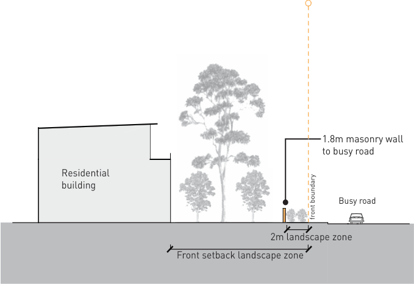

### 20.1 	DEVELOPMENT NEAR ROAD OR RAIL

### NOISE (continued)

#### Controls

5 Any multi-unit or residential flat building, on a busy road may include

a maximum 1.8m high fence or masonry wall only if a maximum of

1.8m high, with a minimum 2m setback from the front boundary is

provided for a street facing landscape zone. This landscape zone is

to incorporate shrubs and trees that screen the wall from the road.

Single low density dwellings on busy roads will be considered on a

merit basis. Refer to Figure 20.1-1.

> [Picture on page 3: a picture, saved as a picture (images/part-20-development-near-rail-corridors-and-busy-roads-page-3-11.gif, 150 dpi).]
> Words printed on the picture (title and legend, copied from the PDF):
> 1.8m masonry wall
> to busy road
> Residential
> building
> Busy road
> front boundary
> 2m landscape zone
> Front setback landscape zone

#### Figure 20.1-1:

#### Fencing for development facing a busy road.

> [Picture on page 3: a picture, saved as a picture (images/part-20-development-near-rail-corridors-and-busy-roads-page-3-14.gif, 150 dpi).]
> Words printed on the picture (title and legend, copied from the PDF):
> 1.8m masonry wall
> to busy road
> New Development
> Front setback landscape zone

footpath street

2m landscape zone

### DEVELOPMENT NEAR RAIL CORRIDORS AND BUSY ROADS

### DEVELOPMENT NEAR

### ROAD OR RAIL NOISE

### THIS PAGE IS INTENTIONALLY BLANK
