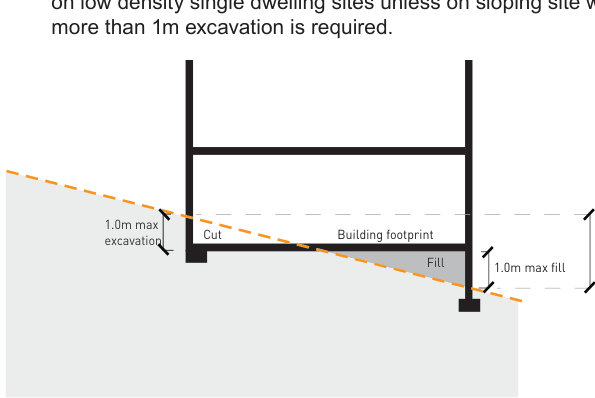
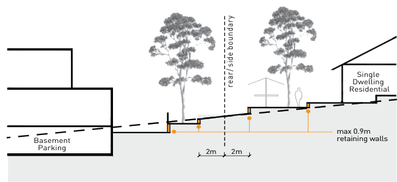
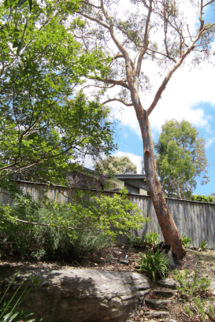

### 21.1 	EARTHWORKS AND SLOPE (continued)

#### Controls

10 The design of the proposal is to consider the impacts of altered

subsurface/groundwater flows or direction on groundwater

dependent ecosystems or species. Note: Riparian systems and a number of vegetation communities or species

may be fully or partially dependent on subsurface/groundwater flows. A

hydrogeological report may be required to address changes to groundwater.

Details of measures proposed to mitigate such impacts are required. 11 For any dwelling house development, excavation within the building

footprint is not to exceed 1.0m depth relative to ground level

(existing), fill is not to exceed 1m relative to ground level, with a

maximum level difference across the building footprint of 2m. See

Figure 21.2-1. 12 Retaining walls on low and medium residential density sites are not

to exceed 1m in height above existing ground level. Where greater

level change over the site is required, the site should be terraced.

See Figure 21.2-2. 13 Excavation for basements and subterranean rooms are not permitted

> [Picture on page 4: a picture, saved as a picture (images/part-21-general-site-design-page-4-20.gif, 150 dpi).]
> Words printed on the picture (title and legend, copied from the PDF):
> Cut
> Building footprint
> 1.0m max
> excavation
> Fill
> 1.0m max fill

on low density single dwelling sites unless on sloping site where no

more than 1m excavation is required.

1.8m max

#### Figure 21.1-1:

#### Earthworks within the building footprint.

> [Picture on page 4: a picture, saved as a picture (images/part-21-general-site-design-page-4-26.gif, 150 dpi).]
> Words printed on the picture (title and legend, copied from the PDF):
> rear/ side boundary
> Single
> Dwelling
> Residential
> max 0.9m
> retaining walls
> Basement
> Parking
> 2m 2m

#### Retaining walls, terraces and ground lines at boundaries.

#### Objectives

1	 To contribute to the

landscape character of

Ku-ring-gai.

2	 To ensure landscape

design and species

selection is suitable to the

site and its context and

considers the amenity of

residents and neighbours. 3	 To increase the resilience

of significant vegetation

and habitat, through the

improvement of condition,

extent and connectivity of

vegetation.

4	 To conserve landscaped

settings for heritage

items and components

of heritage conservation

areas.

5	 To ensure that

landscaping in the vicinity

of heritage places does

not detract from the

heritage value of the

place.

6	 To integrate landscape

design and biodiversity

protection with bushfire

management.

> [Picture on page 5: a picture, saved as a picture (images/part-21-general-site-design-page-5-32.gif, 150 dpi).]

#### Example of a rock outcrop.
