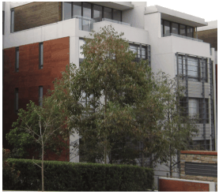

### 21.2	 LANDSCAPE DESIGN

#### Controls Site Planning and Design

1 The site planning and design of developments is to:

i) retain and enhance indigenous vegetation, biodiversity

corridors and existing natural features on the site including

trees, shrubs and groundcovers, soils, rock outcrops and

water features. These provide habitat, breeding sites, food

and shelter for a wide variety of life forms and ecological

processes that support life and define the character of the

locality.

Note: Specific controls for the areas mapped for their biodiversity

significance on the Greenweb map in Part 18R.1 are included in Part 6 of this DCP.

ii)	 retain significant and visually prominent trees and vegetation

that contributes to neighbourhood character;

iii)	 Retain habitat within the site including:

- drainage features and damp areas;

- rock outcrops

- hollow-bearing trees;

- areas of leaf litter;

- bushrock.

2 Landscape design is to demonstrate consideration of:

i) the proximity of trees to buildings, walls and other structures

on site and on adjoining sites;

ii)	 the proximity of trees to stormwater, electricity, gas, sewer

and other services; and

iii)	 the potential hazard of planting types and densities on

sites prone to bushfire risk (refer to Planning for Bushfire

Protection 2019).

### SITE DESIGN

3 The retention of existing appropriate screen planting is

encouraged.

4 Disturbance of natural soil profiles is to be minimised. 5 Structures (including services) are to be located outside the Tree

Protection Zone of trees to be retained. This applies to street

trees, trees on site and on adjoining sites.

6 Existing ground level are to be maintained beneath the Tree

Protection Zone of trees to be retained.

Note: If the ground level is modified by excavation or fill within the

canopy spread, an assessment prepared by a suitably qualified arborist

in accordance with AS 4970-2009  Protection of Trees on Development

Sites, will be required.

#### Objectives

7	 To support visual privacy. 8	 To contribute to climate

control by retaining and

planting trees to capture

carbon.

9	 To promote climate

change adaptation

through landscape design

which:

- minimises water use

- provides for summer

shade

- is resilient to storms

- consolidates and

interconnects

vegetation, habitat and

waterways, and

- minimises bushfire risk. 10	To avoid species that

result in boundary issues

of shading, root invasion

and growth that is out of

character with the local

area.

> [Picture on page 6: a picture, saved as a picture (images/part-21-general-site-design-page-6-26.gif, 150 dpi).]

#### Figure 21.2-2:

Trees planted in groups are

more resilient to storms
