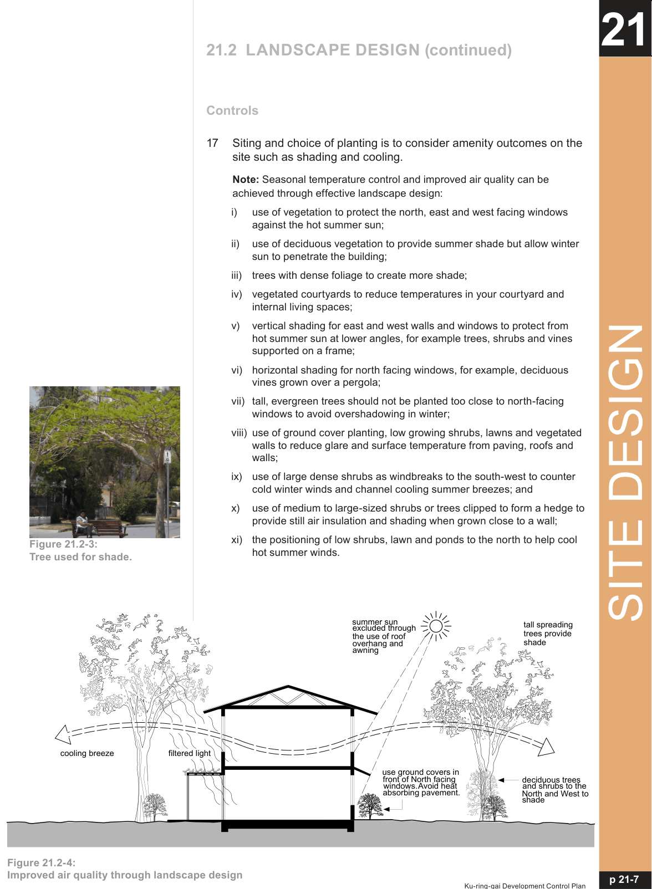

### 21.2	 LANDSCAPE DESIGN (continued)

#### Controls

7 Vegetation retention is to consider the following:

i) healthy specimens that have a high Useful Life Expectancy are

to be the first priority for retention;

ii)	 trees and vegetation within heritage items or heritage

conservation areas are to be assessed in terms of heritage

significance.

#### Planting

8 Artificial grass surfaces are to be avoided except in exceptional

circumstances.

9 Continuous rows of monoculture planting (consisting of one species

or variety) to boundaries are to be avoided. Planting is to include a

diversity of species and heights including trees shrubs and ground

covers.

10 Planting beds for screen planting is to be of adequate width to allow

the plants to flourish.

Note: Screen planting should not be continuous on bushfire prone land. 11 The use of vigorous growing and dense species such as Bamboo

and Leighton Green are to be avoided.

12 The height of planting within the front setback is to allow partial

views to and from the dwelling or main building and beyond; 13 Where a property boundary is within 300m from bushland at least

55% of the overall number of trees and shrubs are to be locally

indigenous vegetation. Species are to reflect the relevant vegetation

communities within the area.

14 For development on sites where single residential development is

permitted, and all property boundaries are greater than 300m from

bushland, at least 25% of the overall number of trees and shrubs

are to be locally indigenous vegetation. Species are to reflect the

relevant vegetation communities within the area. 15 The planting of species listed in Council’s Weed Management Policy

and the Greater Sydney Regional Strategic Weed Management Plan

is not permitted.

Note: Council’s Weeds Management Policy is available on Council’s web

site (www.krg.gov.nsw.au) and the Greater Sydney Regional Strategic Weed

Management Plan is available on the NSW Local Land Services web site

(www.lls.nsw.gov.au).

16 Species used for planting in or directly adjacent to areas with

significant vegetation or habitat should be of local provenance. Note: To enable this, propagation is to be started well before any

construction begins. A list of appropriate species for native vegetation

communities within Ku-ring-gai is available from Council and on the

Council’s website (www.krg.gov.nsw.au).

> [Picture on page 7: a picture, saved as a picture (images/part-21-general-site-design-page-7-1.gif, 150 dpi).]
> Words printed on the picture (title and legend, copied from the PDF):
> Note: Seasonal temperature control and improved air quality can be
> achieved through effective landscape design:
> i) use of vegetation to protect the north, east and west facing windows
> against the hot summer sun;
> ii) use of deciduous vegetation to provide summer shade but allow winter
> sun to penetrate the building;
> iii)	 trees with dense foliage to create more shade;
> iv)	 vegetated courtyards to reduce temperatures in your courtyard and
> internal living spaces;
> v) vertical shading for east and west walls and windows to protect from
> hot summer sun at lower angles, for example trees, shrubs and vines
> supported on a frame;
> vi)	 horizontal shading for north facing windows, for example, deciduous
> vines grown over a pergola;
> vii)	 tall, evergreen trees should not be planted too close to north-facing
> windows to avoid overshadowing in winter;
> viii)	 use of ground cover planting, low growing shrubs, lawns and vegetated
> walls to reduce glare and surface temperature from paving, roofs and
> walls;
> ix)	 use of large dense shrubs as windbreaks to the south-west to counter
> cold winter winds and channel cooling summer breezes; and
> x) use of medium to large-sized shrubs or trees clipped to form a hedge to
> provide still air insulation and shading when grown close to a wall;
> xi)	 the positioning of low shrubs, lawn and ponds to the north to help cool
> hot summer winds.
> Tree used for shade.
> tall spreading
> trees provide
> shade
> summer sun
> excluded through
> the use of roof
> overhang and
> awning
> filtered light
> cooling breeze
> use ground covers in
> windows.
> front of North facing
> Avoid heat
> absorbing pavement.
> deciduous trees
> and shrubs to the
> North and West to
> shade
> Improved air quality through landscape design

Figure 21.2-3:
