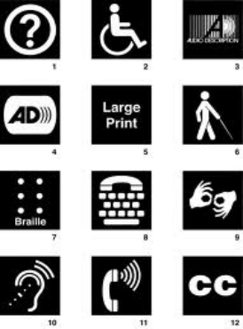

### 22.1	 EQUITABLE ACCESS

#### Controls

1 For the purpose of this Part “access” is defined as:

i) an ability to travel from one point to another in a continuous

and independent manner, following a reasonable route;

ii)	 an ability to communicate or obtain information or service

from any person, display or facility which is intended to

communicate or provide that information or service to any

person.

2 Designing for access for all people is encouraged for all

development types.

3 Where minor alterations or additions to an existing building are

proposed, the alterations is not to reduce the accessibility of

the building.

4 Applications for development, other than single dwellings, are to

demonstrate how access to and within developments meets the

requirements of the Disability Discrimination Act 1992 (DDA) and

the Disability (Access to Premises – Buildings) Standards 2010. Note: Section 23 of the Disability Discrimination Act 1992 (DDA)

requires non- discriminatory access to premises which the public or a

section of the public is entitled or allowed to use. It does not apply to

single dwellings.

Some of the premises covered by Section 23 include:

i) public footpaths, walkways, pedestrian malls and public

transport facilities

ii)	 educational institutions, child care centres, libraries and

other information and advice centres

iii)	 shops, department stores, travel agents,

hairdressers, beauty salons, cafes, restaurants and

pubs

iv)	 banks and other financial institutions

v)	 parks, public swimming pools, sporting venues, social clubs

and public toilets

vi)	 theatres and other places of entertainment

vii)	 government service offices

viii)	hospitals and other medical facilities

ix)	 doctors’, lawyers, dentists and other professional offices

x)	 other premises the public or a part of the public is entitled or

allowed to enter or use.

### GENERAL ACCESS AND PARKING

Section 23 applies to existing places as well as places under

construction. The Disability (Access to Premises – Buildings)

Standards 2010 are one of three standards established under

the DDA, and provides information for people responsible for the

design, construction and management of buildings in relation

to the level of access required, and how this may be achieved.

### 22.1	 EQUITABLE ACCESS (continued)

#### Controls

To comply with the DDA and the Disability (Access to Premises –

Buildings) Standards 2010 existing places may need to be modified to

be accessible. The DDA does not require the provision of access to be made if

this will cause major difficulties or excessive costs to a person or

organisation. This is called “unjustifiable hardship”. But before deciding that providing access is unjustified, a person or

organisation should:

i) thoroughly consider how access might be provided

ii)	 discuss this directly with the person involved, and

iii)	 consult relevant sources of advice. If alterations to premises to provide full and equitable access would

involve the destruction or removal of significant heritage value, in

some circumstances making these alterations MAY be found to

involve unjustifiable hardship. If adjustments cause hardship it is up

to the organisation to show that they are unjustified. It remains the responsibility of the owner or occupier to comply with

the requirements of the DDA and to investigate their own personal

legal liabilities under the DDA. Council cannot certify compliance. 5 Entry access ramps for people with a disability are to be located

within the site and is not to dominate the front façade. 6 The provision of access for all to and within heritage items is to:

i) have minimal impact on the significant fabric of the item;

ii)	 be, as far as possible, reversible.

1\. Universal Information Symbol

2\. International Symbol of Accessibility

3\. Symbol indicating Audio Description for Theatre & Live Performances

4\. Audio Description for TV, Films & Video

5\. Large Print / Accessible Print Symbol

6\. Symbol indicating Access for Individuals Who Are Blind or Have Low Vision

7\. Braille Symbol

8\. Telephone Typewriter Symbol

9\. Sign Language Interpretation Symbol

10\. Assistive Listening Systems Symbol (Ear)

11\. Assistive Listening System Symbol (Telephone)

12\. Closed Captioning Symbol

> [Picture on page 4: a picture, saved as a picture (images/part-22-general-access-and-parking-page-4-39.gif, 150 dpi).]

#### Figure 22.1-1 International

#### Symbols for Facilities

### 22.1	 EQUITABLE ACCESS (continued)

#### Controls

7 Where such access is likely to have a major adverse impact on

significant fabric, alternative solutions should be considered.

However every effort is to be made to provide equitable access

through the main entrance to the building. Note: Alternative solutions may include a temporary ramp, or access

through a side entrance or the like. 8 Building entries are to be clearly visible from the street. Where site

configuration is conducive to having a side entry, the path to the

entry is to be obvious from the street. 9 Ensure pedestrian areas have clear sightlines, are appropriately lit

and overlooked by buildings that provide street level activity. 10 Access ways for pedestrians and for vehicles are to be separated. 11 Ensure landmarks, including landmark buildings, are distinctive

in form and reinforce the street pattern and topography to enable

people to find their way. 12 Buildings are to be sited and designed to avoid obscuring landmark

features and views which enable ease of orientation from the street

and public open space areas. 13 Ensure all users of the site can find their way within the

development. This can be achieved by:

i) Designing foyers and orienting reception and information desks

so that arriving visitors can be seen;

ii)	 Locating reception and information desks near lifts to enable

staff to assist visitors with directions;

iii)	 Dividing large-scale sites into distinctive smaller parts, or

zones of functional use, while preserving a ‘sense of place’ and

connectivity between spaces;

iv)	 Organising the smaller parts of the development under a simple

organisational principle, such as ‘use’ through a zonation plan

with a logical and rational structure;

v)	 Providing frequent directional cues throughout the space,

particularly at decision points along routes in both directions;

vi)	 Displaying/using appropriate international symbols for facilities

as illustrated in Figure 22.1-1.

#### Residential only

14 All Multi Dwelling Housing, Residential Flat Buildings and Shop Top

Housing within Mixed Use developments are to provide access to,

and between, dwellings and parking in accordance with the Livable

Housing Guidelines as stipulated in Part 6 Multi Dwelling Housing,

Part 7 Residential Flat Buildings and Part 8 Mixed Use Development.

### GENERAL ACCESS AND PARKING

#### Objectives

1	 To ensure pedestrian

amenity and safety. 2	 To minimise the size,

quantity and visual

intrusion of vehicle access

points and driveways. 3	 To provide well located

and designed vehicle

entrances that facilitate

streetscape continuity and

a high quality and amenity

of the public domain. 4	 To ensure continuous

kerbside on-street

parking.
