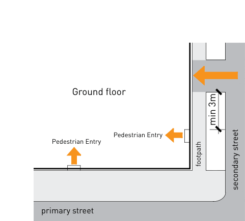
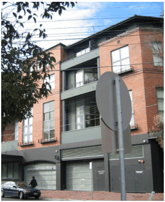
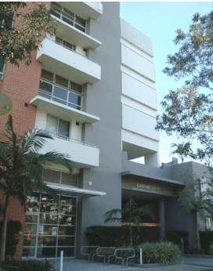
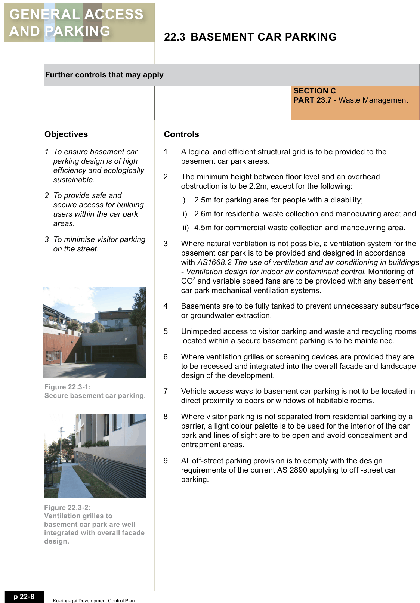

### 22.2	 GENERAL VEHICLE ACCESS

#### Controls

1 Except as provided in Part 14 of this DCP, car park entry and egress,

for developments other than low density residential, are to be

provided from secondary streets or lanes where these are available. Note: For service access and loading requirements see relevant

development type in Section A.

2 The width and number of vehicle access points are to be limited

to minimise potential pedestrian/vehicle conflicts. Wherever

practicable, commercial and mixed use buildings are to share,

amalgamate or provide a rear lane for vehicle access. 3 Vehicle access driveways are to be set back a minimum of 10m

from street intersections or as specified in Clause 3.2.3 of AS2890.1

(whichever is the greater). Refer to Figure 22.2-1.

> [Picture on page 6: a picture, saved as a picture (images/part-22-general-access-and-parking-page-6-31.gif, 150 dpi).]
> Words printed on the picture (title and legend, copied from the PDF):
> Ground floor
> min 3m
> Pedestrian Entry
> Pedestrian Entry
> footpath
> secondary street
> primary street

Driveway to basement parking

min 10m

#### Figure 22.2-1:

#### Vehicle access controls.

4 Vehicle and pedestrian access to buildings are to be separated and

clearly distinguished. Vehicle access is to be located a minimum of

3m from pedestrian entrances. Refer to Figure 22.2-1. 5 Provide clear sight lines at pedestrian and vehicle crossings. 6 The width of any driveway for a low density residential development,

as measured at the front site boundary, is not to exceed 3.5m. 7 For all other development types, driveway width is to comply with

the table below. Greater widths will only be considered where it

is required by RMS or Australian Standards relating to off-street

parking and pedestrian safety.

### 22.2	 GENERAL VEHICLE ACCESS (continued)

#### Controls

| Proposed Number of Car Parking Spaces in Development | Driveway Clear Width |
|---|---|
| Less than 25 spaces | 6m max |
| 25-100 spaces | 6m max (on local roads) 6m min - 9m max (on main roads)* |
| 100-300 spaces | 6m min – 9m max (on local roads) 6m for entry, 4-6m for exit, 1.3m separation (on main roads)* |

\* Subject to TfNSW approval 8 Long driveways (greater than 30m) are to be avoided. Where they

are unavoidable, driveways over 30m long are to be provided with a

passing bay. 9 Service ducts, pipes and storage facilities located in proximity to

vehicular access points are to be concealed and not be visible form

the street. 10 External security doors may be provided to access points where

necessary. Security doors are to be of high quality material and

detail and are to

are to blend into the building facade.

11 Vehicles are to be able to enter and leave the site in a forward

direction. 12 Vehicle entries and service areas are to be set back or recessed

from the main facade line and integrated into the overall facade

design, so as not to dominate the building elevation. 13 Vehicle entries, walls and ceilings are to be finished with high quality

materials, finishes and detailing, similar to the external facades of

the building. 14 For driveways on sloping sites, where high retaining walls are

required on both sides of the driveway, one wall is to be no higher

than 1.2m. Where greater level change is required, the retaining wall

should be stepped back and softened by landscaping. High solid

walls should be relieved by

i) change in colour or finish;

ii)	 recessing; and/ or

iii)	 exposed brick or block work. 15 Any new development with 4 or more dwellings, or childcare

development, which has its driveway on a road that carries over

2,000 vehicles per day is to make an application to the Ku-ring-gai

Traffic committee to provide ‘No Parking’ restrictions for 6 metres

on either side of the driveway. Costs of reporting, processing and

installation are to be at the applicant’s expense.

### GENERAL ACCESS AND PARKING

> [Picture on page 7: a picture, saved as a picture (images/part-22-general-access-and-parking-page-7-38.gif, 150 dpi).]

> [Picture on page 7: a picture, saved as a picture (images/part-22-general-access-and-parking-page-7-39.gif, 150 dpi).]

#### Figure 22.2-2:

#### Vehicle entries that are well

integrated with overall facade

design.

> [Picture on page 8: a map, saved as a picture (images/part-22-general-access-and-parking-page-8-1.gif, 150 dpi); the street names and other small labels are on the picture.]
> Words printed on the picture (title and legend, copied from the PDF):
> basement car park areas.
> efficiency and ecologically
> secure access for building
> on the street.
> or groundwater extraction.
> design of the development.
> Secure basement car parking.
> Ventilation grilles to
> basement car park are well
> integrated with overall facade

Figure 22.3-1:

Figure 22.3-2:
