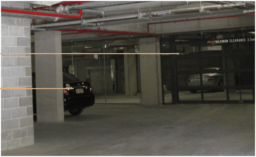

### 22.4	 VISITOR PARKING

#### Controls

This section applies where visitor parking is required by this DCP. Where visitor parking is required by this DCP, the spaces are to be

1

provided on site and clearly marked.

Visitor parking located behind a security grille require an intercom

2

system to gain entry.

At least one visitor parking space it to be accessible, designed in

3

accordance with AS2890.6.

> [Picture on page 9: a picture, saved as a picture (images/part-22-general-access-and-parking-page-9-18.gif, 150 dpi).]

#### Security grille

#### Visitor space

#### Figure 22.4-1:

### GENERAL ACCESS AND PARKING

Basement visitor parking provided in front of

security grille.
