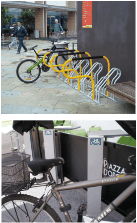

### 22.7	 BICYCLE PARKING AND FACILITIES

#### Controls

#### Objectives

1 Bicycle parking and storage facilities are to be designed in

accordance with AS2890.3 to ensure:

1	 To provide well designed

bicycle parking and

facilities that are functional

and secure.

> [Picture on page 12: a picture, saved as a picture (images/part-22-general-access-and-parking-page-12-10.gif, 150 dpi).]

i) both wheels and frames can be locked to the device without

damaging the bike;

ii)	 easy access from a bicycle lane or roadway with appropriate

signage;

iii)	 access paths have a minimum width of 1.5m to accommodate a

person pushing a bicycle, and adequate sight lines for safety.

#### Figure 22.7-1:

#### Bicycle Stands

#### Objectives

1	 To locate and design car

parking which is integrated

into the design of the site

and the building. 2	 To limit surface car

parking and ensure it

is incorporated into the

landscape design of the

development site. 3	 To ensure shading of

outdoor car park areas

through the use of

landscaping.
