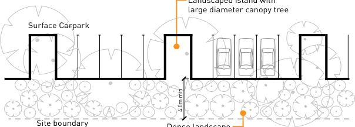

### 22.8	 SURFACE PARKING

#### Controls

1 Any surface car parking is to be located behind the building line

and screened from view.

2 The landscape design of surface car parks is to provide for

adequate watering.

3 Illuminated areas of surface car parks or driveways is to be

screened to minimise light spillage and loss of amenity to

adjacent residential areas.

4 Surface parking areas are to:

i) have a maximum of 5 parking bays with minimum 2m

wide deep soil landscape islands between parking bays

and around the perimeter of the area.

ii)	 have broad canopy plant species selected and located

in these areas to provide screening and shade, without

blocking signs or reducing driver visibility or creating

entrapment areas. See Figure 22.8-1.

> [Picture on page 13: a picture, saved as a picture (images/part-22-general-access-and-parking-page-13-32.gif, 150 dpi).]
> Words printed on the picture (title and legend, copied from the PDF):
> large diameter canopy tree
> Surface Carpark
> 4.0m min
> Site boundary

Landscaped island with

Dense landscape

screening within setback

#### Figure 22.8-1:

#### The use of vegetation in a typical car park to provide

screening and shade.

### GENERAL ACCESS AND PARKING

### THIS PAGE IS INTENTIONALLY BLANK
