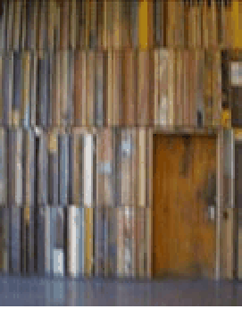

### 23.2	 GREEN BUILDINGS

#### Introduction

This section applies to the following new buildings and alterations/additions:

- offices under 1,000sqm;

- hotels, motels, serviced apartments with less than 100 rooms;

- all other non-residential development, including non-residential

components of mixed-use buildings. This section does not apply to development that is required to comply with:

- State Environmental Planning Policy (Sustainable Buildings) 2022 All non-residential development (listed above) must incorporate ecologically

sustainable design measures, and achieve Green Star rated buildings to

Green Building Council of Australia (GBCA) standards as required in 23.2 (3),

(4), (5). This will enable buildings to comply with the ongoing mandatory performance

ratings required under the Building Energy Efficiency Disclosure Act 2010

(refer to the website for details: www.cbd.gov.au.) The Green Building Council of Australia (GBCA) has developed the following

rating tools:

-Green Star Buildings: for all building types;

-Green Star Communities: for projects at the neighbourhood, precinct or

community scale;

-Green Star Interiors: for interior fit-outs in buildings including offices,

hotels schools and shops;

-Green Star Homes: for assessing the health, resilience and energy

efficiency of homes;

-Green Star Performance: for the operational efficiency of existing

buildings. Except for development mentioned in the State Environmental Planning

Policy (Sustainable Buildings) 2022 (offices with more than 1,000sqm GFA,

and hotels, motels, serviced apartments with more than 100 rooms), all

non-residential buildings with a total GFA above 2,000sqm are required to

obtain Certification under the GBCA Green Star Buildings rating tool. This

is to ensure the design and construction of buildings deliver a sustainable

structure, architecture and performance, Where developments involve large master planned sites, use of the

Green Star - Communities rating tool is encouraged. Where large interior

refurbishments are being undertaken, the use of the Green Star - Interiors

rating tool is encouraged. The GBCA Green Star Buildings rating will entitle the developer, architect

and team to publicise their building as Green Star rated early in the design

development stage (via the ‘Design’ portion of the Certification) and for the life

of the building (via the ‘As Built’ portion of the Certification). In addition, the

building will recieve publicity and marketing through the GBCA and Ku-ring-

gai Council’s media. Council and GCBA will also publicise developments that

achieve ratings under the Interiors, Communities and Performance rating

tools.

#### Objectives

1	 To ensure that

development minimises

the use of non-renewable

energy resources and

water consumption. 2	 To utilise an integrated

sustainability assessment

tool for gauging building

sustainability.

3	 To develop green buildings

that incorporate innovative

design, construction and

operational practices that

significantly reduce, or

eliminate, the negative

impact of development

on the environment and

building occupants. 4	 To ensure commercial

buildings deliver lower

operating costs from

reduced energy and

alternative resource

consumption, and so

represent better life cycle

value.

5	 To ensure that all non-

residential buildings

consider and incorporate

Ecologically Sustainable

Design (ESD) systems

and measures.

### 23.2 GREEN BUILDINGS (continued)

#### Controls General

1 All new non residential developments are to include Ecologically

Sustainable Design (ESD) measures in the following areas, and list

them under these titles in the required ESD report and checklist:

i) Water Efficiency:

- provide systems to minimise mains water usage.

ii)	 Energy Generation:

- building design is to demonstrate a reduced reliance on mains

power and provision of alternate energy sources.

iii)	 Heating and Cooling:

- use of mechanical air conditioning and heating is to be

minimised. Where it is unavoidable, the systems are to be of

a high efficiency in technology choice to reduce peak energy

demand.

iv)	 Lighting:

- buildings are to be designed to reduce the need for artificial

light use.

Note: Refer to 23R of this Part for examples of measures of the above. Note: This control does not apply to non-residential development assessed

under the State Environmental Planning Policy (Sustainable Buildings)

2022.

#### Green Star Rating

#### Required Ecologically Sustainable Measures

2 This control applies to:

- all new non-residential buildings, including alternations/

additions, less than 2,000sqm GFA;

- all non-residential components of mixed-use buildings with

less than 2,000sqm GFA;

- offices, including new buildings alterations/additions with less

than 1,000sqm GFA;

- hotels, motels, serviced apartments with less than 100 rooms,

where the GFA is less than 2,000sqm.

The above development types are to provide the following

documentation at Development Application (DA stage)

i) Ecologically Sustainable Design (ESD) Report:

- prepared by a GBCA Accredited Professional, verifying that

the elements/systems included in the development will, in the

view of that professional, result in buildings with an ESD level

equivalent to a 4, 5 or 6 Star Rating under the GBCA Green

Star Buildings rating tool.

### GENERAL BUILDING DESIGN AND SUSTAINABILITY

#### Controls

ii)	 Annotated Development Application (DA) Drawings:

- clearly indicating the elements/systems described in the ESD

Report, including the requirements in 23.2(1) of this section.

iii)	 A signed Statement of Commitment from the applicant to

develop and implement the elements/systems described in the

ESD Report into the Construction Certificate (CC) stage and

deliver elements/systems in the final built form. Note: Applicants are advised to consult with a GBCA Accredited

Professional at the onset of the design process to ensure the building

supports ESD principles at the outset. Refer to www.gbca.org.au for a list of Green Star Accredited Professionals. Note: Approved DAs will have a Condition of Consent requiring the

applicant to include the following documentation as part of their CC

submission:

i.	 An updated ESD Report by the applicant’s Green Star Accredited

Professional describing elements/systems incorporated to maintain

the ESD principles that were approved at DA.

ii.	 A Checklist Table of each ESD system/element included in the ESD

Report to clearly state systems incorporated (refer to 23R.3 of this Part

for example of Checklist);

iii.	Annotated CC Drawings clearly indicating elements/systems

described in the ESD Report.

#### Required Green Building Council of Australia (GBCA) Certification

3 This control applies to:

- all new non-residential buildings with a GFA between

2,000sqm and 5,000sqm;

- all non-residential components of mixed-use buildings with a

GFA between 2,000sqm and 5,000sqm;

- hotels, motels, serviced apartments with less than 100 rooms,

where the GFA is between 2,000sqm and 5,000sqm;

- all alterations/ additions to existing non-residential buildings

and existing components of non-residential buildings, where

the proposed development has a GFA between 2,000sqm and

5000sqm.

The above development types must achieve 4 Star Green Star (‘Best

Practice’) Rating under the GBCA Green Star Buildings rating tool. 4 This control applies to:

- all new non-residential buildings with a GFA of 5,000sqm or

greater;

- all non-residential components of mixed use buildings with

GFA of 5,000sqm or greater;

#### Controls

- hotels, motels, serviced apartments with less than 100 rooms,

where the GFA is 5,000sqm or greater;

- all alterations and additions to existing non-residential

buildings and existing components of non-residential buildings

where the proposed development has a GFA of 5,000sqm or

greater. The above development types must achieve a 5 Star Green

Star ('Australian Excellence') rating under the GBCA Green Star

Buildings rating tool. Note: Refer to 23R.2 of this Part for the Green Star Information Sheet. Note: Refer to www.gbca.org.au for the latest version of the GBCA’s Green

Star Rating Tools. 5 Where 23.2 (3) and (4) apply, the development application (DA) must

include the following documentation:

i) Proof of registration of the proposal with GBCA for a Green Star

Buildings Certification; and GBCA Certification of the ‘Design’

component of the Development Application;

ii)	 A signed Statement of Commitment from the applicant to

implement and achieve Certification for both components of the

Green Star Buildings rating tool.

iii)	 Ecologically Sustainable Design (ESD) Report prepared by

GBCA Accredited Professional, stating the Green Star point

distribution for the proposal, and the strategy, methods and

systems proposed to achieve the Green Star rating, including the

requirements in 23.2(1) of this section;

iv)	 Annotated Development Application Drawings clearly indicating

the Green Star rating elements described in the ESD Report.

v)	 A signed Statement of Commitment from the applicant to retain

their GBCA Accredited Professional and complete the formal

GBCA Certification process and achieve Certification for both

Green Star Designed and Green Star Certified under the Green

Star Buildings rating tool. Note: Approved DAs will have a Condition of Consent requiring the

applicant to include the following documentation as part of their

Construction Certificate submission:

i. The GBCA Certificate of achievement of the Green

Star Buildings: Design component demonstrating the

development application will achieve the full Green Star

Buildings certification as per the conditioned ESD report.

ii.	 An updated Credit Summary and ESD Report describing

elements/ systems incorporated to achieve the nominated

Green Star rating;

### GENERAL BUILDING DESIGN AND SUSTAINABILITY

#### Controls

iii.	 A Checklist Table of each ESD system/element (refer to

23R.3 of this Part for example of Checklist);

iv.	 Annotated Construction Certificate Drawings clearly

indicating elements/systems described in the DA approved

ESD Report including the requirements of 23.2(1) in this

section;

v.	 A copy of the letter and invoices from the GBCA to the

applicant, confirming the project is registered and will

progress to full certification under the Green Star Buildings

rating tool. Note: Approved DAs will have a Condition of Consent requiring

the applicant to submit the completed and final GBCA Green

Star Buildings Certification to Council prior to the release of the

Occupation Certificate.

#### Objectives

1	 To provide good indoor air

quality.

2	 To limit pollution and

protect public health and

comfort.

3	 To select materials and

products which minimise

environmental impact

throughout a building’s life

cycle

4	 To reduce the

consumption of natural

and non-renewable,

resources.

5	 To ensure material

selection has been equally

driven by environmental

sustainability,

safety, commercial

competitiveness and

quality.

6	 To promote use of

materials and finishes that

contribute to the design of

innovative buildings. 7	 To reduce urban heat

island effects.

> [Picture on page 9: a picture, saved as a picture (images/part-23-general-building-design-and-sustainability-page-9-29.gif, 150 dpi).]

#### Figure 23.3-1

Recycled timber wall as a

feature in the entry lobby.
