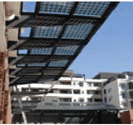

### 23.3	 SUSTAINABILITY OF BUILDING MATERIALS 23

#### Controls

1 Development proposals are to consider the following in the selection

of building materials:

i) retain, re-use, recycle materials with:

• low embodied energy such as sandstone and timber; and

• high embodied energy such as brick and concrete.

ii)	 materials that come from renewable sources;

iii)	 materials that generate a lower environmental cost over time;

iv)	 materials with a low life cycle cost and/or high durability;

v)	 production methods with a low environmental impact;

vi)	 avoid large expanses of dark coloured materials that contribute

to urban heat.

Note: Generally, non-recycled metals contain the highest embodied energy,

followed by plastics and other materials with a high chemical content.

Natural construction materials such as timber, brick and render

contain the least embodied energy. To reduce the embodied energy

of a typical building structure, specify:

i.	 metal produced from post-consumer waste

ii.	concrete blends that include a percentage of recycled content (for

example, cement extender including fly ash or blast furnace slag)

iii.	concrete that incorporates recycled aggregate wherever possible

iv.	the sourcing of locally produced materials and products

2 Where the use of timber is proposed, only FSC, AFS or PEFC

certified timbers may be specified for construction or finishing.

Medium Density Fibreboard (MDF) and particleboard is not to be

specified as a construction material for the development. 3 The use of alternatives to PVC piping is highly encouraged including

Colorbond (above ground only), and HDPE where appropriate. 4 The use of construction materials and chemicals with toxic

components are to be avoided, to facilitate recycling and reduce

pollution.

5 Structures are to be designed with physical, rather than chemical,

termite measures. This can be achieved by:

i) appropriate materials and construction design;

ii)	 physical barriers;

iii)	 suspended floor systems.

6 Low Volatile Organic Compounds (VOC) are to be used throughout

the building interior (carpets, paints, adhesives, sealants and all

other finishes), and low emission building materials are to be used

across the site.

### GENERAL BUILDING DESIGN AND SUSTAINABILITY

### 23.3 SUSTAINABILITY OF BUILDING MATERIALS

### (continued)

#### Controls

7 Avoid the use of ozone depleting products and materials, or products

and materials manufactured using ozone depleting substances must

be avoided. 8 Materials likely to contribute to poor internal air quality, such as

those generating formaldehyde, or those that may create a breathing

hazard in the event of fire, such as polyurethane, must be avoided.

#### Objectives

#### Non-residential Buildings

1	 To promote the use of high

quality materials, finishes

and colours for building

facade articulation design

and visual interest. 2	 To ensure the use of

materials, finishes and

colours creates well

proportioned facades and

minimises the visual bulk. 3	 To encourage the use of a

subdued palette of colours

and limited range of hues

for building consistency

across the LGA. 4	 To deliver buildings with

high quality materials and

finishes that are durable

and able to retain their

aesthetic value over time. 5	 To complement

streetscapes natural

environment and the high

quality urban character of

Ku-ring-gai.

> [Picture on page 11: a picture, saved as a picture (images/part-23-general-building-design-and-sustainability-page-11-28.gif, 150 dpi).]

#### Figure 23.4-1:

#### Photovoltaic cells integrated

into the awning design.
