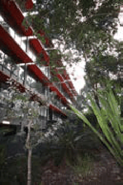
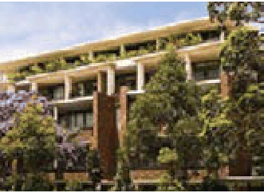
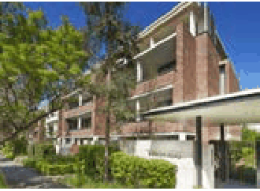
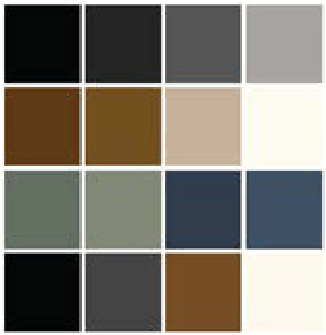
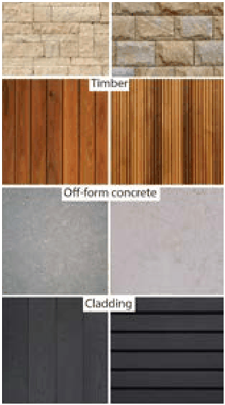
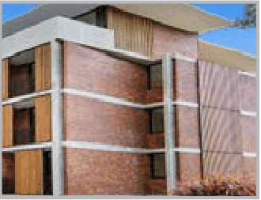
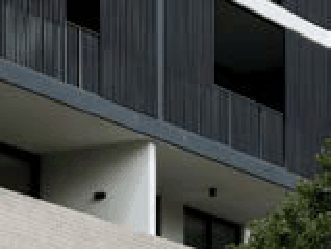
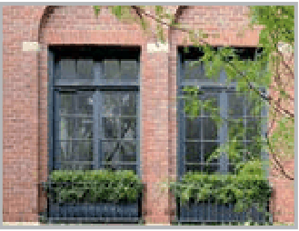
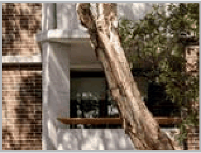

### 23.4	 MATERIALS, COLOURS AND FINISHES

#### Controls

#### Non-residential Buildings

1 Non-residential development must:

i) use heavy weight building materials with high thermal mass on

roofs and/or walls. Where lightweight materials are used, with

high R-value insulation is to be used;

ii)	 integrate photovoltaic cells which can be mounted as panels, or

used as an integrated building cladding or sun shading.

iii)	 use light coloured internal finishes to improve internal reflectivity and minimise lighting use.

2 External walls are to be constructed of high quality and durable

materials and finishes.

Note: Material and finishes selection is to be made in accordance with

objectives and controls as stated in 23.3 of this Part to ensure low

environmental impact.

3 Reuse or recycling of existing local materials such as sandstone and

brick is encouraged.

4 Building facades must avoid large, unbroken expanses of any single

material and/or finish, in particular rendered and/or painted finishes. Note: Well-detailed and modulated face brickwork may be acceptable. 5 New development is to avoid extensive use of highly reflective or

gloss materials on the exterior of buildings.

6 For buildings of 3 storeys and above:

i) a large expanse of sandstone or face brick is not to be used on

the upper levels of the buildings;

ii)	 lightweight materials and finishes (eg. timber and copper/steel)

are encouraged for the upper levels of buildings;

iii)	 use of colours that minimise the bulk and scale of upper levels

of buildings are encouraged to assist in minimising the bulk and

scale of the building.

7 The exterior finish material (e.g. sandstone or brick) must be integral

to the overall building façade design and must not appear to be

cosmetic. Rendered and/or painted finishes are limited to accent

elements only, and must not be the primary finish. 8 Highly contrasting coloured bricks are to be restricted to building

elements such as sills, window heads, string courses and to assist in

the division of the building into bays.

9 Where louvres are used, they are to be an integral element in the

building façade design (e.g. west facing windows). 10 Material selection is to demonstrate dual purpose solutions. For

example, photovoltaic panels integrated with wall cladding, and

utilised as shading devices for ground level and rooftop communal

spaces. See Figure 23.4-1.

### GENERAL BUILDING DESIGN AND SUSTAINABILITY

### (continued)

#### Controls

11 Where additions and alterations are proposed, external materials

and finishes are to complement the existing building. 12 The selection of a colour scheme for new development and in

the restoration of existing facades is to comply with the following

guidelines:

i) Base colours for major areas of building façade are to be light in

tone (eg. earth tone) with minimal colour intensity (or hue) eg. off

white or grey colours. Larger expanses of bold colour, black and

white are to be avoided, as these detract from the prominence of

other façade details. Contrasting tints, tones and shades are to

be restricted to small areas. See Figure 23.4-3.

ii)	 Highlight colours to window and door mouldings, string courses,

parapet details and the like, are to be in sufficient contrast to the

base colour. Strong colours to large sections of the building are

to be avoided. Details are to be finished in a matt to semi gloss

range. See Figure 23.4-3.

iii)	 Trim colours for window frames and awning fascias are to be a

darker contrast to base and highlight colours. Window frames

are to be finished in either a semi gloss or full gloss.

13 Natural earth tones and recessive colour tones are to be used on

building facades in close proximity to bushland. 14 The use of corporate colours to identify a business name is to be

limited to signage, and is not to be used as the main building façade

colour. 15 Where buildings colours are representational of a company or

brand, the colour scheme will be accepted by Council provided

the built form has been designed to addressed the site attributes

and constraints and the surrounding urban fabric. Stock standard

building forms (representational of a company) placed onto a site

regardless of the context will not be accepted.

> [Picture on page 12: a picture, saved as a picture (images/part-23-general-building-design-and-sustainability-page-12-33.gif, 150 dpi).]

#### Figure 23.4-2:

#### Accent colour on shading devices

to commercial building.

#### Objectives

Multi-unit Dwellings,

#### Residnetial Flat Buildings

and Mixed-use Buildings 6	 To ensure buildings are

constructed using high

quality materials and

finishes that are durable

and able to retain their

aesthetic value over time. 7	 To ensure built form

is of high architectural

standard and able to

positively contribute to the

streetscape.

8	 To ensure the future

character of dense

built form continues to

contribute to the Ku-ring-

gai character.

#### Figure 23.4-3:

#### Building facade with bricks

as the Primary Field facade

with painted finishes creating

a contrasting Secondary

#### Field.

### (continued)

#### Controls

#### Multi-unit Dwellings, Residnetial Flat Buildings and Mixed-use

#### Buildings

16 External building walls are to be constructed of high quality and

durable materials and finishes with low reflectivity. Note: Material and finish selection is to be in accordance with Part 23.3 to

ensure low environmental impact.

Note: For controls relating to façade articulation refer to:

• Part 6C.8 for Multi-dwelling Housing.

• Part 7C.6 for Residential Flat Buildings.

• Part 8C.9 for Mixed-use Buildings.

17 The material and colour palette for all building façades are to be

composed of three fields:

i) Primary Field - the predominant façade material/colour that gives

the building its primary character.

ii)	 Secondary Field - a supporting colour/material that provides

diversity and façade articulation by highlighting the Primary

Field.

iii)	 Accent Field – supplementary colours and materials that:

• add emphasis to the façade; and

• highlight facade elements; and

• typically contrast in colour or material or texture with the

Primary and Secondary fields.

See Figure 23.4-3, Figure 23.4-4, Figure 23.4-5, Figure 23.4-

6, Figure 23.4-7, Figure 23.4-8 and Figure 23.4-9 for Indicative

Primary, Secondary and Accent Field materials, colours and

finishes.

Note:

i) Considered and resolved composition of elevations and facades

communicates a clear visual hierarchy of building elements and use

of materials, textures and colours.

ii) Well-composed facades with high quality edge detailing of a more

limited materials palette achieve positive streetscape outcomes.

iii)	 Arbitrary changes of materials and colours and/or featureless wall

planes and edge detailing do not achieve Ku-ring-gai's streetscape

> [Picture on page 13: a picture, saved as a picture (images/part-23-general-building-design-and-sustainability-page-13-63.gif, 150 dpi).]

character.

> [Picture on page 13: a picture, saved as a picture (images/part-23-general-building-design-and-sustainability-page-13-65.gif, 150 dpi).]

### GENERAL BUILDING DESIGN AND SUSTAINABILITY

#### Figure 23.4-4:

#### Indicative Primary Field Colours.

> [Picture on page 14: a picture, saved as a picture (images/part-23-general-building-design-and-sustainability-page-14-3.gif, 150 dpi).]

#### Figure 23.4-5:

#### Indicative Secondary Field Colours.

> [Picture on page 14: a picture, saved as a picture (images/part-23-general-building-design-and-sustainability-page-14-6.gif, 150 dpi).]

#### Figure 23.4-6:

#### Indicative Secondary Field

#### Materials.

### (continued)

#### Controls

18 The Primary Field and predominant façade material is to be face

brick. Selected bricks are to be warm earthy colours and tones

that complement the local setting or future character of areas in

transition, and require minimal maintenance to retain their high

quality finish.

19 The Secondary Field is to comprise materials and textures

consistent with the indicative colour and material palette at Figure

24.4-4.

20 The Accent Field materials and colours are to be consistent with the

indicative colour and material palette at Figure 24.4-3, Figure 24.4-4,

and Figure 23.4-5. The Accent Field is to highlight building elements

including, but not limited to, windows, railings, parapets, doors,

balustrades. The material and colour selection is to complement the

overall Primary and Secondary Field façade treatment. Note: A sample board displaying and describing the selected

Primary, Secondary and Accent Field materials and colour is to be

specified and submitted with the application.

> [Picture on page 14: a picture, saved as a picture (images/part-23-general-building-design-and-sustainability-page-14-29.gif, 150 dpi).]

> [Picture on page 14: a picture, saved as a picture (images/part-23-general-building-design-and-sustainability-page-14-30.gif, 150 dpi).]

#### Figure 23.4-7:

#### Louvres, sliding panels and screens as integrated Secondary Field facade

> [Picture on page 14: a picture, saved as a picture (images/part-23-general-building-design-and-sustainability-page-14-33.gif, 150 dpi).]

elements.

> [Picture on page 14: a picture, saved as a picture (images/part-23-general-building-design-and-sustainability-page-14-35.gif, 150 dpi).]

#### Figure 23.4-9:

#### Dark window and balcony rail

Accent colour contrasting with the

#### Primary brick facade.

#### Figure 23.4-8:

#### Timber handrails provide Accent

contrast to the Secondary concrete

balustrades and columns and

complement the Primary brick

facades.

#### Objectives

1	 To provide high quality

of private and public

common open space

on roof terraces and

podiums.

2	 To design roof terraces so

that they contribute to the

streetscape.

3	 To encourage use of low

maintenance planting

and low water use on roof

terraces and podiums

with appropriate support

systems.

#### Figure 23.5-1:

#### Roof top recreation area.

#### Figure 23.5-2:

#### Roof top public parkland.

#### Figure 23.5-3:

#### Roof top vegetable garden.
