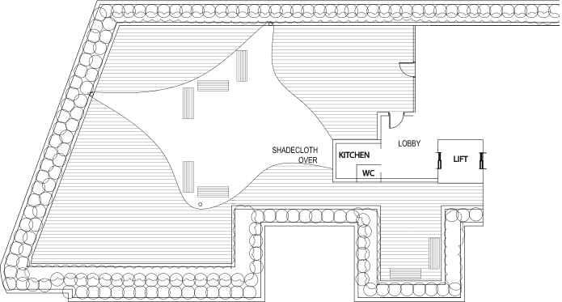
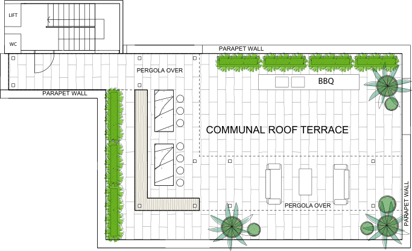

### 23.5	 ROOF TERRACES AND PODIUMS

This section does not apply to single dwellings

#### Controls

1 All roof terraces and podiums are to provide appropriate building

systems to make them trafficable, and to support landscaping. 2 Roof and terrace common open areas are to incorporate sun

shading devices, wind screens and facilities such as BBQ and

kitchenette area with drinking water to encourage usage. 3 Where artificial lighting is required, energy efficient lights are to be

used in conjunction with timers or daylight controls. All light spill is

prohibited.

4 Roof terraces and podiums are to provide soft landscaping areas

that complement the appearance of the building, soften the edges of

the building, and reduce the scale of raised terraces and other built

elements such as services.

5 Robust and drought tolerant plant material are to be used to

minimise maintenance and ensure long term survival. Note: Communal produce gardens are encouraged. 6 Roof terraces and podiums are to be designed for optimum

conditions for plant growth by appropriate solar access, soil mix, and

the provision of water connections and drainage. 7 Minimum soil provision for a range of plant sizes are to be in

accordance with the following:

i) large trees (canopy diameter of up to 16m at maturity)

- minimum soil volume 150m3

- minimum soil depth 1.3m

- minimum soil area 10m x 10m area or equivalent

ii)	 medium trees (8m canopy diameter at maturity)

- minimum soil volume 36m3

- minimum soil depth 1m

- approximate soil area 6m x 6m or equivalent

iii)	 small trees (4m canopy diameter at maturity)

- minimum soil volume 11m3

- minimum soil depth 0.8m

- approximate soil area 3.5m x 3.5m or equivalent

iv)	 shrubs

- minimum soil depth 0.5-0.6m

v)	 ground cover

- minimum soil depth 0.3-0.45m

vi)	 turf

- minimum soil depth 0.1-0.3m

Note: Any subsurface drainage requirements are in addition to the minimum

soil depths quoted above.

Note: Council will require a long term maintenance plan for both the

greenery and the waterproofing.

### GENERAL BUILDING DESIGN AND SUSTAINABILITY

### 23.5 ROOF TERRACES AND PODIUMS

### (continued)

#### Controls

> [Picture on page 16: a picture, saved as a picture (images/part-23-general-building-design-and-sustainability-page-16-4.gif, 150 dpi).]
> Words printed on the picture (title and legend, copied from the PDF):
> KITCHEN
> LIFT
> WC

#### Figure 23.5-4: Roof terrace design

> [Picture on page 16: a picture, saved as a picture (images/part-23-general-building-design-and-sustainability-page-16-6.gif, 150 dpi).]
> Words printed on the picture (title and legend, copied from the PDF):
> LIFT
> WC
> PERGOLA OVER
> PARAPET WALL
> PARAPET WALL
> BBQ
> COMMUNAL ROOF TERRACE
> PERGOLA OVER
> PARAPET WALL

#### Figure 23.5-5: Roof terrace design
