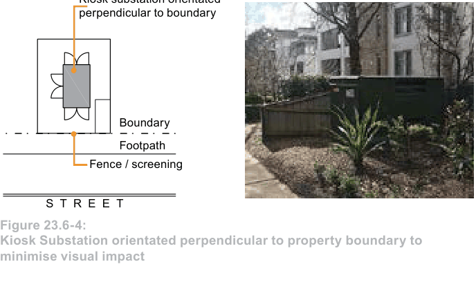
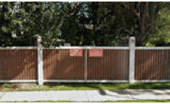
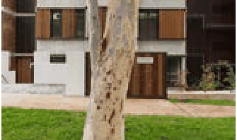
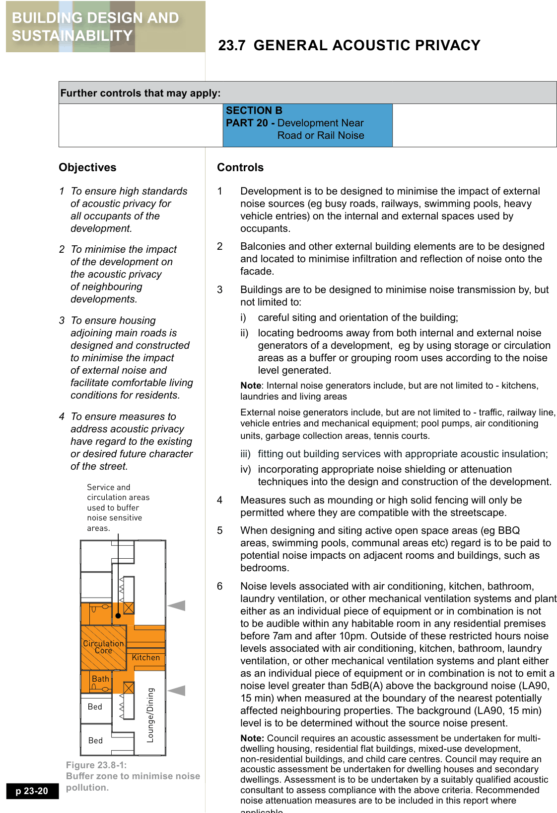

### 23.6	 BUILDING SERVICES

#### Objectives

#### Controls

1 All applicants are to consult with service providers such as energy,

electricity, gas, water, telephone and fire.

1	 To ensure visually

intrusive service elements

are located away from the

streetscape.

2 For high and medium density development, including Seniors

Housing, Multi Dwelling Housing and Residential Flat Buildings,

underground electricity services are to be provided from the

proposed building on the site to the appropriate power pole(s) or

other connection point.

2	 To ensure that proposed

or future service provision

does not detract from the

visual or general amenity

of the building users.

3 Services and structures required by the providers are to be located

within basements, or concealed within the facade, with appropriate

access. Where this is not possible, the proposal is to demonstrate

an alternative method of minimising street impact, such as screening

with landscape or built elements. Particular care should be taken in

mixed use precincts to ensure substations and fire hydrants are not

visible from the primary street and principal active street frontages. 4 Ventilation stacks are to be concealed within the building. Where

they exhaust at street level (eg. from basements) they should be

integrated within the design of the site. (See Figure 23.3-1) 5 All new developments designed to allow for commercial uses are to

include an internal ventilation shaft to ensure future alterations do

not place the shaft in an unsuitable location. 6 With the exception of dwelling houses, all buildings are to

accommodate proposed or future air conditioning units within the

basement or on rooftops, with provision of associated vertical/

horizontal stacks to all sections of the building. 7 Air conditioning condensers are to be located within the basement

or within the roof structure of the upper most roof. Air conditioning

condensers are not to be located on:

i) the building façade;

ii)	 the top of a flat roof;

iii)	 terraces;

iv)	 private or communal open spaces; or

v)	 balconies.

#### Figure 23.6-1 Public art used

to hide ventilation stacks

Note: Where air conditioning condensers are to be located within the

basement, certification from a mechanical engineer is to be provided

confirming that the nominated area/plantroom will be large enough to

accommodate the number of proposed condenser units. This certification is

to also indicate the likely required supply/extraction air flow within the plant

room to demonstrate that ventilation requirements have been sufficiently

incorporated into the basement design. Additionally there is to be sufficient

service ducting incorporated into the development so that the systems operate efficiently. 8 Air conditioning units located on the roof will only be permitted where

they are well screened, integrated into the building form and do not

result in adverse noise impacts on neighbouring occupants.

### GENERAL BUILDING DESIGN AND SUSTAINABILITY

#### Objectives

3	 To minimise visual impacts

of utility infrastructure,

including kiosk substations

and fire hydrant and

booster assemblies, on

streetscape character and

amenity.

4	 To manage the

cumulative visual and

amenity impacts of utility

infrastructure, including

kiosk substations and

fire hydrant and booster

assemblies, resulting from

development. 5	 To ensure early

consultation with utility

providers to enable

joint consideration of

visual impacts of new

infrastructure.

### X

#### Figure 23.6-2:

#### Visually obtrusive kiosk

substation detracting from

streetscape.

#### Figure 23.6-3:

#### Hydrant and Booster

#### Assembly located

perpendicular to the street to

reduce visual impact

### 23.6 BUILDING SERVICES (continued)

#### Controls

#### Electrical Kiosk Substations and Fire Hydrant Boosters

9 All utility infrastructure is to be located to have minimal physical and

visual impact and obstruction to the streetscape, natural environment

and to the development.

10 Kiosk substations and hydrant and booster assemblies are to be

designed and located to:

i) not dominate the street frontage of the development; and

ii)	 be integrated within the overall development; and

iii)	 retain and protect existing trees.

11 Any proposed kiosk substation and hydrant and booster assembly

that is part of a Residential Flat Building development or a Multi-

dwelling Housing development is to be screened from the street

using a fence/ gate system that is integrated into the architecture

of the development and its fencing. The fence/gate is to provide a

screen so that the kiosk substation and hydrant/booster assembly is

not visible from the adjoining public street. Refer to Figure 23.6-5.

> [Picture on page 18: a map, saved as a picture (images/part-23-general-building-design-and-sustainability-page-18-51.gif, 150 dpi); the street names and other small labels are on the picture.]
> Words printed on the picture (title and legend, copied from the PDF):
> perpendicular to boundary
> Fence / screening
> Kiosk Substation orientated perpendicular to property boundary to
> minimise visual impact
> Fence / screening

Figure 23.6-4:

> [Picture on page 18: a picture, saved as a picture (images/part-23-general-building-design-and-sustainability-page-18-52.gif, 150 dpi).]

Kiosk substation orientated

> [Picture on page 18: a picture, saved as a picture (images/part-23-general-building-design-and-sustainability-page-18-54.gif, 150 dpi).]
> Words printed on the picture (title and legend, copied from the PDF):
> STREET

#### Figure 23.6-5:

#### Screened Hydrant and Booster Assembly – within an enclosure or 1.2m

high fence to minimise visual impact to streetscape.

### 23.6 BUILDING SERVICES (continued)

#### Controls

12 For Mixed-use Buildings, all kiosk substation and hydrant and

booster assemblies are to be enclosed within the building facade

with compliant access doors that are integrated into the design of

the building architecture.

Note: To demonstrate due diligent consideration of the location of key utility

infrastructure, development applications are to submit the following:

i) A letter from Ausgrid to demonstrate consultation to agree:

a)	 The assessment undertaken to determine the type of kiosk

substation required and its proposed location.

b)	 The incorporation of a fence/gate screen at the front of the kiosk as

per Section 8 - Ausgrid Network Standard NS141Site Selection and

Preparation for Kiosk Substations 10/02/2023.

c) The location and orientation of the kiosk substation perpendicular

to the street frontage with reference to Annexure A: Site

Requirements for Off-Street sites - Ausgrid Network Standard

NS141Site Selection and Preparation for Kiosk Substations

10/02/2023.

ii)	 A letter from Fire and Rescue NSW (FRNSW) to demonstrate

consultation to agree:

a)	 An assessment has been undertaken by FRNSW to determine the

performance requirements for a fire hydrant and booster assembly,

specific to the proposed development.

b)	 An assessment has been undertaken by FRNSW of the

performance solution proposed by the Proponent and submitted

with the Development Application.

c)	 A request has been made to FRNSW to incorporate the Hydrant and

Booster Assembly within an enclosure or to be screened.

> [Picture on page 20: a map, saved as a picture (images/part-23-general-building-design-and-sustainability-page-20-1.gif, 150 dpi); the street names and other small labels are on the picture.]
> Words printed on the picture (title and legend, copied from the PDF):
> Road or Rail Noise
> of acoustic privacy for
> all occupants of the
> of the development on
> the acoustic privacy
> 3	 To ensure housing
> adjoining main roads is
> designed and constructed
> to minimise the impact
> of external noise and
> facilitate comfortable living
> conditions for residents.
> Note: Internal noise generators include, but are not limited to - kitchens,
> laundries and living areas
> External noise generators include, but are not limited to - traffic, railway line,
> vehicle entries and mechanical equipment; pool pumps, air conditioning
> units, garbage collection areas, tennis courts.
> address acoustic privacy
> or desired future character
> of the street.
> used to buffer
> Buffer zone to minimise noise
> Note: Council requires an acoustic assessment be undertaken for multi-
> dwelling housing, residential flat buildings, mixed-use development,
> non-residential buildings, and child care centres. Council may require an
> acoustic assessment be undertaken for dwelling houses and secondary
> dwellings. Assessment is to be undertaken by a suitably qualified acoustic
> consultant to assess compliance with the above criteria. Recommended
> noise attenuation measures are to be included in this report where

Figure 23.8-1:
