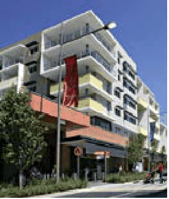
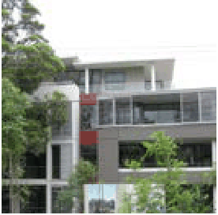
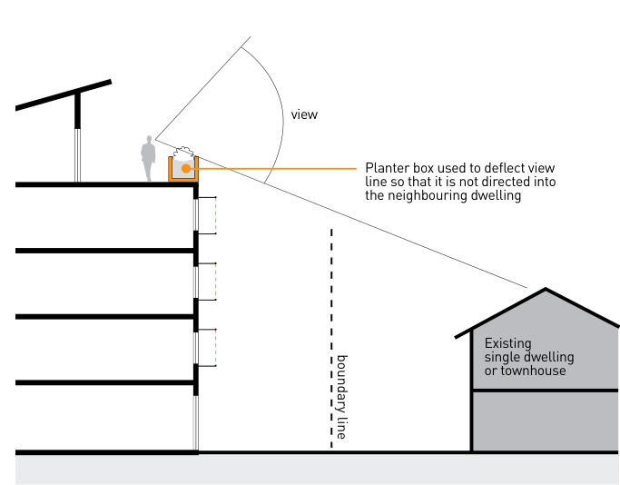
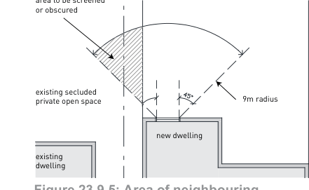

### 23.8	 GENERAL VISUAL PRIVACY

#### Controls

1 Private open spaces and principal living spaces of the proposed

dwelling/s and adjacent dwellings are to be protected from direct

or unreasonable overlooking from all new residential and non-

residential developments. Siting and design measures to achieve

this include:

i) use of distance or slope;

ii)	 appropriate dwelling layout;

iii)	 off-setting windows in relation to adjacent windows;

iv)	 use of obscure glass or highlight windows;

v)	 screening devices such as fences, louvres, translucent screens,

perforated panels, trellises and courtyard walls;

vi)	 using louvres/screen panels to windows and balconies (see

Figure 23.9-1);

vii)	 using solid or semi-transparent balustrades or screens to

balconies or terraces (see Figure 23.9-2);

viii)	off setting balconies in relation to adjacent balconies;

ix)	 using recessed balconies and/or vertical fins between adjacent

private balconies;

x)	 using deep sills with planter boxes or incorporating planter boxes

into walls or balustrades (see Figure 23.9-3).

xi)	 providing vegetation as a screen between spaces;

xii)	 utilising pergolas or shading devices to limit overlooking of lower

building levels or communal and private open space.

> [Picture on page 21: a picture, saved as a picture (images/part-23-general-building-design-and-sustainability-page-21-49.gif, 150 dpi).]

> [Picture on page 21: a picture, saved as a picture (images/part-23-general-building-design-and-sustainability-page-21-50.gif, 150 dpi).]

#### Figure 23.9-1:

#### Balconies with sliding panels

to increase visual privacy.

#### Figure 23.9-2:

Use of a mix of solid and

transparent balustrades on

different levels to ensure

visual privacy.

### 23.9 VISUAL PRIVACY(continued)

> [Picture on page 22: a picture, saved as a picture (images/part-23-general-building-design-and-sustainability-page-22-2.gif, 150 dpi).]
> Words printed on the picture (title and legend, copied from the PDF):
> view
> Planter box used to deflect view
> line so that it is not directed into
> the neighbouring dwelling
> Existing
> single dwelling
> or townhouse
> boundary line

#### Controls

Figure 23.9-3: Incorporation of planter boxes into walls or balustrades for

visual privacy.

property boundary

property boundary

area to be screened

> [Picture on page 22: a map, saved as a picture (images/part-23-general-building-design-and-sustainability-page-22-11.gif, 150 dpi); the street names and other small labels are on the picture.]
> Words printed on the picture (title and legend, copied from the PDF):
> area to be screened
> private open space
> private open space

existing secluded private open space

area to be screened

existing secluded private open space

area to be screened or obscured

or obscured

existing secluded private open space

area to be screened or obscured

existing dwelling

area to be screened or obscured

existing dwelling existing dwelling

existing secluded private open space

property boundary

property boundary

property boundary 9m radius

9m radius

9m radius

new dwelling

existing dwelling

new dwelling

new dwelling

#### Figure 23.9.5: Area of neighbouring

development to be protected from

overlooking..

#### Figure 23.9.4: Designs incorporating

screening to protect residents of the

development.

property boundary

property boundary

property boundary

property boundary

property boundary

property boundary

property boundary

property boundary

property boundary

property boundary

p

Figure 23.9.6: Arrangement of windows to avoid overlooking of adjacent open space or

living areas

### 23.9 VISUAL PRIVACY(continued)

#### Controls

2 For low density residential development first floor decks, balconies

and roof top terraces are not permitted where they unreasonably

overlook or would directly overlook principal living spaces or private

open space and the impact cannot be adequately mitigated. 3 Continuous transparent balustrades are not permitted to balconies or

terraces for the lower 3 storeys.

### GENERAL BUILDING DESIGN AND SUSTAINABILITY

#### Objectives

1	 To preserve the various

natural elements and

habitats such as soil

profile, vegetation,

natural rock shelves and

watercourses. 2	 To protect existing trees

and the natural elements

of the site, including

soil profile, vegetation,

rock outcrops and water

courses.

3	 To reduce the volume and

cost of construction and

demolition waste material. 4	 To protect neighbouring

structures and

minimise disturbance

to neighbouring and

downstream properties. 5	 To ensure regular rainfall

events do not adversely

affect water quality. 6	 To protect the sensitive

Hawkesbury Sandstone

communities in the LGA. 7	 To prevent cumulative

impacts from pollutants,

(such as excess nutrients,

sediment) on downstream

ecosystems. 8	 To maintain visual amenity

of the locality and the

natural environment.
