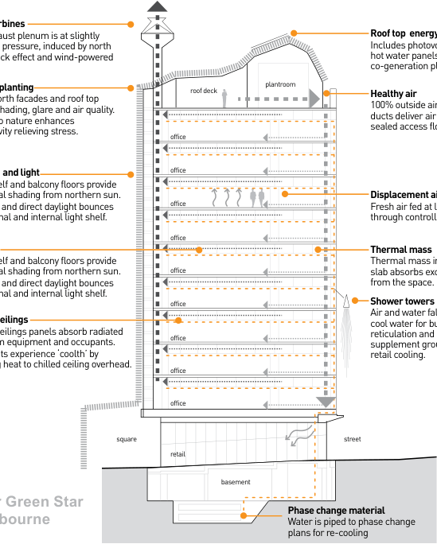
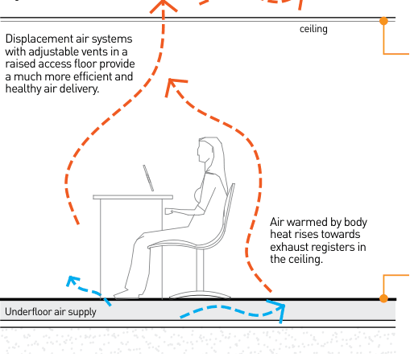
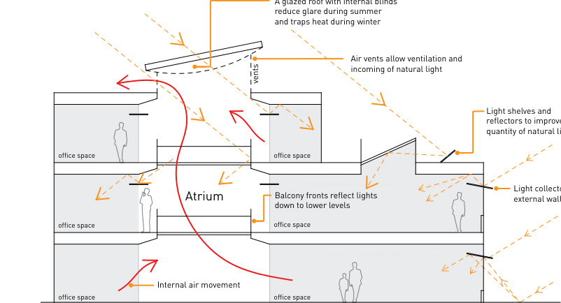

### 23R.1  EXAMPLES OF ESD MEASURES

#### Water Efficiency

These measures ensure all non-residential buildings implement systems

of water collection and recycling. Systems to minimise mains water usage

may include:

i) on-site rainwater collection and on-site waste water treatment to

provide recycled water for use within the development;

ii)	 provide low flush toilets and water efficient fixtures and fittings,

including waterless urinals;

iii)	 utilise water efficient landscape principles, such as the selection

of low water usage species, including local species, and the use

of tree foliage to create on ground shade and windbreaks.

#### Energy Generation

These measures encourage implementation of systems that provide

alternative energy sources. Energy generation measures may include:

i) solar louvres (powered by photovoltaic cells) that track the sun to

supply building use;

ii)	 solar hot water system;

iii)	 solar energy collection technology such as solar heat pumps for

hot water and photovoltaic cells;

> [Picture on page 28: a picture, saved as a picture (images/part-23-general-building-design-and-sustainability-page-28-21.gif, 150 dpi).]
> Words printed on the picture (title and legend, copied from the PDF):
> Roof top  energy
> co-generation plant.
> The exhaust plenum is at slightly
> negative pressure, induced by north
> flues stack effect and wind-powered
> plantroom
> roof deck
> Healthy air
> Green north facades and roof top
> assists shading, glare and air quality.
> Access to nature enhances
> productivity relieving stress.
> office
> office
> office
> Light shelf and balcony floors provide
> horizontal shading from northern sun.
> Ambient and direct daylight bounces
> off external and internal light shelf.
> Displacement air
> Fresh air fed at low speed
> office
> office
> Thermal mass
> Thermal mass in concrete
> slab absorbs excess heat
> from the space.
> Light shelf and balcony floors provide
> horizontal shading from northern sun.
> Ambient and direct daylight bounces
> off external and internal light shelf.
> office
> office
> Shower towers
> cool water for building
> reticulation and cool air to
> retail cooling.
> Chilled ceilings panels absorb radiated
> heat from equipment and occupants.
> Occupants experience ‘coolth’ by
> radiating heat to chilled ceiling overhead.
> office
> office
> street
> square
> retail
> basement
> Phase change material
> Water is piped to phase change
> plans for re-cooling

Includes photovoltaic cells, solar

hot water panels and gas fired

#### Wind turbines

turbines

100% outside air supply via vertical

ducts deliver air floor by floor to

sealed access floor plenum.

#### Vertical planting

#### Shading  and light

through controllable floor vents.

#### Exhaust

Air and water falls to provide

supplement ground floor and

#### Chilled ceilings

#### Figure 23R.1-1:

#### Example of 6 Star Green Star

#### Building CH2 Melbourne

(Source: GBCA)

### 23R

### (continued)

i) use of photovoltaic cells which can be mounted as panels, or

used as an integrated building cladding as shading device;

ii)	 use of co-generation or tri-generation plants located within the

basement to service the whole building; and

iii)	 wind turbine technology.

#### Heating and Cooling

These measures reduce the heat and carbon output of non-residential

buildings. Alternative heating and cooling measures may include (refer to

Figure 23R.1-2):

i) displacement ventilation with low level air delivery and high level

air exhaust to create air change effectiveness;

ii)	 thermal chimneys in atriums to draw warm air up and out of work

areas;

iii)	 new generation cooling systems such as chilled ceiling beams;

iv)	 active mass cooling system utilising thermo-active slabs and

concrete core conditioning;

v)	 radiant slab heating to provide energy efficient thermal comfort;

vi)	 night purge systems to cool and clear stale air within the building;

vii)	 roof surfaces with a sheen finish that reduce heat gain in

summer (only where they do not impact on the amenity of

neighbour in terms of glare and reflectivity);

viii)	roof gardens and landscaped terraces which provide thermal

insulation;

Floor slab above

#### Thermal mass

Thermal mass in concrete

slab absorbs excess heat

from the space.

High level exhaust

> [Picture on page 29: a picture, saved as a picture (images/part-23-general-building-design-and-sustainability-page-29-32.gif, 150 dpi).]
> Words printed on the picture (title and legend, copied from the PDF):
> ceiling
> Displacement air systems
> with adjustable vents in a
> raised access floor provide
> a much more efficient and
> healthy air delivery.
> Air warmed by body
> heat rises towards
> exhaust registers in
> the ceiling.
> Underfloor air supply

### REFERENCES

#### Chilled ceilings

Chilled ceilings panels

absorb radiated heat from

equipment and occupants. Occupants experience

‘coolth’ by radiating heat to

chilled ceiling overhead.

#### Displacement air

Fresh air fed at low

speed through

controllable floor vents.

#### Figure 23R.1-2:

A displacement air system. Removing contaminants efficiently with

#### 100% fresh air supply, resulting in a healthier work environment.

### (continued)

ix)	 use of tri-generation plants located within the building basement;

x)	 use of vertical planting to shade building elevations;

xi)	 insulation and ventilation of roof spaces; and

xii)	 use of heavy weight building materials, such as concrete, for

thermal mass on flat roofs and/or walls. Where lighter weight materials are used they are to be well insulated.

#### Lighting

These measures reduce the energy uptake for lighting systems within

non-residential building sites. Measures to reduce artificial light use may

include (refer to Figure 23R.1-3):

i) considering internal building use relative to window location;

ii)	 consider fenestration with high performance glazing with

spectrally selective glass that allows views and a high degree of

diffused natural light into the workspace without glare;

iii)	 select and position light fittings to minimise energy consumption.

For example create separate lighting zones for areas close to

and further away from windows;

iv)	 lighting used in common areas such as entries, corridors, car

parks and communal open space areas are to utilise daylight

sensor control, movement detectors, automated dimmers and

timers. Lightspill is to be controlled;

v)	 improve internal natural light reflection and minimise lighting use

by using light coloured internal finishes;

> [Picture on page 30: a map, saved as a picture (images/part-23-general-building-design-and-sustainability-page-30-25.gif, 150 dpi); the street names and other small labels are on the picture.]
> Words printed on the picture (title and legend, copied from the PDF):
> reduce glare during summer
> and traps heat during winter
> Air vents allow ventilation and
> incoming of natural light
> Light shelves and
> reflectors to improve
> quantity of natural light
> Light collectors on
> Balcony fronts reflect lights
> down to lower levels
> Internal air movement

A glazed roof with internal blinds

#### Figure 23R.1-3:

#### Lighting and ventilation.
