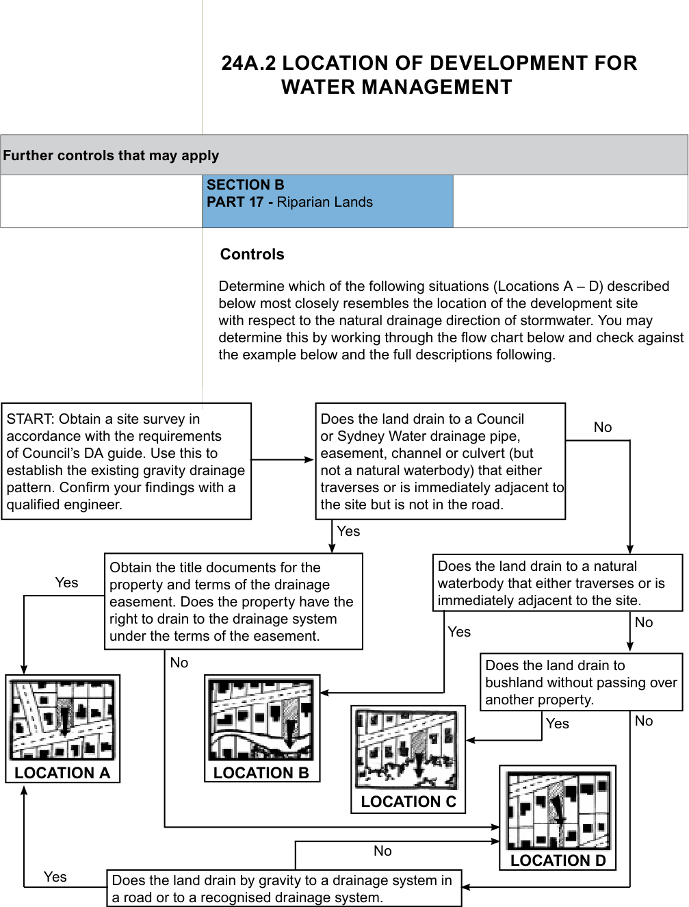

### 24A.1 DEVELOPMENT TYPE FOR WATER

### MANAGEMENT

#### Controls

#### Objectives

1	 To plan water

management techniques

that are appropriate to the

development and location.

Select the Type from those listed below (1-9) that best represents the

development proposed. Note that Type 9 is for any other development

type not listed in the previous eight categories. The majority of controls

applicable to Type 9 development will be determined by Council on an

individual basis in consultation with the developer.

Type 1 Minor alterations and additions - any alteration or addition to

a single detached dwelling or secondary dwelling where the

increase in hard surface area is less than 100m2.

2	 To manage water to

preserve, enhance and

complement existing

environmental, social and

aesthetic conditions within

and external to the site. Type 2 Major alterations and additions - construction of a secondary

dwelling or any alteration or addition to a single detached

dwelling where the increase in hard surface area exceeds

100m2.

Type 3 New single dwellings including replacement single dwellings.

3	 To design measures to

support and enhance

sustainable water

management.

Type 4 Dual Occupancies- two dwellings on one allotment (either

attached or detached), where either one or both of the

dwellings are new.

4	 To ensure that

development does not

increase surface and

subsurface runoff to

downstream properties.

Type 5 High and medium density development - any development

involving three or more dwellings on one allotment, regardless

of the size of the allotment and regardless of whether the

dwellings are attached or detached. Includes seniors housing,

multi-dwelling housing and residential flat buildings.

Type 6 Business, Commercial or Retail Premises - any building to be

used for business, commercial or retail purposes, and mixed

use developments such as shop top housing.

Type 7 Open Space - land used exclusively for recreational

purposes, whether passive or active recreation, including

any buildings erected on the land, where the land is primarily

permeable and landscaped.

Type 8 Subdivision other than strata subdivision. Type 9 Any other development.

> [Picture on page 5: a map, saved as a picture (images/part-24-water-management-page-5-1.gif, 150 dpi); the street names and other small labels are on the picture.]
> Words printed on the picture (title and legend, copied from the PDF):
> accordance with the requirements
> bushland without passing over
