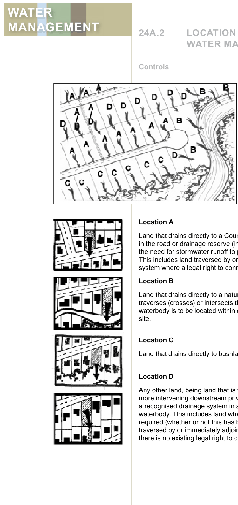
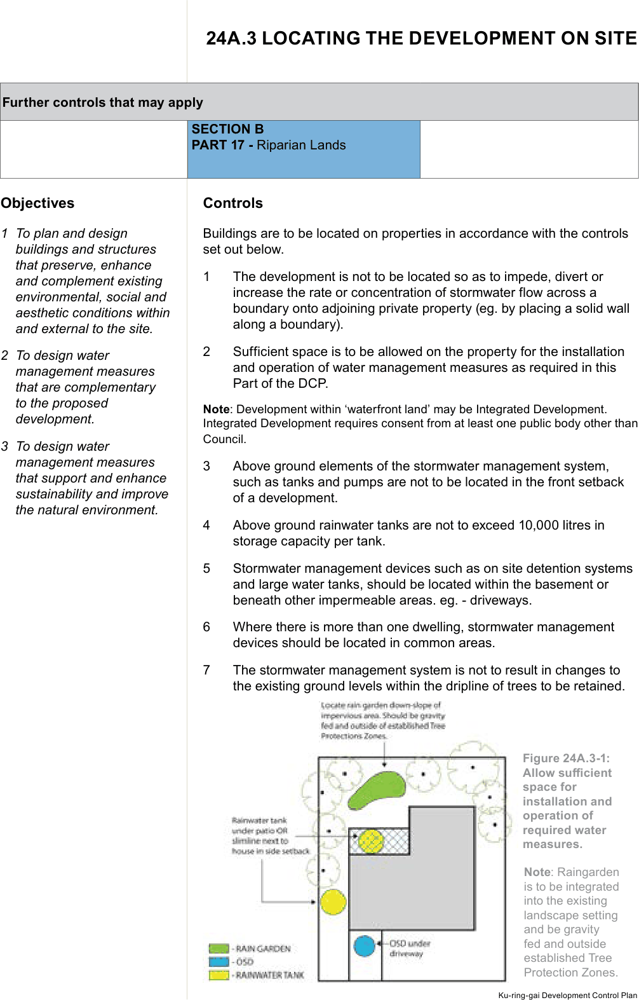

### 24A.2 LOCATION OF DEVELOPMENT FOR

### WATER MANAGEMENT

#### Further controls that may apply

#### SECTION B

PART 17 - Riparian Lands

#### Controls

Determine which of the following situations (Locations A – D) described

below most closely resembles the location of the development site

with respect to the natural drainage direction of stormwater. You may

determine this by working through the flow chart below and check against

the example below and the full descriptions following.

START: Obtain a site survey in

of Council’s DA guide. Use this to

establish the existing gravity drainage

pattern. Confirm your findings with a

Does the land drain to a Council

or Sydney Water drainage pipe,

easement, channel or culvert (but

not a natural waterbody) that either

traverses or is immediately adjacent to

the site but is not in the road.

Does the land drain to a natural

waterbody that either traverses or is

immediately adjacent to the site.

Obtain the title documents for the

property and terms of the drainage

easement. Does the property have the

right to drain to the drainage system

under the terms of the easement.

Does the land drain to

#### LOCATION A

#### LOCATION B

#### LOCATION C

#### LOCATION D

Yes Does the land drain by gravity to a drainage system in

a road or to a recognised drainage system.

### SITE DESIGN FOR WATER MANAGEMENT

> [Picture on page 6: a picture, saved as a picture (images/part-24-water-management-page-6-1.gif, 150 dpi).]
> Words printed on the picture (title and legend, copied from the PDF):
> site.

### 24A.2 LOCATION OF DEVELOPMENT FOR

### WATER MANAGEMENT (continued)

#### Controls

#### Figure 24A.2-1:

#### Examples of Location Types

#### Location A

Land that drains directly to a Council or Sydney Water drainage system

in the road or drainage reserve (including a gutter, pipe or road) without

the need for stormwater runoff to pass over another private property.

This includes land traversed by or immediately adjoining a trunk drainage

system where a legal right to connect already exists.

#### Location B

Land that drains directly to a natural waterbody (see LEP definitions) that

traverses (crosses) or intersects the subject site. At least one bank of the

waterbody is to be located within or immediately adjacent to the subject

#### Location C

Land that drains directly to bushland.

#### Location D

Any other land, being land that is to pass its stormwater over one or

more intervening downstream private properties or public land to reach

a recognised drainage system in a road reserve, drainage reserve or

waterbody. This includes land where a private drainage easement is

required (whether or not this has been obtained) and properties that are

traversed by or immediately adjoining a trunk drainage system where

there is no existing legal right to connect to the system.

> [Picture on page 7: a map, saved as a picture (images/part-24-water-management-page-7-1.gif, 150 dpi); the street names and other small labels are on the picture.]
> Words printed on the picture (title and legend, copied from the PDF):
> along a boundary).
> buildings and structures
> that preserve, enhance
> and complement existing
> environmental, social and
> aesthetic conditions within
> Part of the DCP.
> 2	 To design water
> that are complementary
> to the proposed
> Note: Development within ‘waterfront land’ may be Integrated Development.
> Integrated Development requires consent from at least one public body other than
> of a development.
> 3	 To design water
> that support and enhance
> sustainability and improve
> the natural environment.
> storage capacity per tank.
> is to be integrated
> into the existing
> and be gravity
> fed and outside

Figure 24A.3-1:
