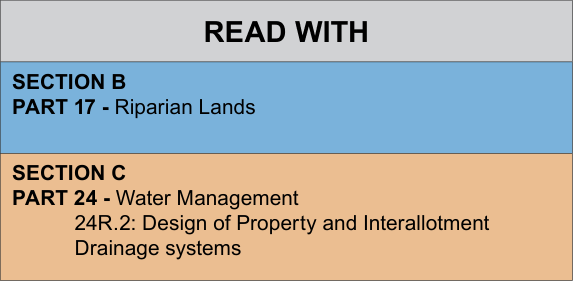

#### 24B Stormwater Discharge

24B.1 	 General 24B.2 	 Stormwater Disposal from Location A

Properties

24B.3 	 Stormwater Disposal from Location B

Properties

24B.4 	 Stormwater Disposal from Location C

Properties

24B.5 	 Stormwater Disposal from Location D

Properties

24B.6 	 Relocating pipes and modifying or

extinguishing easements where council is

the authority

> [Picture on page 9: a picture, saved as a picture (images/part-24-water-management-page-9-15.gif, 150 dpi).]
> Words printed on the picture (title and legend, copied from the PDF):
> Drainage systems

### READ WITH

#### SECTION B

PART 17 - Riparian Lands

#### SECTION C

PART 24 - Water Management

24R.2: Design of Property and Interallotment

> [Picture on page 9: a picture, saved as a picture (images/part-24-water-management-page-9-22.gif, 150 dpi).]

### REFER TO

#### Ku-ring-gai Council

#### Technical Guideline for Water Management

### STORM WATER DISCHARGE

### 24B. 1  GENERAL

#### Objectives

#### Controls

Note: For all location types refer to - Ku-ring-gai Council Technical

Guideline for Water Management.

1	 To achieve a high level

of residential safety and

amenity.

Note: For the control of stormwater runoff and water quality measures refer

to Figure 6: Typical Stormwater Pit Details in the Ku-ring-gai Council

Technical Guideline for Water Management.

2	 To conserve the natural

environment of

Ku-ring-gai and adjoining

areas.

1 Stormwater is to be discharged from the site in accordance with the

controls for the relevant location category, as identified in Part 24A

of this DCP. Note: Where Council drainage easement is designed to only convey

“roadwater”, the terms of the easement is to be legally updated to allow for

the site drainage connection.

3	 To minimise the adverse

impact of stormwater

runoff on neighbouring

properties.

2 Stormwater that is not retained for a use or appropriately infiltrated

on site is to generally be directed to a public drainage system

comprising gutters, streets, pipes, box culverts and channels.

4	 To ensure adverse

impacts are not increased

beyond what was present

prior to the development. 3 The scale of the development and the site conditions (including

factors such as the lie and type of the land) will inform the selection

of the most appropriate form of stormwater discharge.

5	 To minimise the adverse

impact of stormwater

runoff on the natural

environment

4 In the selection of the means of stormwater disposal, particular

regard is to be given to downstream impacts.

#### Carrying Out Drainage Works

5 Drainage systems for stormwater disposal is to comply with

AS3500.1:2021: Plumbing and Drainage Water Services or any

standard replacing that standard. Note: See Council Website for the Ku-ring-gai Council Easement

Management Policy.

### 24B. 2  STORMWATER DISPOSAL FROM

### LOCATION A PROPERTIES

#### Controls Discharge to Kerb and Gutter/Table Drain

1 Piped drainage from the boundary line of the development to the

street gutter or table drain is to have a minimum 1% longitudinal fall

towards the street gutter. 2 The total discharge from any dwelling on a lot to the street gutter

or table drain is not to exceed 25 litres per second for development

Type 3 and above. Note: Where this is not possible, stormwater is to be discharged to an

enclosed system (pipe, box culvert, road pit). Alternatively, on-site detention

may be required to lower the total discharge rate, or the site coverage

contributing to the discharge, reduced. 3 For Development Types 1, 2 and 3 where piped drainage line

crossings from the site boundary are to be employed:

i) the piped drainage line crossing is to extend no further than 20m

from the development site across the frontage of a neighbouring

property (see note) except where the location of trees prevent

such piped crossings;

ii)	 the crossing line is to be at an angle not less than 45° from the

line of the frontage of the neighbouring property;

iii)	 the crossing line is to run directly behind, and parallel to the

street kerb as far as the discharge point. Any necessary

drainage line crossing of driveways are to be constructed in a

trafficable grade, directly behind the layback and parallel to it,

subject to Council approval. (These requirements may be varied

by Council where they are demonstrated to be impracticable and

where a suitable alternative route is demonstrated); and

iv)	 the proposed piped crossing will not compromise existing or

future vehicular access to the neighbouring property or to

services, trees or similar. Note: Details of the proposed route are to be provided to Council in the

form of scale plans with all these features shown. 4 For development types 4 – 9, piped drainage line crossings to the

street drainage system are to take place directly outside the frontage

of that development and is not to encroach across the frontage of

any neighbouring property. 5 Connection to existing secondary footpath drainage systems, such

as pipes beneath the concrete footpath, will not be permitted as they

have limited capacity and block easily.

### STORMWATER DISCHARGE

6 Connections to concrete kerb and gutter is to comply with Figure

12: Connection of Drainage Line to Kerb in the Ku-ring-gai Council

Technical Guideline for Water Management.
