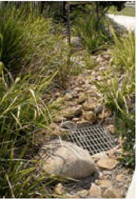

### 24C.2  EFFECTIVE STORMWATER

### MANAGEMENT

#### Controls

An appropriate method or combination of methods are to be provided

on the site to manage stormwater quality and flows. The system is to be

designed to ensure the optimum outcome for both the catchment and the

subject site. Available management techniques include rainwater tanks,

detention basins and tanks, infiltration basins and trenches, passive

irrigation tanks, raingardens (biofiltration gardens), green roofs, dense

native vegetation buffer strips, vegetated swales, biofiltration swales,

rainscaping and dispersal trenches. Note: Some techniques, such as green roofs, are predominantly used for

water quality treatment, microclimate regulation and aesthetics, rather than

for retention or detention. However, consideration of retention or detention

contribution will be made where such benefits can be demonstrated through

modelling. Note: Biofiltration systems can be used for stormwater quality and flow

management. Refer to Figure 7: Typical Biofiltration System and Figure

8: Biofiltration System Standard Details in the Ku-ring-gai Council Technical

Guideline for Water Management.

> [Picture on page 31: a picture, saved as a picture (images/part-24-water-management-page-31-21.gif, 150 dpi).]

#### Figure 24C.2-1

#### Informal raingarden

These systems can be designed to retain or detain stormwater: 1 On-site Retention (OSR) is a stormwater management system that

keeps water on site for re-use in the hydrological cycle or as an

alternative to mains water. OSR controls the volume of runoff during

rainfall and storm events. Stormwater is not sent directly off the

site, reducing runoff draining to pipelines, minimising flood events,

conserving water and reducing the impact on the natural water cycle.

#### Figure 24C.2-2

#### Formal detention pond

amphitheatre in public space

(www.wsud.org)

2 On-site Detention (OSD) works involve holding back stormwater

temporarily within a site and then releasing it at a controlled rate.

It controls the rate of runoff and reduces peak discharges during

storm events; to minimise the load on pipelines and to minimise flood

events. OSD does not alter the total volume of stormwater leaving

the site and normally does not allow the stormwater to be used

before it leaves the site. 3 In many situations a combination of OSD and OSR may be

appropriate. In general, the factors that the designing engineer

should take into account when determining the stormwater

management techniques for a site are:

i) the timing of peak flows from the site relative to those from

the upstream catchment which drain to the same point. This

is influenced by the time of concentration and the proximity of

the site to the catchment point. Generally, in upper parts of the

catchment water needs to be detained, whereas in lower areas

it may be preferable to allow most of the stormwater to leave the

site immediately;

ii)	 the proximity of the subject property to environmentally sensitive

areas such as bushland. Specifically, OSD can be problematic

where a site drains to bushland as constant seepage causes

weed growth;

iii)	 the impact of any proposed stormwater management method

### ON-SITE STORMWATER MANAGEMENT

on the streetscape and neighbouring properties, particularly in

terms of aesthetics.

### 24C.2  EFFECTIVE STORMWATER

### MANAGEMENT (CONTINUED)

#### Controls

4 Both OSR and OSD options are to be designed and constructed to

meet water quality controls in accordance with 24C.6 of this Part.

This can be achieved by incorporating litter screens, proprietary

devices, biofiltration or infiltration within the design.
