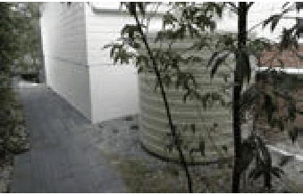

### 24C.4  MANDATORY RAINWATER TANK

### REQUIREMENTS

#### Controls

For all Locations (A-D), at least one rainwater tank is to be established to

capture as much as possible roof water from the primary building(s) on

the property. The controls are as set out in the table below:

#### Table 24C.4-1: Mandatory Rainwater Tank Requirement by Development Type

| Type | Description |  | Minimum Tank Storage Volume | Minimum Use of Retained Water |
|---|---|---|---|---|
| Type 1 <20m2 | Alts & adds to a single detached dwelling or secondary dwelling. Increase in hard surface area. |  | A water tank is strongly recommended but not mandatory, | Where installed, are to be connected to garden. Connection to toilet and laundry hot water is also encouraged. |
| 20- 100m2 | Alts and Adds to single or secondary dwellings where the development is increase in hard surface area. | Where proposal does not involve a bathroom or laundry Where proposal involves a bathroom or laundry. | The minimum tank storage volume is 2,000L, or, compliance with BASIX, whichever is the greater. The minimum tank storage volume is 2,000L, or in compliance with BASIX, whichever is the greater. | For garden irrigation only. Is to be at least one connection to laundry or toilet. |
| Type 2 | Alts and Adds or construction of secondary dwellings >100m2 increase in hard surface area. |  | The minimum tank storage volume is 5,000L, or in compliance with BASIX, whichever is the greater. | Connection for garden irrigation and for internal use. |
| Type 3 | Single Dwellings in sites less than 1000m². Single Dwelling in sites greater than 1000m2. Single Dwellings in locations B, C and D (where an inter- allotment drainage cannot be obtained or it is located within the OSD exemption map 24.R.9) is to provide rainwater storage in lieu of OSD. |  | The minimum tank storage volume is 5,000L, or in compliance with BASIX, whichever is the greater. The minimum tank storage volume is 10,000L; or in compliance with BASIX, whichever is the greater. | Connection for garden irrigation and for internal use. Is to be at least one internal connection to laundry or toilet. |

### 24C.4 MANDATORY RAINWATER TANK

### REQUIREMENTS (continued)

#### Controls

Table 24C.4-1: Mandatory Rainwater Tank Requirement by Development Type (continued)

| Type | Description | Minimum Tank Storage Volume | Minimum Use of Retained Water |
|---|---|---|---|
| Type 4 | Dual Occupancy | For any new dwelling: • The minimum tank storage volume is 5,000L; or in compliance with BASIX. whichever is the greater; plus • 2,000L for any existing dwelling to be retained | Connection to garden, toilet and laundry and hot water is encouraged for the existing dwelling. |
| Type 5 | High and medium density | The minimum tank storage volume is that required to meet the 50% reduction in runoff days specified in control 24B.3-4, or compliance with BASIX whichever is the greater. | Number of connections required to meet the specified target. Is to also be connected to garden, podium plantings, green roofs and walls. |
| Type 6 | Business, Commercial, Retail | The minimum tank storage volume is that required to meet the 50% reduction in runoff days specified in control 24B.3-4, or compliance with BASIX or the Green Star Rating, whichever is the greater. | Number of connections required to meet the specified target. Is to be connected to garden, podium plantings, and any green roofs and walls. |
| Type 7 | Open Space | 2,000L for every five toilets or part thereof in any building erected. | Is to be connected to toilets. Where possible also for irrigation. |
| Type 8 | Subdivision | 2,000L for any dwelling to be retained on a newly created lot. | The minimum use of retained water will be garden irrigation. Connection to toilet and laundry and hot water is also encouraged. |
| Type 9 | Any Other Development | As determined by Council, dependent on development type |  |

Or where total site Built Upon Area is above 60%. Note: The mandatory rainwater tank volume requirement may be met using one or more tanks, as appropriate to

the site and the required use of stormwater. Note: The installation of rainwater tanks are to be in accordance with Figure 2: Typical Rainwater Reuse Tank and

Use in the Ku-ring-gai Council Technical Guideline for Water Management.

> [Picture on page 37: a picture, saved as a picture (images/part-24-water-management-page-37-11.gif, 150 dpi).]

### ON-SITE STORMWATER MANAGEMENT

#### Figure 24C.4-1

#### Rainwater tank blends

with dwelling
