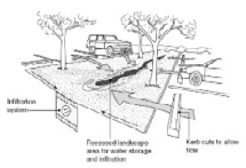

### 24C.5  CONTROLS FOR ON-SITE DETENTION

#### Controls

Part 24C.5 applies to locations A, B and D (where connection to an

easement is available), and in some circumstances to Location C

properties where bushland overland flow is directed to downslope

properties. 1 OSD Exemptions will only be considered for properties identified on

the OSD Exemption Map in 24R.5. Note: Exempting of OSD will be subject to Council approval. Note: Developments on properties which benefit from an OSD exemption

may be subject to additional rainwater reuse tanks requirements in

accordance with part 24C.4. 2 The orifice plate is to be installed in any discharge control pit at the

same time as the pit is connected to the outlet pipe. The on-site

detention system is not to discharge uncontrolled runoff into the

downstream drainage network. 3 To protect the streetscape character, above ground on-site detention

systems in the front setback are to be avoided.

#### Development Type 1 and 2

4 OSD is not required for development Types 1 and 2 unless the

development increases the BUA to over 60% of the site area, or it is

required to control rates of runoff into existing stormwater systems.

#### Development Types 3, 4, 5 and 6

5 Any rainwater retention system is to be included as part of the

stormwater management system and is to comply with the

installation specifications available on Council’s website. 6 In areas where it is desirable that peak outflows from the subject site

do not coincide with the peak flow for the catchment as a whole, the

permitted site discharge and storage volume is to be calculated in

the following manner:

i) Determine in which OSD drainage catchment the site is located

(refer to the Ku-ring-gai Council Technical Guideline for Water

Management);

ii)	 Use the information and calculation sheet in the Ku-ring-gai

Council Technical Guideline for Water Management to determine

the permitted site discharge and minimum OSD storage volume

required for the development; and

iii)	 Deduct from the minimum storage volume (SSR1 or SSR2

from the Ku-ring-gai Council Technical Guideline for Water

Management) the minimum volume of the any rainwater tank

required at 24B.4 of this Part up to an absolute maximum of

10% of SSR provided the tank, is at least, plumbed to toilet and

garden irrigation. Note: The permitted site discharge (PSD) is to remain as specified in the

Ku-ring-gai Council Technical Guideline for Water Management.

### 24C.5 CONTROLS FOR ON-SITE DETENTION

### (continued)

#### Controls

iv)	 Areas, such as green roofs, permeable paving, and hard stand

directed to raingardens or rainscaping, may be included in the

impervious area bypassing the detention system in the On-site

Detention system, calculation sheet (in the Ku-ring-gai Council

Technical Guideline for Water Management).

7 Except where it is demonstrably not practicable, the stormwater

management system is to incorporate at least two different devices

or techniques so as to reduce the risk of total system failure, ie.

rainwater tanks may NOT be the sole means employed for on-site

stormwater management. Note: Examples of means that may be acceptable to Council (depending on

site circumstances) include:

i) a rainwater tank and OSD; or

ii) a rainwater tank, OSD and a raingarden. 8 The system is to be designed such that overflow from the retention

system is captured by the OSD device(s) employed on the site and

disposed of in accordance with Part 24B.

#### Development Types 7, 8, and 9

9 For development where construction of sealed driveways or

roadways with an area greater than 200m2 is proposed, an on-site

detention system will be required to treat that area prior to discharge

into the Council system. The SSR and PSD for this system is to be

calculated using the on-site detention calculation sheet in the Ku-

ring-gai Council Technical Guideline for Water Management and

based upon the total impervious area to be constructed under the

subdivision application. Note: The creation of new lots will not be approved unless adequate

provision for gravity drainage is demonstrated for each of the lots to be

created. This will include demonstration of the necessary easements as

required. 10 Tennis Courts are to be constructed as on-site detention systems

unless otherwise approved. Note: For other type 7, 8, and 9 developments it is recommended that

Councils pre-DA service be used, prior to the lodgement of a DA.

> [Picture on page 39: a picture, saved as a picture (images/part-24-water-management-page-39-38.gif, 150 dpi).]

#### Figure 24C.5-1:

Biofiltration systems can be

incorporated into vegetated

areas within car parks

reducing the on site detention

requirements.

### ON-SITE STORMWATER MANAGEMENT
