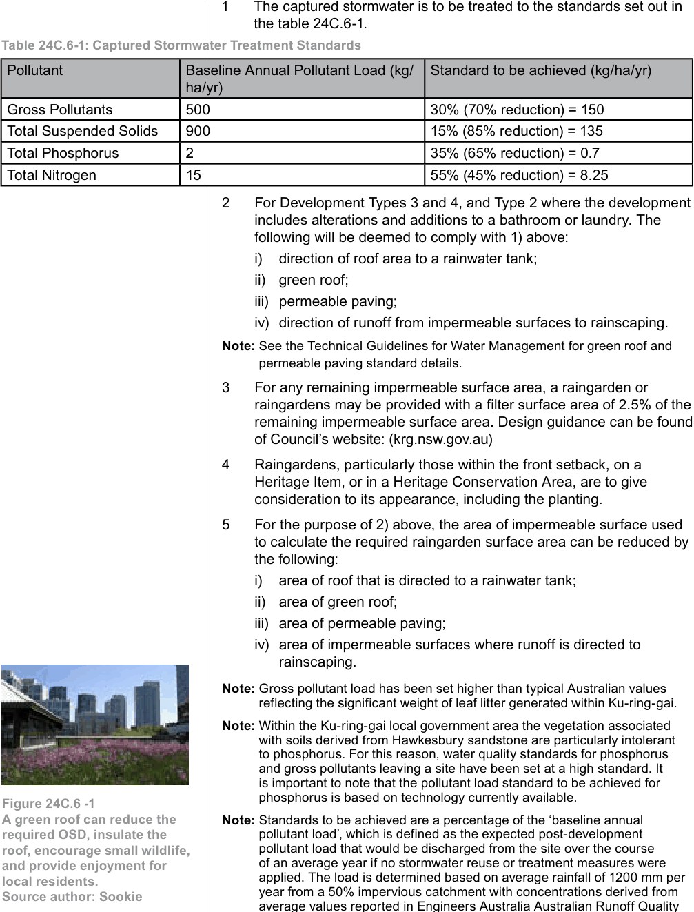
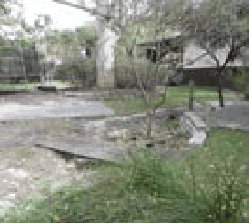

### 24C.6  STORMWATER QUALITY CONTROL

#### Controls

> [Picture on page 40: a picture, saved as a picture (images/part-24-water-management-page-40-3.gif, 150 dpi).]
> Words printed on the picture (title and legend, copied from the PDF):
> the table 24C.6-1.
> Note: See the Technical Guidelines for Water Management for green roof and
> permeable paving standard details.
> of Council’s website: (krg.nsw.gov.au)
> rainscaping.
> Note: Gross pollutant load has been set higher than typical Australian values
> reflecting the significant weight of leaf litter generated within Ku-ring-gai.
> Note: Within the Ku-ring-gai local government area the vegetation associated
> with soils derived from Hawkesbury sandstone are particularly intolerant
> to phosphorus. For this reason, water quality standards for phosphorus
> and gross pollutants leaving a site have been set at a high standard. It
> is important to note that the pollutant load standard to be achieved for
> phosphorus is based on technology currently available.
> Note: Standards to be achieved are a percentage of the ‘baseline annual
> A green roof can reduce the
> required OSD, insulate the
> roof, encourage small wildlife,
> and provide enjoyment for
> local residents.
> Source author: Sookie
> pollutant load’, which is defined as the expected post-development
> pollutant load that would be discharged from the site over the course
> of an average year if no stormwater reuse or treatment measures were
> applied. The load is determined based on average rainfall of 1200 mm per
> year from a 50% impervious catchment with concentrations derived from
> average values reported in Engineers Australia Australian Runoff Quality

Table 24C.6-1: Captured Stormwater Treatment Standards

Figure 24C.6 -1

1 The captured stormwater is to be treated to the standards set out in

| Pollutant | ha/yr) | Baseline Annual Pollutant Load (kg/ | Standard to be achieved (kg/ha/yr) |
|---|---|---|---|
| Gross Pollutants | 500 |  | 30% (70% reduction) = 150 |
| Total Suspended Solids | 900 |  | 15% (85% reduction) = 135 |
| Total Phosphorus | 2 |  | 35% (65% reduction) = 0.7 |
| Total Nitrogen | 15 |  | 55% (45% reduction) = 8.25 |

2 For Development Types 3 and 4, and Type 2 where the development

includes alterations and additions to a bathroom or laundry. The

following will be deemed to comply with 1) above:

i) direction of roof area to a rainwater tank;

ii)	 green roof;

iii)	 permeable paving;

iv)	 direction of runoff from impermeable surfaces to rainscaping.

3 For any remaining impermeable surface area, a raingarden or

raingardens may be provided with a filter surface area of 2.5% of the

remaining impermeable surface area. Design guidance can be found

4 Raingardens, particularly those within the front setback, on a

Heritage Item, or in a Heritage Conservation Area, are to give

consideration to its appearance, including the planting. 5 For the purpose of 2) above, the area of impermeable surface used

to calculate the required raingarden surface area can be reduced by

the following:

i) area of roof that is directed to a rainwater tank;

ii)	 area of green roof;

iii)	 area of permeable paving;

iv)	 area of impermeable surfaces where runoff is directed to

(as updated).

### 24C.6   STORMWATER QUALITY CONTROL

### (continued)

#### Controls

6 For Development Types 5, 6, 8 and 9 (including car parks):

i) all stormwater flows from regular rainfall events (up to the 40%

AEP storm) are to be captured for treatment prior to discharge to

the stormwater drainage system.

ii)	 a suitably qualified and experienced engineer is to certify that

the proposed management measure(s) to be used at the site

(whether proprietary or otherwise) will achieve the standards for

water quality required in this DCP;

iii)	 the design is to be based on MUSIC modelling prepared

in accordance with Council’s MUSIC Modelling Guidelines

available on Council’s website (www.krg.nsw.gov.au) and in the

MUSIC-link function within MUSICv6 (or the latest version).

iv)	 the certification and modelling is to be submitted with the

development application.

> [Picture on page 41: a picture, saved as a picture (images/part-24-water-management-page-41-18.gif, 150 dpi).]

#### Figure 24C.6 -2

#### A local raingarden connected

to the overflow of a rainwater

tank improves water quality

and reduces runoff to the

adjoining bushland.

- where MUSICv6 (or the latest version) is used a MUSIC-link

validation report for Ku-ring-gai Council is to be submitted with

the development application

- where an older version of MUSIC is used the model files are

to be submitted to Council to enable MUSIC-link validation to

be undertaken.

- any model using parameters not in line with Councils MUSIC

modelling guidelines are to provide clear justification for any

variation. Note: modelling software other than MUSIC may be used, however

all assumptions, inputs and parameters used are to match Councils

MUSIC modelling guidelines and be clearly explained/demonstrated.

Council may also require the model to be certified by a third party (at

the proponents expense).

7 The treatment measure(s) is to include one or more of the following

methods or other as appropriate:

i) Proprietary device/s including an independent certification that it

is able to capture and treat or retain the pollutant load specified;

ii)	 Any appropriate method described on Council’s website or other

technique appropriate to the site including:

- retention (ponds, wetlands);

- retention and filtration (raingarden, sand filters, permeable

paving);

- re-use and re-charge (rainwater tanks and infiltration

systems); or

- filtering and conveyance (vegetated swales); and

- Gross Pollutant Traps (GPTs).

8 Treatment is to occur as close as practicable to the source to

maximise effectiveness. 9 Where it is proposed to treat stormwater using one or more

proprietary devices, technical specifications from the manufacturer

are to be provided with the development application as evidence of

the performance capabilities of the device.

### ON-SITE STORMWATER MANAGEMENT

10 Council will require a Positive Covenant or restriction on use (see

24R.4 of this Part) for any approved proprietary device to ensure the

continued functioning and maintenance of the device.

### 24D
