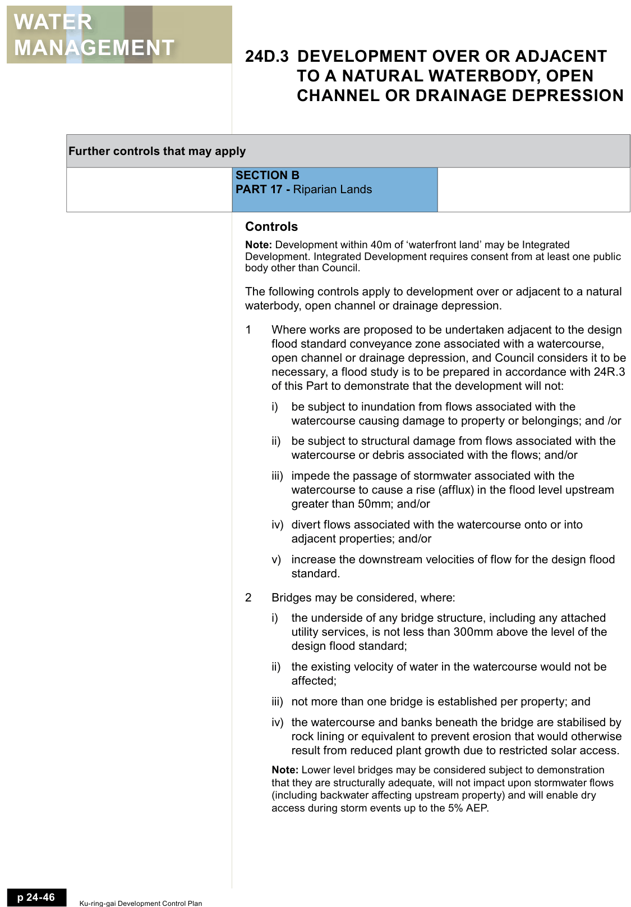

### 24D.2  FLOOD STUDIES AND THE DESIGN

### FLOOD STANDARD

#### Controls

A flood study is undertaken to identify the reach and depth of overland

flows associated with drainage systems on or near a site and to assess

the impact of development on such flows and vice versa. Drainage

systems include underground pipes, natural watercourses, open

channels and depressions. Note: Council has completed flood studies for selected catchments.

Refer to Flooding Ku-ring-gai (nsw.gov.au) 1 Where a Catchment Flood Study has been completed and the site

is identified on the Flood Planning Area map any development

proposal is to demonstrate:

i) Development is confined to a part of the site which is flood free;

or

ii)	 All dwellings are set at or above the specified freeboard; and

iii)	 Development will not exacerbate flooding depth, extent or flow

velocities on adjoining properties; and

iv)	 Any part of the dwelling house or any ancillary development

that is erected at or below the flood planning level is to be

constructed of flood compatible material, and able to withstand

the forces exerted during a flood by water, debris and buoyancy

up to the flood planning level.

Note: Absence of Flood Planning Area or Probable Maximum Flood mapping

on a property does not mean the site is free from overland flows during major

rainfall events – all development is to carefully consider potential flow paths and

incorporate good drainage design to minimise potential impacts during major rainfall events.

2\.	 Where a Catchment Flood Study has not been completed or Council

considers that a development proposal, associated with a nearby

drainage system, may:

i) be subject to inundation from overland flows causing damage to

property or belongings; and/or

ii)	 be subject to structural damage from overland flows or debris

associated with the overland flows; and/or

iii)	 impede the passage of stormwater associated with the design

flood standard to cause a rise (afflux) in the flood level upstream

greater than 50mm; and/or

iv)	 divert overland flows onto or into surrounding properties; and/or

v)	 increase the downstream velocities of flow for the design flood

standard.

Council reserves the right to request that a flood study be undertaken and

prepared in accordance with 24R.3 of this Part.

### 24D.2   FLOOD STUDIES AND THE DESIGN

### FLOOD STANDARD (continued)

3 The design flood standard is to be calculated based on either:

i) the overland flow associated with the 1% AEP storm event

with any above-ground channels and underground pipes /

culverts operating at a maximum of 50% capacity; or

ii)	 the overland flow associated with the 20% AEP storm event

with any above-ground channel or underground pipes /

culverts fully blocked;

iii)	 whichever is the greater. 4 For sensitive and hazardous development Council may require the

adoption of events between the 1% AEP and Probable Maximum

Flood (PMF) as the design flood event where it is considered that

the proposed works pose a greater than usual risk to persons and/

or property.

i) Sensitive and hazardous development includes:

a)	 Early education and care facilities.

b)	 Educational establishments.

c)	 Emergency services facilities.

d)	 Group homes.

e)	 Hospitals.

f) Respite day care centres.

g)	 Seniors housing.

h)	 Hazardous storage establishments.

### EXISTING DRAINAGE SYSTEMS

> [Picture on page 46: a picture, saved as a picture (images/part-24-water-management-page-46-1.gif, 150 dpi).]
> Words printed on the picture (title and legend, copied from the PDF):
> Note: Development within 40m of ‘waterfront land’ may be Integrated
> Development. Integrated Development requires consent from at least one public
> body other than Council.
> greater than 50mm; and/or
> adjacent properties; and/or
> standard.
> design flood standard;
> affected;
> Note: Lower level bridges may be considered subject to demonstration
> that they are structurally adequate, will not impact upon stormwater flows
> (including backwater affecting upstream property) and will enable dry
> access during storm events up to the 5% AEP.
