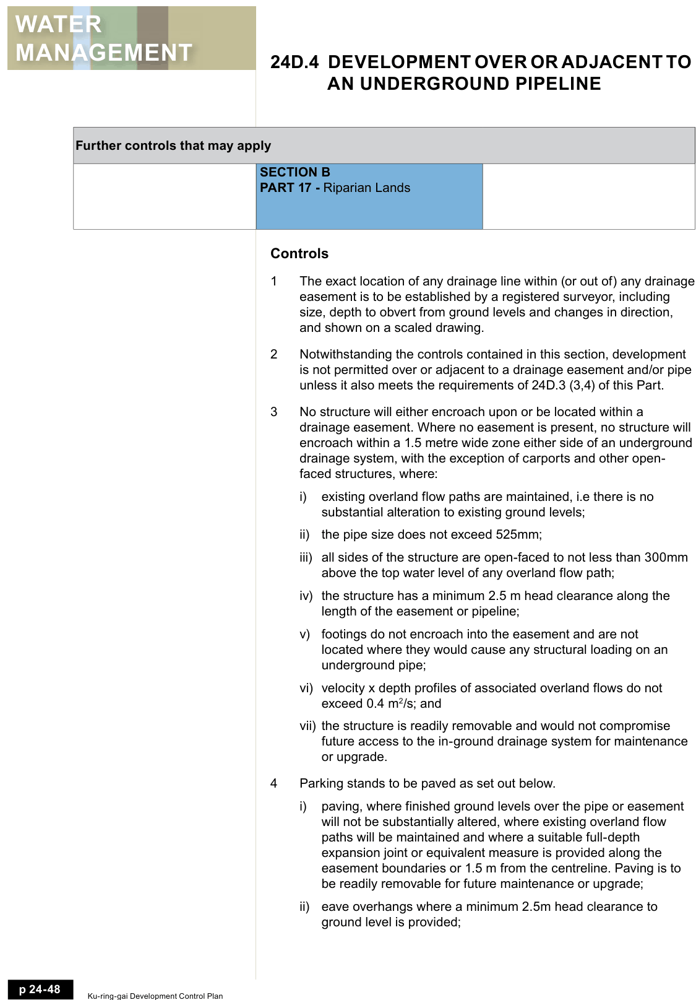

### 24D.3  DEVELOPMENT OVER OR ADJACENT

### TO A NATURAL WATERBODY, OPEN

### CHANNEL OR DRAINAGE DEPRESSION

#### Further controls that may apply

#### SECTION B

PART 17 - Riparian Lands

#### Controls

The following controls apply to development over or adjacent to a natural

waterbody, open channel or drainage depression. 1 Where works are proposed to be undertaken adjacent to the design

flood standard conveyance zone associated with a watercourse,

open channel or drainage depression, and Council considers it to be

necessary, a flood study is to be prepared in accordance with 24R.3

of this Part to demonstrate that the development will not:

i) be subject to inundation from flows associated with the

watercourse causing damage to property or belongings; and /or

ii)	 be subject to structural damage from flows associated with the

watercourse or debris associated with the flows; and/or

iii)	 impede the passage of stormwater associated with the

watercourse to cause a rise (afflux) in the flood level upstream

iv)	 divert flows associated with the watercourse onto or into

v)	 increase the downstream velocities of flow for the design flood

2 Bridges may be considered, where:

i) the underside of any bridge structure, including any attached

utility services, is not less than 300mm above the level of the

ii)	 the existing velocity of water in the watercourse would not be

iii)	 not more than one bridge is established per property; and

iv)	 the watercourse and banks beneath the bridge are stabilised by

rock lining or equivalent to prevent erosion that would otherwise

result from reduced plant growth due to restricted solar access.

### 24D.3 DEVELOPMENT OVER OR ADJACENT

### TO A NATURAL WATERBODY, OPEN

### CHANNEL OR DRAINAGE DEPRESSION

### (continued)

#### Controls

3 Where the design flood standard is less than 20m3/s, or identified as

overland flow on the Flood Planning Area Map* the minimum floor

level of all enclosed areas and structures, including all habitable floor

areas, is to be either:

i) 300mm above the design flood standard level; or

ii)	 300mm above the highest existing ground level along the

associated overland flow path; or

iii)	 whichever is the greater, except in the case of garages, where

the minimum height is to be 150mm instead of 300mm, and in-

ground swimming pools, which is to be designed in accordance

with the provisions of 24D.7 (4) of this Part

\*where a flood study has been completed. 4 Where the design flood standard exceeds 20m3/s, or as identified

as mainstream flow on the Flood Planning Area Map* the minimum

floor level for all enclosed areas, including all habitable floor areas,

are to be 500mm above the design flood standard level, except in

the case of garages, where the minimum height is to be 300mm, and

in- ground swimming pools, which is to be designed in accordance

with the provisions of 24D.7 (3,4,5) of this Part. *where a flood study has been completed. Note: Council may require, as a condition of consent, that the following

burdens be placed on the title of the subject property over the following

areas of the property:

i) a restriction-on-use over the determined design flood standard

conveyance zone for an overland flow path associated with a natural

waterbody, open channel or drainage depression, the terms of which do

not permit the placement of any structures within that zone which may

impede the design flood standard; and/or

ii) a drainage easement to the benefit of Council and/or upstream properties as applicable.

5 Safety fencing that is required to reduce hazard to persons to

acceptable limits may be installed in any areas that are subject to

overland flow. Safety fencing is to be able to withstand a velocity

x depth ratio of 0.4m2/s, not impede flows or debris, and meet the

minimum requirements of AS1926.1-1993: Fencing for Swimming

Pools or any standard that replaces it. If fencing is not feasible, other

suitable measures may be provided to restrict access to areas which

exceed this limit. 6 Parking areas are not to be established in areas where vehicles

would become buoyant in an overland flow zone, and hence

unstable. A maximum velocity x depth ratio of 0.6m2/s to 0.7 m2/s

applies in these instances in accordance with Australian Rainfall and

Runoff.

### EXISTING DRAINAGE SYSTEMS

Note: Australian Rainfall and Runoff is published by Engineers Australia

www.eabooks.com.au. Information on updates to Australian Rainfall and

Runoff can be found at www.arr.org.au

> [Picture on page 48: a picture, saved as a picture (images/part-24-water-management-page-48-1.gif, 150 dpi).]
> Words printed on the picture (title and legend, copied from the PDF):
> underground pipe;
> exceed 0.4 m2/s; and
> or upgrade.
> ground level is provided;
