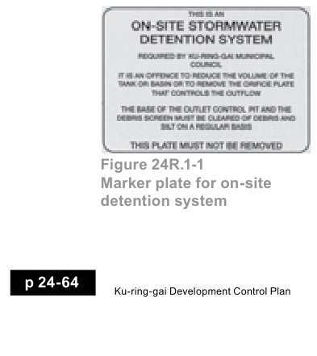

### 24R.1   DESIGN OF ON-SITE DETENTION

### SYSTEMS (OSD)

#### Controls

Depending on the site, stormwater may be detained above and/or below

ground. Where it is above ground, it may be held in an open grassed

or landscaped area or in a driveway designed for such a purpose. It is

possible to use a combination of different locations. The following controls

apply to on-site detention tanks:

#### General Controls for On-site Detention Systems (OSD)

1 On-site detention (OSD) is not to be established across allotment

boundaries unless intended to be covered by reciprocal drainage

easements. 2 The design of the facility is to be compatible with the proposed

overall site layout and landscaping and is not to be unsightly. 3 On-site detention storages are to generally be located as close as

possible to the lowest point of the site. 4 The site drainage system is not to surcharge before the on-site

detention area is full to the design top-water level. 5 On-site detention storages are not to be located in drainage

easements and/or overland flow paths that convey catchment flows

through the site. 6 The on-site detention system is to drain freely to the public drainage

system for storm events up to and including the  1% AEP. If this is not possible, compensation is to be made by increasing the

storage volume provided (calculations to be submitted for approval). The rate of discharge from the OSD system is to be calculated

based on the impervious area remaining after the deep soil area is

deducted from the total site area. 7 Where the development is on land that is to be strata titled or

community titled, OSD is to be located in common areas (and not in

private courtyards). 8 Locations of on-site detention systems are to be included on any

new final plans of subdivision. 9 Cut and/or fill within the canopy areas of any trees to be retained is

not permitted. 10 The excavation influence line is not to affect footings of adjacent or

neighbouring structures. 11 The location of the OSD is not to restrict pedestrian access between

a public road and any site building and is not to cause hazard or

inconvenience in any manner. 12 A spillway or overflow outlet is to be provided in all OSD systems as

part of the operation of the system. The overflow is to be designed

to cater for total system failure (blockage) in extreme storm events

### and designed to safely convey all overflows up to the 1% AEP REFERENCES - WATER MANAGEMENT

### SYSTEMS (OSD) (continued)

#### Controls

uncontrolled flow to an adequate downstream drainage system

without adverse impact on neighbouring properties. Note: Where large overflow structures are required, Council may determine

that approval for the structure is required from the Dam Safety Committee. 13 The overflow from the system is to be collected within a suitably

located and sized drainage pipeline with a design capacity

equivalent to the 1% AEP storm runoff from the site. 14 Overflow is not to be directed to another private property unless

along an overland flowpath along an easement. 15 The spillway is to be protected by the fixing of suitable armour over

the overflow facility. 16 The overflow level is not to be less than:

i) 0.3m below the floor level of all habitable areas adjacent to the

OSD and

ii)	 0.15m below the floor level of all garage areas adjacent to the

OSD.

17 The top level of kerbs and other retaining structures is to be a

minimum of 50mm above the level of flow over the spillway. 18 The location of all on-site stormwater detention systems is to be

marked on site by the fixing of a marker plate of minimum size of

0.15m x 0.1m to the grate of the discharge control pit or nearest

concrete or permanent surface in a prominent position. The plate is

to be of non-corrosive metal or 4mm thick laminated plastic and that

contains the following wording: This is an on-site stormwater detention system required by Ku-ring-

gai Council. It is an offence to reduce the volume of the tank or basin

or to interfere with the orifice plate that controls the outflow. The

owner is to clean the base of the outlet control pit and the debris

screen of debris and sediment on a regular basis. This plate is not to

be removed. 19 A positive covenant and restriction on use is to be established for the

detention system in accordance with 24R.4 of this Part.

#### Discharge control pits (dcp)

20 The discharge control pit is to have dimensions of 0.6m x 0.6m

for pits up to 0.6m deep, and 0.9m x 0.6m for pits exceeding 0.6m

depth. 21 To protect against blockage, all outflow controls are to be totally

and solely enclosed by a rustproof debris screen or wire cage in

accordance with the following:

i) the screen material is to be hot dipped galvanised mesh

(Lysaght’s maximesh 3030 or equivalent product);

ii)	 the minimum surface area of the debris screen  is to be 50 times

> [Picture on page 64: a picture, saved as a picture (images/part-24-water-management-page-64-45.gif, 150 dpi).]
> Words printed on the picture (title and legend, copied from the PDF):
> Marker plate for on-site
> detention system

Figure 24R.1-1

### SYSTEMS (OSD) (continued)

#### Controls

the area of the outlet pipe or orifice;

iii)	 the screen is to be a minimum of 0.1m from the face of the orifice

and attached (generally on a sliding mechanism) to the wall;

iv)	 the screen is to be capable of removal by hand to permit

cleaning and easy inspection of the outlet control; and

v)	 the inlet pipe to a DCP should direct inflows parallel to the

screen. To assist in shedding debris, the screen should be

positioned as close as possible to the vertical, but not less than

45 degrees to the horizontal.

22 A sediment collection sump is to be provided below the orifice outlet

to the stormwater detention system that:

i) has a minimum depth of 0.2m below the invert of the orifice;

ii)	 is connected to the outlet pipe by means of 3 x 40mm weepholes

plugged with a geofabric filter cloth; and

iii)	 includes an additional filter medium between the weepholes and

the connection to the outlet that consists of 15mm river gravel

wrapped in geofabric over a minimum length of 0.6m, thence to

subsoil drainage connected to the main outlet (where possible).

23 If site discharge is controlled through installation of a choke pipe, the

adopted tailwater levels are to be as follows:

i) for systems draining directly to the street drainage system –

- for connections to the kerb, the top of the kerb level, or

- for connections to street drainage pits, 0.15m below the

underside of the grate, or

- for connections to footway or easement pipes or pits, the

surface level of the point of connection; or

ii)	 for systems draining directly to an open channel, the top of the

channel.

iii)	 for systems draining directly to a watercourse, the top of the

watercourse.

24 If site discharge is controlled by a sharp edged orifice, the following

controls apply:

i) orifice plates are to have minimum dimensions of 0.2 x 0.2m with

a minimum orifice diameter of 30mm and are to be 3mm thick

flat stainless steel.

ii)	 the orifice plate is to be tooled to the exact dimension as

calculated and is to be securely fastened in a central position

over the outlet pipe using four galvanised (4) dynabolts and

epoxy cement.

iii)	 orifice plates are to be flush with the wall such that flow does not

pass between the plate and the wall and is to be located so that

the centreline of the orifice is in line with the base of the on-site

detention tank.

### REFERENCES - WATER MANAGEMENT

### SYSTEMS (OSD) (continued)

#### Controls

iv)	 the following formula is to be used to calculate the required

diameter of the sharp edged orifice: D = 21.8 * (PSD / h 0.5)0.5 where D = orifice diameter (mm) PSD = flowrate (L/s) h = pressure head at the middle of the orifice when the system is at

its maximum storage capacity (m) Note: The formula assumes that the water level immediately downstream of

the orifice is not above its obvert.

v)	 where the calculated orifice diameter is less than 30mm, the

detention system is to be redesigned to either reduce water

depths in the storage facility or to increase the catchment

draining to the basin.

vi)	 the outlet pipe to which the orifice discharge is connected is to

have a capacity at least 1.5 times the permissible site discharge

for at least the first 2m downstream from the orifice.

#### Above ground on-site detention systems

25 The facility is to be located where the least possible adjustment to

existing ground levels would be required to achieve storage of the

necessary volume. 26 The calculated storage volume is to be increased by 20% to allow for

the growth of the vegetation and for minor variations to the ground

level occasioned by the maintenance regime. 27 Ponding depth is not to exceed 1.2m at any point and is not to

exceed 0.3m over a minimum width of 1m at the perimeter. 28 A childproof fence is to be established around the OSD area where

ponding depth exceeds 0.3m and where any side of the OSD basin

exceeds 15% gradient. 29 The proposed structure is to be certified by the designing engineer

as impermeable and structurally adequate to retain the design

volume of water. 30 Council will not approve post and sleeper walls and/or earth mounding

as a retaining structure for on-site detention storages unless of double

wall construction with at least 0.5m width of soil between. 31 A minimum of 0.15m freeboard to the top of the basin perimeter is to

be provided above the level of the overflow spillway invert. 32 Where ponding on driveways/parking areas is considered the

maximum ponding depth is to be 0.15m in parking areas and 0.2m in

all other trafficked areas; and 33 Where ponding on driveways/parking areas is considered, all

driveway gradients and gradient transitions are to meet the

standards of Australian Standard 2890.1 – 2004 “Off-street car

parking”.

### SYSTEMS (OSD) (continued)

#### Controls Below ground OSD structures

34 A minimum of 0.3m soil cover is to be provided where the tank is

located under landscaped areas. 35 The tank is to be structurally designed to withstand all service loads

(normal earth, surcharge, traffic and hydrostatic) and to provide a

service life of fifty (50) years. 36 Internal supporting walls are to be minimised to ease maintenance.

Typically internal supports should only be considered for spans

greater than 3m. 37 Excavation for the tank is to be checked for impact on the zone of

influence on adjacent footings and structures. 38 An inspection / access grate measuring 0.6m x 0.9m is to be

installed directly over the overflow outlet and is to be readily

accessible from a point external to the site building(s). 39 Where the internal depth of the tank is less than 0.6m, surface

grates are to be provided in each corner of the on-site detention

tank and all inlet pipes are to be connected directly under the grate

access to the control outlet of the on-site detention tank. This is to

minimise any need to enter the tank for maintenance reasons and to

allow for ventilation and remote flushing of the tank floor. 40 The base of the tank is to have a minimum 1% grade towards the

discharge control pit to ensure proper drainage. 41 Fixed step irons are to be fitted into the tank where the internal tank

depth exceeds 1.2m. 42 A child-proof locking system is to be employed for surface grates

and lids. 43 In high water table areas, the tank is to be designed to avoid

flotation. 44 All inlet pipes are to discharge at the tank floor level in order to

minimise noise disturbance; 45 Rainwater tanks designed for aboveground use are not to be utilised

for underground OSD purposes; and 46 A Ku-ring-gai Council marker plate is to be affixed to the detention

tank/basin at the discharge control pit. 47 On-site detention tanks are to be constructed of concrete insitu,

pre-cast or modular or other approved materials in accordance

with AS/NZS 3500.3 and should consider landscape outcomes and

planning controls. VERSITANK, AUSDRAIN, ATLANTIS modules or

equivalent will not be permitted.

### REFERENCES - WATER MANAGEMENT
