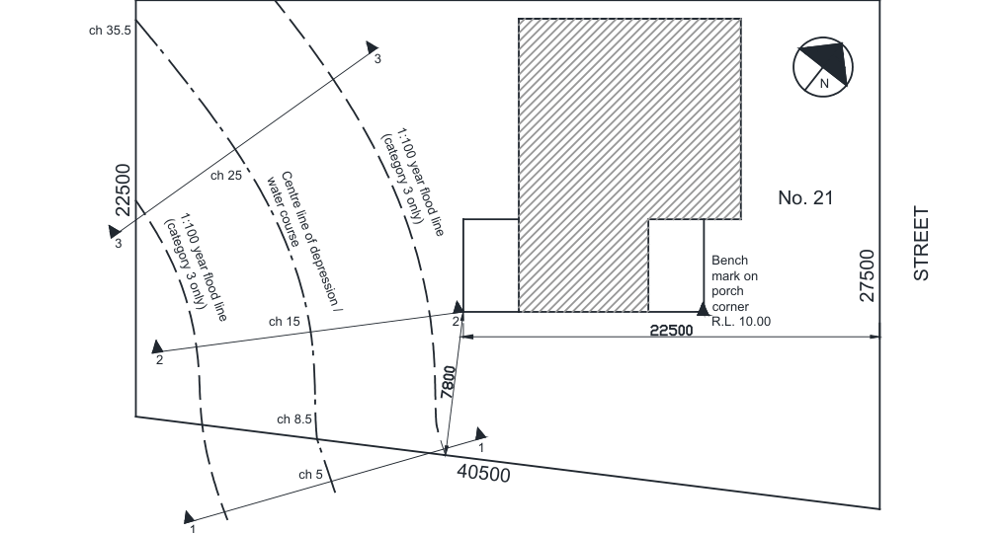
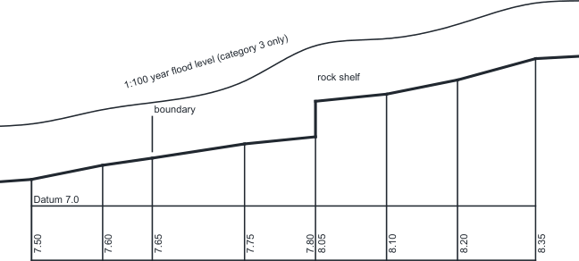
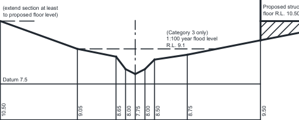

### 24R.3   FLOOD STUDY REQUIREMENTS

#### Controls

A flood study is undertaken to identify the reach and depth of overland

flows associated with drainage systems on or near a site and to assess

the impact of development on such flows and vice versa. Drainage

systems include underground pipes, natural watercourses, open channels

and depressions and seepage. The flood study is to be undertaken by a suitably qualified and

experienced stormwater or hydraulic engineer. It is to conform to

the principles set out in Australian Rainfall and Runoff and the NSW

Floodplain Management Manual and is to include the following

information:

#### Calculations and supporting information

1 A plan of the contributing catchment area and rationale for area

determination is to be submitted. 2 Rationale for time of concentration calculations are to be discussed. 3 A hydrologic model is required to assess the flow discharge arriving

at the site in the 1% AEP event, based on the following:

i) for catchment areas less than 1 Ha, a rational method

assessment is allowed.

ii)	 for catchment areas greater than 1 Ha, an appropriate runoff

routing computer model is to be used (e.g DRAINS, ILSAX etc).

4 Sufficient survey is to be obtained to accurately define the flow limits

and profiles, which may extend onto adjoining properties. 5 A hydraulic model is required to assess the impact of the flow

discharges through the pre-developed and post-developed site.

i) for flow rates of 2m3/s with no backwater effects, the Mannings

Equation may be used.

ii)	 for flow rates greater than 2m3/s and/or with backwater effects,

HEC-RAS or another suitable model is to be used.

6 Where an enclosed drainage system exists in the catchment studied

(and is to be included in the analysis), the overland flow rate is to be

determined as occurring during the greater of:

i) the 1:100 year event with the enclosed system operating at a

maximum of 50% capacity (due to inlet controlled systems and

blockage factors), or

ii)	 the 1:5 year event with the enclosed system fully blocked.

### REFERENCES - WATER MANAGEMENT

### (continued)

#### Controls Information to be included in submission

7 All hydrological and hydraulic calculations undertaken to quantify

the design flood standard and derive the flood levels together with

the catchment map and any other data used in the calculations, as

required above. 8 A scale plan view of the determined flood zone is to be provided at

the same scale as the site survey for:

i) The pre-developed site. This may be overlaid on the existing site

survey plan and the centreline of the watercourse or drainage

depression together with all existing structures and impediments

to flow are to be shown on this detail, and

ii)	 The post-developed site. This is to be overlaid on a plan, at the

same scale as the submitted architectural plans, showing the

footprint of all proposed structures in relation to the determined

flood zone. The centreline chainages of the watercourse or

drainage depression, together with all proposed structures and

impediments to flow, are to be shown on this detail.

9 A minimum of three 1:50 scale cross-sections taken at right angles

to the drainage system, showing both the pre-developed and post-

developed flow sections with all levels to AHD, drawn at the following

chainages:

i) at the upstream property boundary;

ii)	 where the existing and proposed development is closest to the

drainage line;

iii)	 at the downstream extent of the development work; and

iv)	 other cross-sections as needed if other parts of the system affect

the site. Note: Cross-sections are to show existing and proposed levels, top water

levels, hydraulic data, flood extents and critical proposed development

levels such as floor levels. 10 A longitudinal section (at vertical scale 1:50, horizontal scale to that

of plan view) of the drainage system through the property showing

existing and proposed levels, flood levels, hydraulic data and all

changes in grade. 11 The conclusion of the report is to have a signed declaration by the

engineer stating: “I have examined the site, existing improvements and proposed

development. In accordance with accepted engineering practice, I

have undertaken a flood study of the adjacent drainage system and

can confirm the accuracy of my calculated results. I declare that the

proposed development will be safeguarded from flooding and flood

damage associated with the design flood standard as defined in Part

24 of the Ku-ring-gai DCP and will not adversely affect any other

structures or properties.

### (continued)

#### Controls

12 The study is to be submitted in a flood report form which includes

an introduction and reference to the plans for the proposed

development, methodology adopted and a written explanation/

conclusion for findings of the study, together with all supporting

information. The study is to nominate floor levels for the proposed

development, with regard to Council freeboard requirements. Note : Please consult Council’s website for flood studies which have been

completed

### REFERENCES - WATER MANAGEMENT

### (continued)

ch 35.5

> [Picture on page 78: a map, saved as a picture (images/part-24-water-management-page-78-3.gif, 150 dpi); the street names and other small labels are on the picture.]
> Words printed on the picture (title and legend, copied from the PDF):
> 1:100 year flood line
> (category 3 only)
> Centre line of depression /
> 1:100 year flood line
> (category 3 only)
> 1:100 year flood line
> (category 3 only)
> Centre line of depression /
> 1:100 year flood line
> (category 3 only)

3

3 1:100 year flood level (category 3 only)

8.20

.L. on

e

0

5

8.5

15

20

> [Picture on page 78: a picture, saved as a picture (images/part-24-water-management-page-78-14.gif, 150 dpi).]
> Words printed on the picture (title and legend, copied from the PDF):
> rock shelf
> 1:100 year flood level (category 3 only)
> boundary
> Datum 7.0
> rock shelf
> 8.05 8.10 8.20 8.35
> 7.50 7.60 7.65 7.75 7.80
> 1:100 year flood level (category 3 only)

25

30

### LONGITUDINAL SECTION

### H 1:250, V 1:50

Surface R.L. on Centre line

0 5 8.5 15 20 25 30 35.5

Chainage

boundary

LONGITUDINAL SECTION

H 1:250, V 1:50

> [Picture on page 78: a map, saved as a picture (images/part-24-water-management-page-78-26.gif, 150 dpi); the street names and other small labels are on the picture.]
> Words printed on the picture (title and legend, copied from the PDF):
> floor R.L. 10.50
> (extend section at least
> to proposed floor level)
> (Category 3 only)
> 1:100 year flood level
> 8.05 8.10 8.20 8.35
> 15 20 25 30 35.5
> floor R.L. 10.50
> (extend section at least
> to proposed floor level)
> (Category 3 only)
> 1:100 year flood level
> 9.05 8.65 8.00 8.00 8.50 8.75

Datum 7.0

7.50 7.60 7.65

Surface R.L. on Centre line

0 5 8.5

Chainage

Natural surface R.L.

Natural surface R.L. 9.05 8.65 8.00 8.00 8.50 8.75 9.50

7.75

10.50

7

3 1 0.5 0 0.5 1 2.7

6.5

7 3 1 0.5 0 0.5 1 2.7 6.5

Distance left or right of centre line

H 1:250, V 1:50

Distance left or right of centre line

## SECTION 2-2 (LOOKING UPSTREAM)

1:100 Natural (Sections 1-1 and 3-3 are also to be shown on this form)

## SECTION 2-2 (LOOKING UPSTREAM)

1:100 Natural

(Sections 1-1 and 3-3 are also to be shown on this form)

#### Figure 24R.3-1:

#### Typical Survey Information

Proposed structure floor R.L. 10.50

(extend section at least to proposed floor level)

(Category 3 only) 1:100 year flood level R.L. 9.1

Datum 7.5
