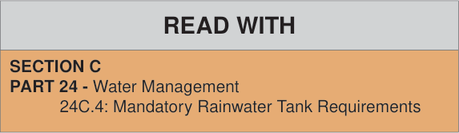

#### 24R 	 References - Water Management

24R.1 	 Design of On-site Detention Systems

(OSD)

24R.2 	Design of Property and Interallotment

Drainage Systems

24R.3 	 Flood Study Requirements

24R.4 	 Terms of Positive Covenants and

Restrictions on use

24R.5	 OSD Exemption Map

> [Picture on page 1: a picture, saved as a picture (images/part-24r-references-water-management-page-1-11.gif, 150 dpi).]

### READ WITH

#### SECTION C

PART 24 - Water Management

24C.4: Mandatory Rainwater Tank Requirements

### REFERENCES - WATER MANAGEMENT
