#### 24R.5 	References

24R.5 	 OSD Exemption Map

### 24R.5

### PART

### REFERENCES

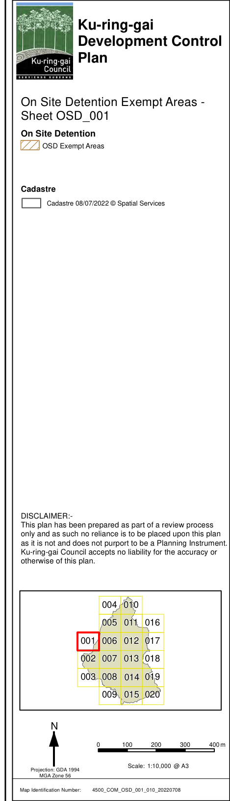

> [Picture on page 32: a map, saved as a picture (images/part-24r-references-water-management-page-32-1.gif, 150 dpi); the street names and other small labels are on the picture.]
> Words printed on the picture (title and legend, copied from the PDF):
> On Site Detention
> OSD Exempt Areas
> Cadastre 08/07/2022 © Spatial Services
> This plan has been prepared as part of a review process
> only and as such no reliance is to be placed upon this plan
> as it is not and does not purport to be a Planning Instrument.
> Ku-ring-gai Council accepts no liability for the accuracy or
> otherwise of this plan.
> 005 011 016
> 001 006 012 017
> 002 007 013 018
> 009 015 020

#### Plan

#### On Site Detention Exempt Areas -

#### Sheet OSD_001

HORNSBY

LGA

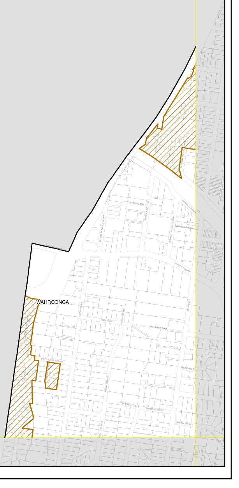

> [Picture on page 32: a map, saved as a picture (images/part-24r-references-water-management-page-32-7.gif, 150 dpi); the street names and other small labels are on the picture.]
> Words printed on the picture (title and legend, copied from the PDF):
> NERINGAH AVENUE NORTH
> BUNDARRA AVENUE SOUTH
> NERINGAH AVENUE SOUTH
> THE GLADE WALK

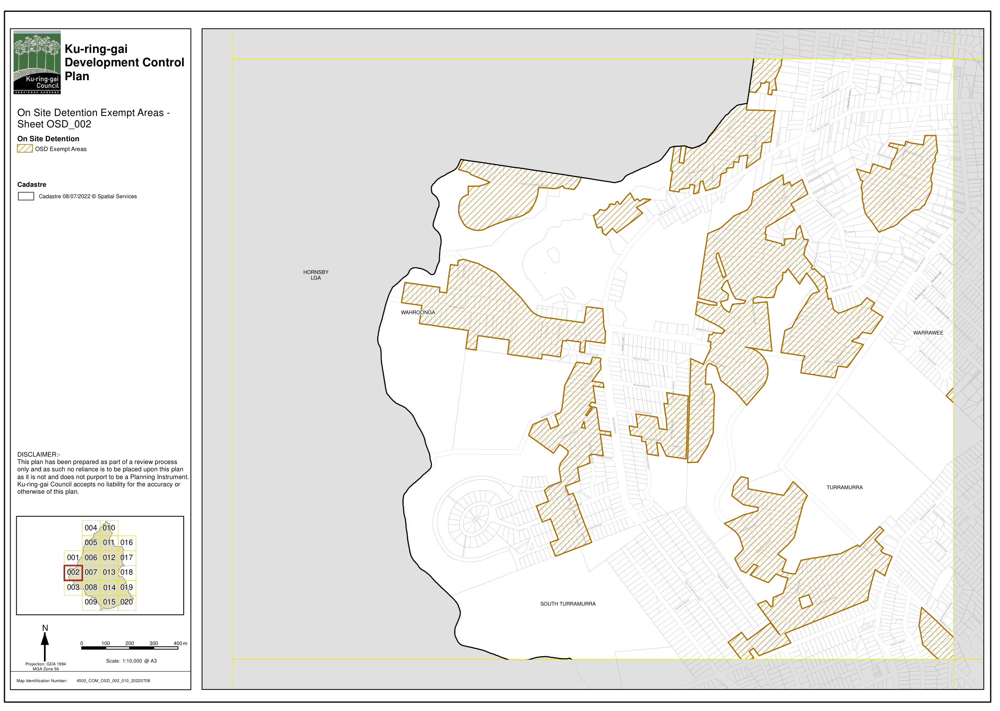

> [Picture on page 33: a map, saved as a picture (images/part-24r-references-water-management-page-33-1.gif, 150 dpi); the street names and other small labels are on the picture.]
> Words printed on the picture (title and legend, copied from the PDF):
> On Site Detention
> OSD Exempt Areas
> Cadastre 08/07/2022 © Spatial Services
> This plan has been prepared as part of a review process
> only and as such no reliance is to be placed upon this plan
> as it is not and does not purport to be a Planning Instrument.
> Ku-ring-gai Council accepts no liability for the accuracy or
> otherwise of this plan.
> 005 011 016
> 001 006 012 017
> 002 007 013 018
> 009 015 020

#### Plan

#### On Site Detention Exempt Areas -

#### Sheet OSD_002

> Words printed on the picture (title and legend, copied from the PDF):
> MOUNT PLEASANT AVENUE
> FOX VALLEY ROAD
> FOX VALLEY ROAD
> FIELD OF MARS AVENUE
> FOX VALLEY ROAD
> DENNIS AVENUE ADA AVENUE SOUTH
> LUCINDA AVENUE SOUTH
> KISSING POINT ROAD

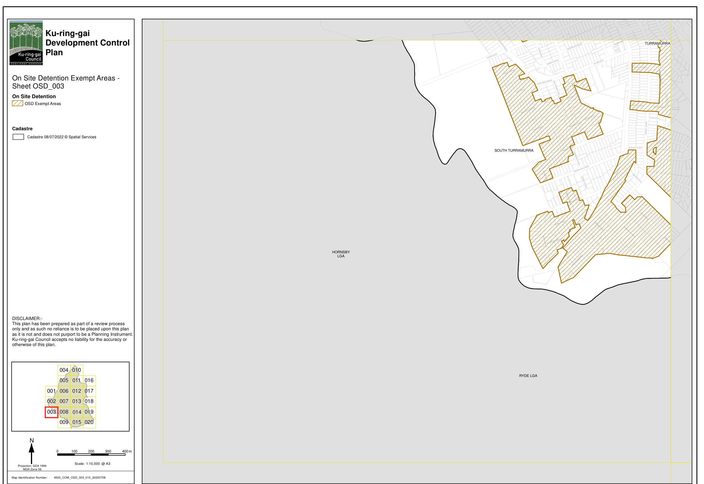

> [Picture on page 34: a map, saved as a picture (images/part-24r-references-water-management-page-34-1.gif, 150 dpi); the street names and other small labels are on the picture.]
> Words printed on the picture (title and legend, copied from the PDF):
> On Site Detention
> OSD Exempt Areas
> Cadastre 08/07/2022 © Spatial Services
> This plan has been prepared as part of a review process
> only and as such no reliance is to be placed upon this plan
> as it is not and does not purport to be a Planning Instrument.
> Ku-ring-gai Council accepts no liability for the accuracy or
> otherwise of this plan.
> 005 011 016
> 001 006 012 017
> 002 007 013 018
> 009 015 020

#### Plan

#### On Site Detention Exempt Areas -

#### Sheet OSD_003

HORNSBY

LGA

> Words printed on the picture (title and legend, copied from the PDF):
> NANCY BIRD AVENUE
> GREY HORSE CLOSE CHISHOLM STREET
> AULUBA LANE TURRAMURRA
> KISSING POINT ROAD

RYDE LGA

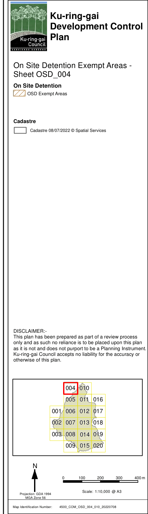

> [Picture on page 35: a picture, saved as a picture (images/part-24r-references-water-management-page-35-1.gif, 150 dpi).]
> Words printed on the picture (title and legend, copied from the PDF):
> On Site Detention
> OSD Exempt Areas
> Cadastre
> Cadastre 08/07/2022 © Spatial Services
> DISCLAIMER:-
> This plan has been prepared as part of a review process
> only and as such no reliance is to be placed upon this plan
> as it is not and does not purport to be a Planning Instrument.
> Ku-ring-gai Council accepts no liability for the accuracy or
> otherwise of this plan.
> N

#### Plan

#### On Site Detention Exempt Areas -

#### Sheet OSD_004

|  | 004 | 010 |  |
|---|---|---|---|
|  | 005 | 011 | 016 |
| 001 | 006 | 012 | 017 |
| 002 | 007 | 013 | 018 |
| 003 | 008 009 | 014 015 | 019 020 |

HORNSBY

LGA

NORTH TURRAMURRA

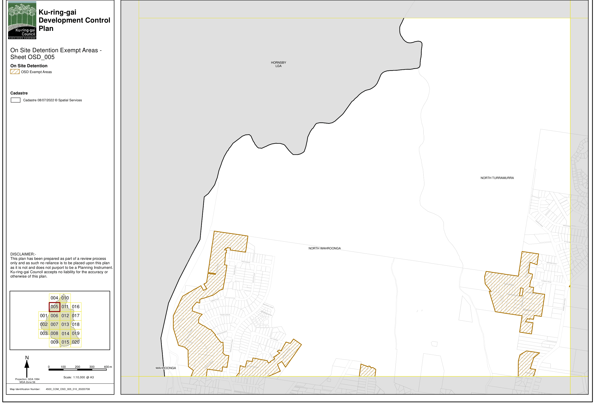

> [Picture on page 36: a map, saved as a picture (images/part-24r-references-water-management-page-36-1.gif, 150 dpi); the street names and other small labels are on the picture.]
> Words printed on the picture (title and legend, copied from the PDF):
> On Site Detention
> OSD Exempt Areas
> Cadastre 08/07/2022 © Spatial Services
> This plan has been prepared as part of a review process
> only and as such no reliance is to be placed upon this plan
> as it is not and does not purport to be a Planning Instrument.
> Ku-ring-gai Council accepts no liability for the accuracy or
> otherwise of this plan.
> 005 011 016
> 001 006 012 017
> 002 007 013 018
> 009 015 020
> SYDNEY NEWCASTLE FREEWAY
> CURTIN AVENUE FADDEN PLACE
> ST COLUMBANS GREEN
> BOBBIN HEAD ROAD

#### Plan

#### On Site Detention Exempt Areas -

#### Sheet OSD_005

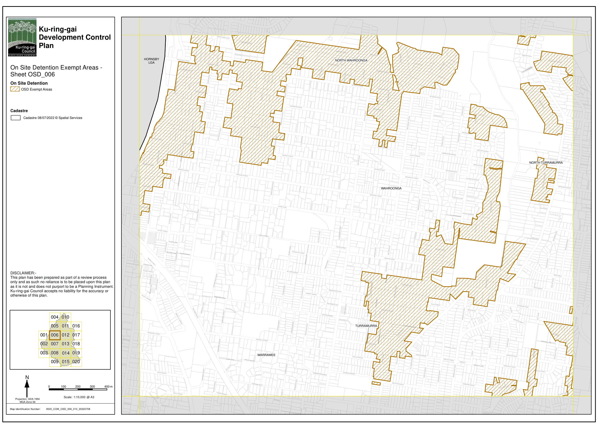

> [Picture on page 37: a map, saved as a picture (images/part-24r-references-water-management-page-37-1.gif, 150 dpi); the street names and other small labels are on the picture.]
> Words printed on the picture (title and legend, copied from the PDF):
> On Site Detention
> OSD Exempt Areas
> Cadastre 08/07/2022 © Spatial Services
> This plan has been prepared as part of a review process
> only and as such no reliance is to be placed upon this plan
> as it is not and does not purport to be a Planning Instrument.
> Ku-ring-gai Council accepts no liability for the accuracy or
> otherwise of this plan.
> 005 011 016
> 001 006 012 017
> 002 007 013 018
> 009 015 020
> MOUNT VIEW PLACE
> COONANBARRA ROAD ILLOURA AVENUE
> YOUNG STREET LARBERT AVENUE
> PARK GROVE LANE
> THE CHASE ROAD
> BOBBIN HEAD ROAD
> VALLEY PARK CRESCENT NORMURRA AVENUE
> SANDFORD ROAD KENT LANE

#### Plan

#### On Site Detention Exempt Areas -

#### Sheet OSD_006

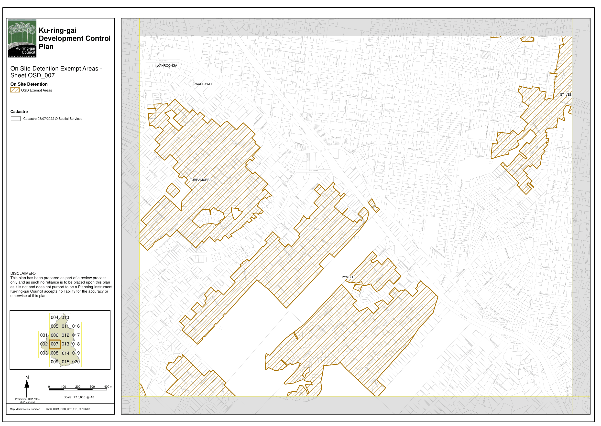

> [Picture on page 38: a map, saved as a picture (images/part-24r-references-water-management-page-38-1.gif, 150 dpi); the street names and other small labels are on the picture.]
> Words printed on the picture (title and legend, copied from the PDF):
> On Site Detention
> OSD Exempt Areas
> Cadastre 08/07/2022 © Spatial Services
> This plan has been prepared as part of a review process
> only and as such no reliance is to be placed upon this plan
> as it is not and does not purport to be a Planning Instrument.
> Ku-ring-gai Council accepts no liability for the accuracy or
> otherwise of this plan.
> 005 011 016
> 001 006 012 017
> 002 007 013 018
> 009 015 020
> FOX VALLEY ROAD
> ST JAMES LANE
> RESERVOIR ROAD AVALON LANE
> WONGA WONGA ST
> WONGA WONGA STREET
> NULLA NULLA ST
> NULLA NULLA ST
> BOBBIN HEAD ROAD
> KISSING POINT ROAD
> BOBBIN HEAD ROAD
> RICHARD PORTER WAY
> KISSING POINT ROAD
> ALMA STREET CHURCH STREET
> POST OFFICE LANE
> POST OFFICE STREET
> KING EDWARD STREET
> DAKARA CLOSE QUADRANT CLOSE
> ST ANDREWS DRIVE

#### Plan

#### On Site Detention Exempt Areas -

#### Sheet OSD_007

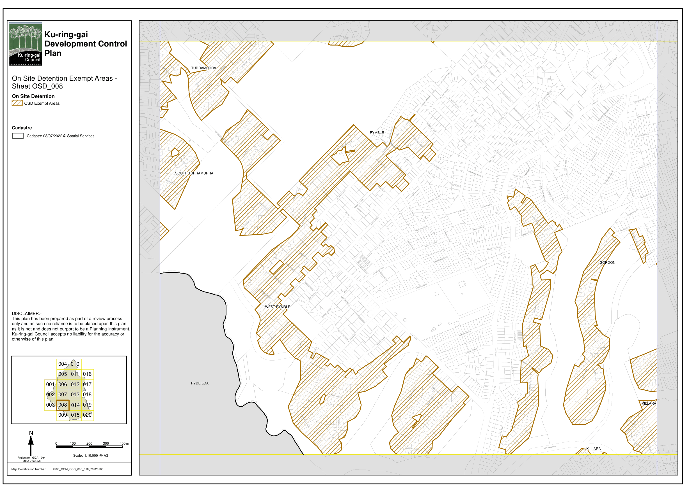

> [Picture on page 39: a map, saved as a picture (images/part-24r-references-water-management-page-39-1.gif, 150 dpi); the street names and other small labels are on the picture.]
> Words printed on the picture (title and legend, copied from the PDF):
> On Site Detention
> OSD Exempt Areas
> Cadastre 08/07/2022 © Spatial Services
> This plan has been prepared as part of a review process
> only and as such no reliance is to be placed upon this plan
> as it is not and does not purport to be a Planning Instrument.
> Ku-ring-gai Council accepts no liability for the accuracy or
> otherwise of this plan.
> 005 011 016
> 001 006 012 017
> 002 007 013 018
> 009 015 020
> THE COMENARRA PARKWAY
> WARROWA AVENUE YARRARA LANE
> LADY GAME DRIVE
> VALE STREET MCINTYRE STREET
> ST JOHNS AVENUE
> LYNN RIDGE AVENUE

#### Plan

#### On Site Detention Exempt Areas -

#### Sheet OSD_008

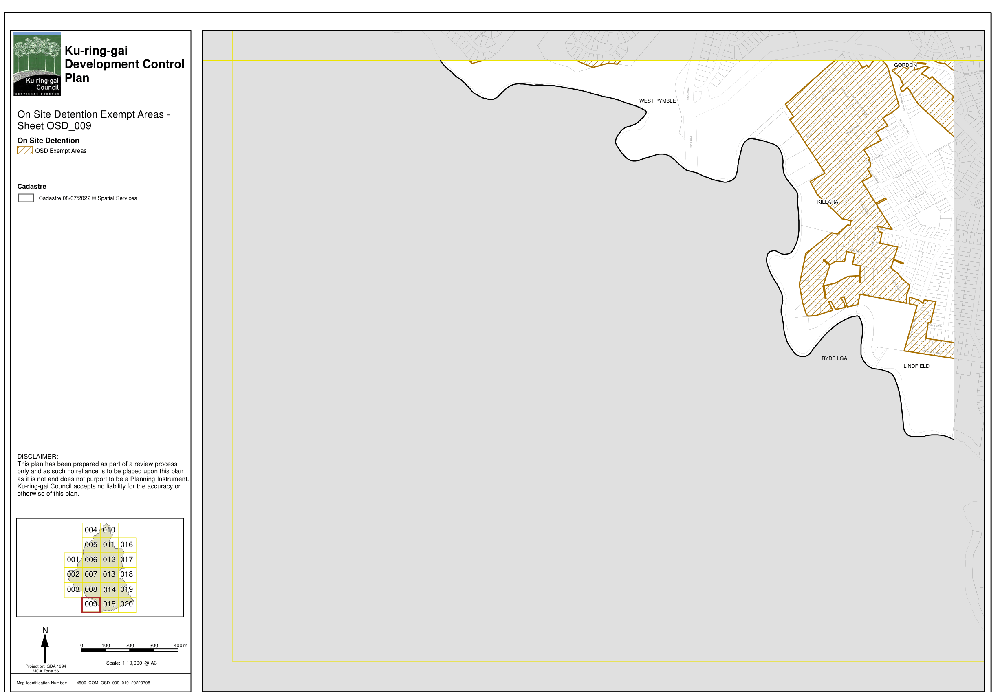

> [Picture on page 40: a picture, saved as a picture (images/part-24r-references-water-management-page-40-1.gif, 150 dpi).]
> Words printed on the picture (title and legend, copied from the PDF):
> On Site Detention
> OSD Exempt Areas
> Cadastre
> Cadastre 08/07/2022 © Spatial Services
> DISCLAIMER:-
> This plan has been prepared as part of a review process
> only and as such no reliance is to be placed upon this plan
> as it is not and does not purport to be a Planning Instrument.
> Ku-ring-gai Council accepts no liability for the accuracy or
> otherwise of this plan.

#### Plan

#### On Site Detention Exempt Areas -

#### Sheet OSD_009

|  | 004 | 010 |  |  |  |
|---|---|---|---|---|---|
|  | 005 | 011 | 016 |  |  |
| 001 | 006 | 012 | 017 |  |  |
| 002 | 007 | 013 | 018 |  |  |
| 003 | 008 | 014 | 019 |  |  |
|  | 009 | 015 | 020 |  |  |
| N |  |  |  |  |  |
| 0 |  | 100 | 200 | 300 | 400 m |
| Projection: GDA 1994 MGA Zone 56 |  | Scale: 1:10,000 @ A3 |  |  |  |

> Words printed on the picture (title and legend, copied from the PDF):
> DE BURGH ROAD
> FIDDENS WHARF ROAD

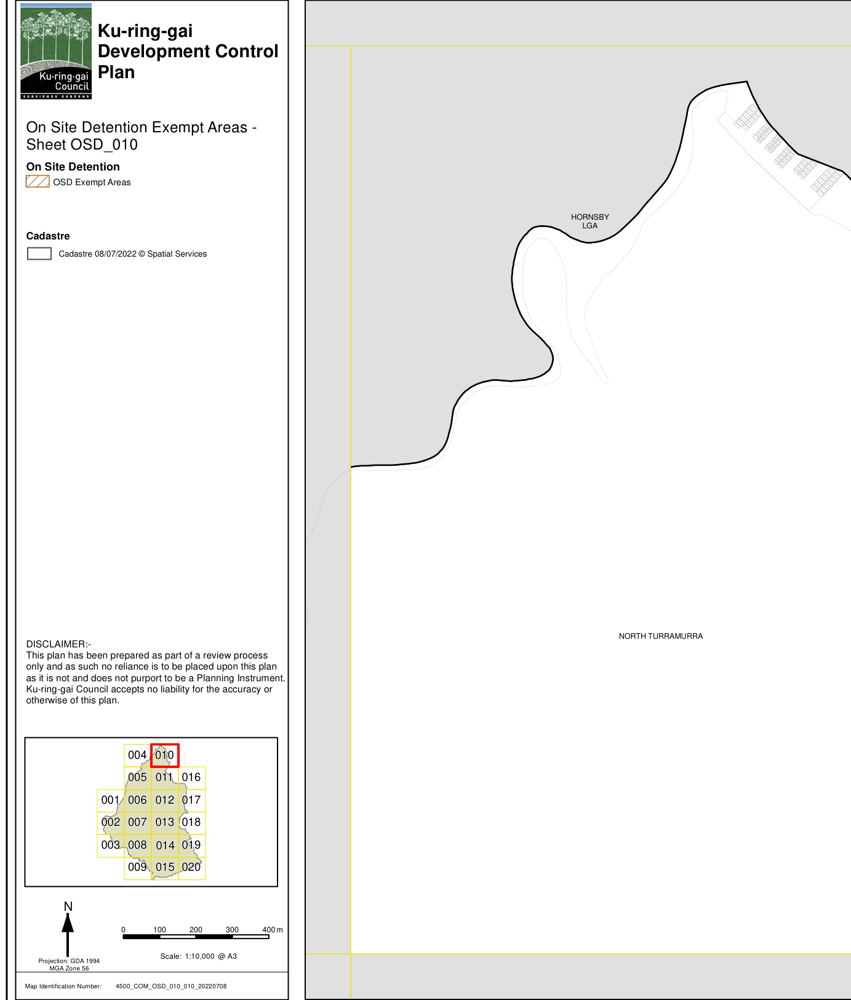

> [Picture on page 41: a map, saved as a picture (images/part-24r-references-water-management-page-41-1.gif, 150 dpi); the street names and other small labels are on the picture.]
> Words printed on the picture (title and legend, copied from the PDF):
> On Site Detention
> OSD Exempt Areas
> Cadastre 08/07/2022 © Spatial Services
> This plan has been prepared as part of a review process
> only and as such no reliance is to be placed upon this plan
> as it is not and does not purport to be a Planning Instrument.
> Ku-ring-gai Council accepts no liability for the accuracy or
> otherwise of this plan.
> 005 011 016
> 001 006 012 017
> 002 007 013 018
> 009 015 020

#### Plan

#### On Site Detention Exempt Areas -

#### Sheet OSD_010

NORTHERN BEACHES LGA

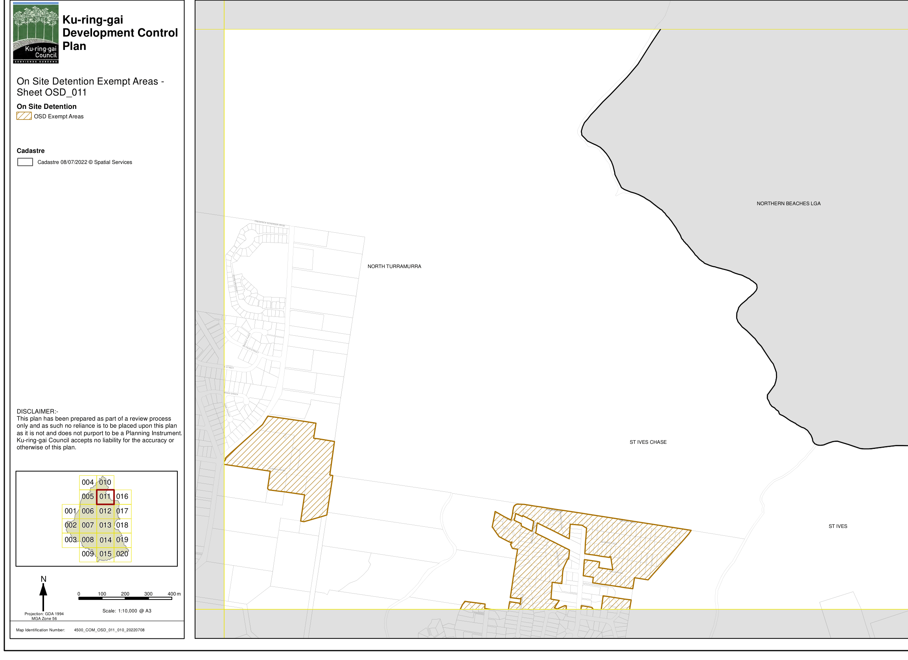

> [Picture on page 42: a map, saved as a picture (images/part-24r-references-water-management-page-42-1.gif, 150 dpi); the street names and other small labels are on the picture.]
> Words printed on the picture (title and legend, copied from the PDF):
> On Site Detention
> OSD Exempt Areas
> Cadastre 08/07/2022 © Spatial Services
> This plan has been prepared as part of a review process
> only and as such no reliance is to be placed upon this plan
> as it is not and does not purport to be a Planning Instrument.
> Ku-ring-gai Council accepts no liability for the accuracy or
> otherwise of this plan.
> 005 011 016
> 001 006 012 017
> 002 007 013 018
> 009 015 020
> FREDERICK SCHERGER DRIVE
> DU FAUR STREET
> ST COLUMBANS GREEN
> NORTHERN BEACHES LGA
> ST IVES CHASE

#### Plan

#### On Site Detention Exempt Areas -

#### Sheet OSD_011

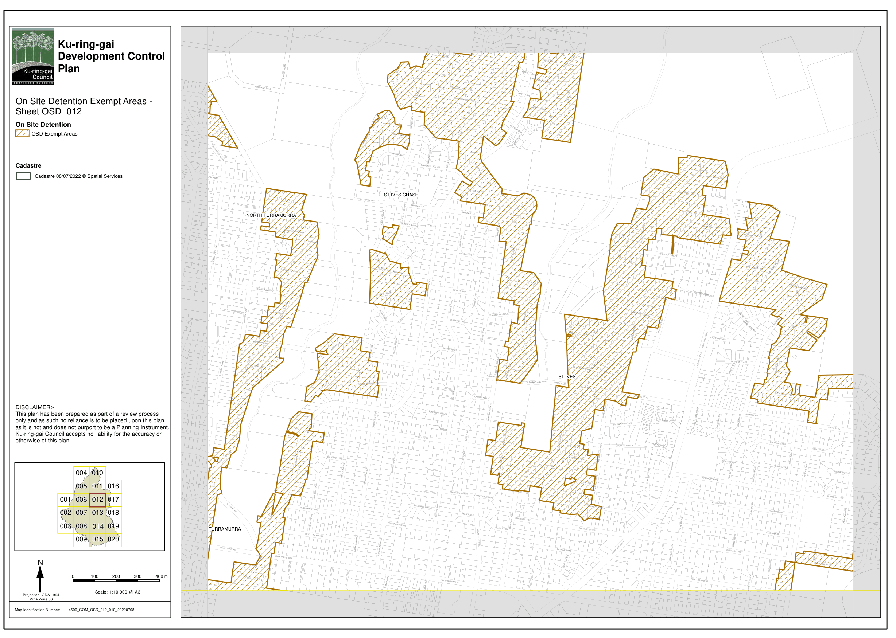

> [Picture on page 43: a map, saved as a picture (images/part-24r-references-water-management-page-43-1.gif, 150 dpi); the street names and other small labels are on the picture.]
> Words printed on the picture (title and legend, copied from the PDF):
> On Site Detention
> OSD Exempt Areas
> Cadastre 08/07/2022 © Spatial Services
> This plan has been prepared as part of a review process
> only and as such no reliance is to be placed upon this plan
> as it is not and does not purport to be a Planning Instrument.
> Ku-ring-gai Council accepts no liability for the accuracy or
> otherwise of this plan.
> 005 011 016
> 001 006 012 017
> 002 007 013 018
> 009 015 020
> ST IVES CHASE
> FAIRVIEW AVENUE THE MALL
> RETIMO CLOSE ROMNEY ROAD
> RALEIGH CRESCENT TOOLANG ROAD
> MONA VALE ROAD
> MONA VALE ROAD
> ROMA ROAD LINIGEN PLACE
> BUENA VISTA WAY
> MONA VALE ROAD
> MONA VALE ROAD
> EDEN VALE CLOSE
> WOODBURY ROAD DARLING STREET

#### Plan

#### On Site Detention Exempt Areas -

#### Sheet OSD_012

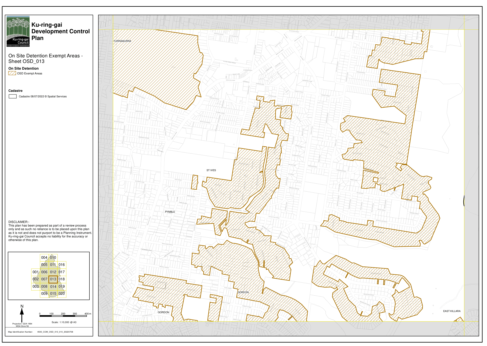

> [Picture on page 44: a map, saved as a picture (images/part-24r-references-water-management-page-44-1.gif, 150 dpi); the street names and other small labels are on the picture.]
> Words printed on the picture (title and legend, copied from the PDF):
> On Site Detention
> OSD Exempt Areas
> Cadastre 08/07/2022 © Spatial Services
> This plan has been prepared as part of a review process
> only and as such no reliance is to be placed upon this plan
> as it is not and does not purport to be a Planning Instrument.
> Ku-ring-gai Council accepts no liability for the accuracy or
> otherwise of this plan.
> 005 011 016
> 001 006 012 017
> 002 007 013 018
> 009 015 020
> MONA VALE ROAD
> MORIAL LANE FIG LANE
> MONA VALE ROAD
> MONA VALE ROAD
> ANATOL PLACE GORDON
> DAINTON AVENUE BRIAR STREET
> MONA VALE ROAD
> MONA VALE ROAD
> VILLAGE GREEN PARADE
> MONA VALE ROAD
> RICHARD ROAD RICHARD ROAD
> MARIANA CLOSE LEVERTON CLOSE
> VALS COURT COREE PLACE
> TOROKINA AVENUE TOROKINA AVENUE
> ANNE MARIE CL LYNBARA AVENUE
> SHEATHER AVENUE HOVEY AVENUE
> LOWRY CRESCENT SUSSEX ROAD
> WOODVALE CLOSE EASTERN ARTERIAL ROAD
> LEAL COURT CAMERON ROAD
> BARRA BRUI CRESCENT

#### Plan

#### On Site Detention Exempt Areas -

#### Sheet OSD_013

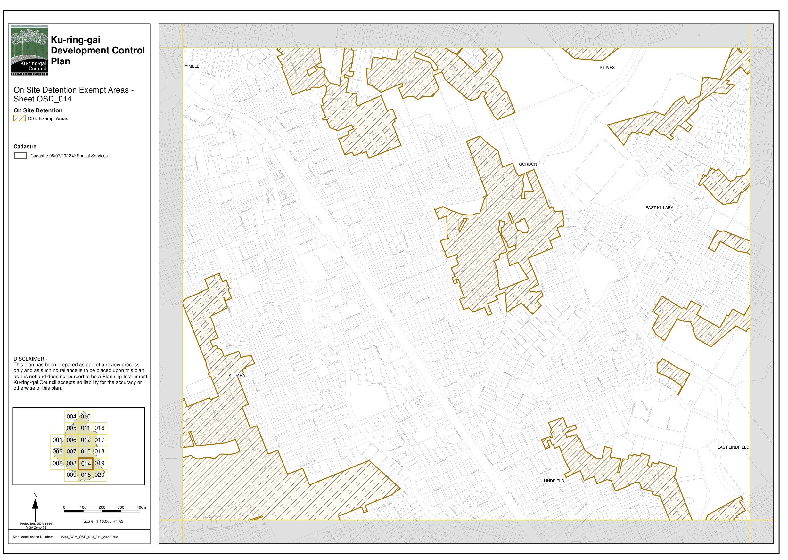

> [Picture on page 45: a map, saved as a picture (images/part-24r-references-water-management-page-45-1.gif, 150 dpi); the street names and other small labels are on the picture.]
> Words printed on the picture (title and legend, copied from the PDF):
> On Site Detention
> OSD Exempt Areas
> Cadastre 08/07/2022 © Spatial Services
> This plan has been prepared as part of a review process
> only and as such no reliance is to be placed upon this plan
> as it is not and does not purport to be a Planning Instrument.
> Ku-ring-gai Council accepts no liability for the accuracy or
> otherwise of this plan.
> 005 011 016
> 001 006 012 017
> 002 007 013 018
> 009 015 020
> MONA VALE ROAD
> GLENVIEW STREET TAYLOR STREET
> MT IDA STREET
> HEATH CLOSE DEAKIN PLACE
> MOUNT WILLIAM STREET
> MOUNT WILLIAM STREET
> FITZSIMONS LANE MT WILLIAM ST BURGOYNE STREET
> STELLA CLOSE WARRINGTON AVENUE
> READING LANE SAIALA ROAD
> BEANS FARM ROAD
> KHARTOUM LANE ROSEDALE ROAD
> WADE LANE KHARTOUM LANE
> MAYTONE AVENUE ILLEROY AVENUE
> ST JOHNS AVENUE
> ST JOHNS LN
> CHURCH HILL LANE
> ST JOHNS AVENUE
> PACIFIC HIGHWAY HENRY STREET
> ST JOHNS WALK
> ST JOHNS AVENUE
> EASTERN ARTERIAL ROAD
> LYNWOOD AVENUE KARRANGA AVENUE
> FIDDENS WHARF ROAD

#### Plan

#### On Site Detention Exempt Areas -

#### Sheet OSD_014

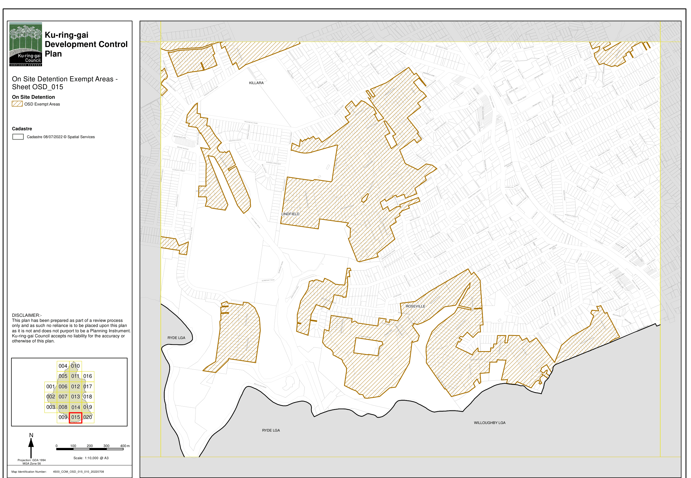

> [Picture on page 46: a map, saved as a picture (images/part-24r-references-water-management-page-46-1.gif, 150 dpi); the street names and other small labels are on the picture.]
> Words printed on the picture (title and legend, copied from the PDF):
> On Site Detention
> OSD Exempt Areas
> Cadastre 08/07/2022 © Spatial Services
> This plan has been prepared as part of a review process
> only and as such no reliance is to be placed upon this plan
> as it is not and does not purport to be a Planning Instrument.
> Ku-ring-gai Council accepts no liability for the accuracy or
> otherwise of this plan.
> 005 011 016
> 001 006 012 017
> 002 007 013 018
> 009 015 020
> GOLF LINKS ROAD
> LADY GAME DRIVE
> FIDDENS WHARF ROAD
> LADY GAME DRIVE
> LADY GAME DRIVE
> MAX ALLEN DRIVE
> TRYON ROAD OWEN STREET
> GRASSMERE ROAD PROVINCIAL ROAD HIGHFIELD LANE
> MIDDLE HARBOUR ROAD
> PROVINCIAL ROAD BAKER PLACE
> MIDDLE HARBOUR ROAD
> MARJORIE STREET ARRUNGA AVENUE
> LOWANA AVENUE CLANVILLE ROAD
> IGNATIUS ROAD POLDING ROAD
> LLEWELLYN STRICKLAND AVENUE
> GROSVENOR ROAD ETON ROAD
> EDENBOROUGH ROAD BENT STREET
> ORTONA ROAD BAYSWATER ROAD
> SIXTH MILE LN
> TOONGARAH ROAD GLEN ROAD

#### Plan

#### On Site Detention Exempt Areas -

#### Sheet OSD_015

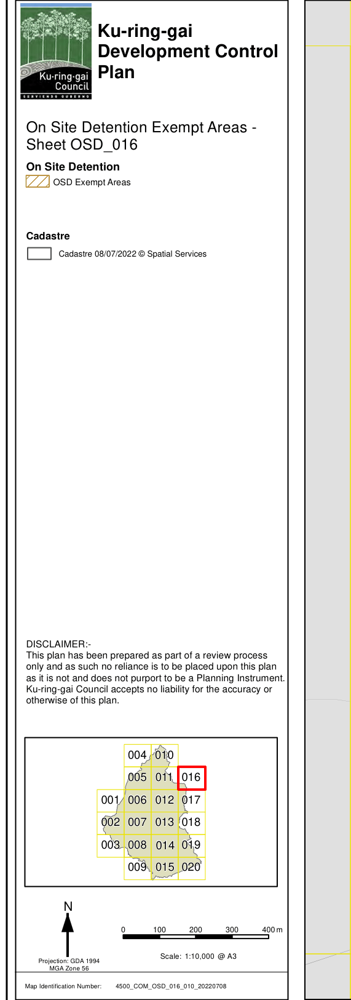

> [Picture on page 47: a picture, saved as a picture (images/part-24r-references-water-management-page-47-1.gif, 150 dpi).]
> Words printed on the picture (title and legend, copied from the PDF):
> On Site Detention
> OSD Exempt Areas
> Cadastre
> Cadastre 08/07/2022 © Spatial Services
> DISCLAIMER:-
> This plan has been prepared as part of a review process
> only and as such no reliance is to be placed upon this plan
> as it is not and does not purport to be a Planning Instrument.
> Ku-ring-gai Council accepts no liability for the accuracy or
> otherwise of this plan.
> N

#### Plan

#### On Site Detention Exempt Areas -

#### Sheet OSD_016

|  | 004 | 010 |  |
|---|---|---|---|
|  | 005 | 011 | 016 |
| 001 | 006 | 012 | 017 |
| 002 | 007 | 013 | 018 |
| 003 | 008 009 | 014 015 | 019 020 |

NORTHERN BEACHES LGA

ST IVES

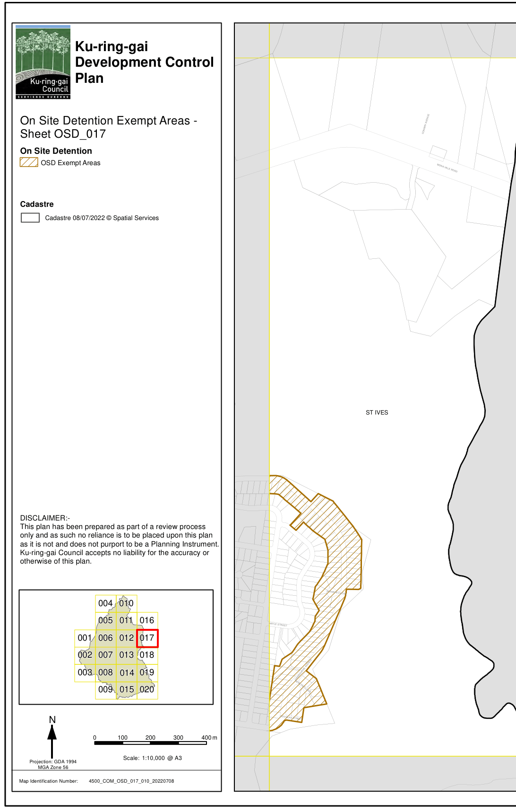

> [Picture on page 48: a map, saved as a picture (images/part-24r-references-water-management-page-48-1.gif, 150 dpi); the street names and other small labels are on the picture.]
> Words printed on the picture (title and legend, copied from the PDF):
> On Site Detention
> OSD Exempt Areas
> Cadastre 08/07/2022 © Spatial Services
> This plan has been prepared as part of a review process
> only and as such no reliance is to be placed upon this plan
> as it is not and does not purport to be a Planning Instrument.
> Ku-ring-gai Council accepts no liability for the accuracy or
> otherwise of this plan.
> MONA VALE ROAD

#### Plan

#### On Site Detention Exempt Areas -

#### Sheet OSD_017

|  | 004 | 010 |  |  |
|---|---|---|---|---|
|  | 005 | 011 | 016 |  |
| 001 | 006 | 012 | 017 |  |
| 002 003 | 007 008 009 | 013 014 015 | 018 019 020 |  |
| N |  |  |  |  |
| 0 |  | 100 | 200 | 300 400 m |
| Projection: GDA 1994 MGA Zone 56 |  | Scale: 1:10,000 @ A3 |  |  |
| Map Identification Number: 4500_COM_OSD_017_010_20220708 |  |  |  |  |

NORTHERN BEACHES LGA

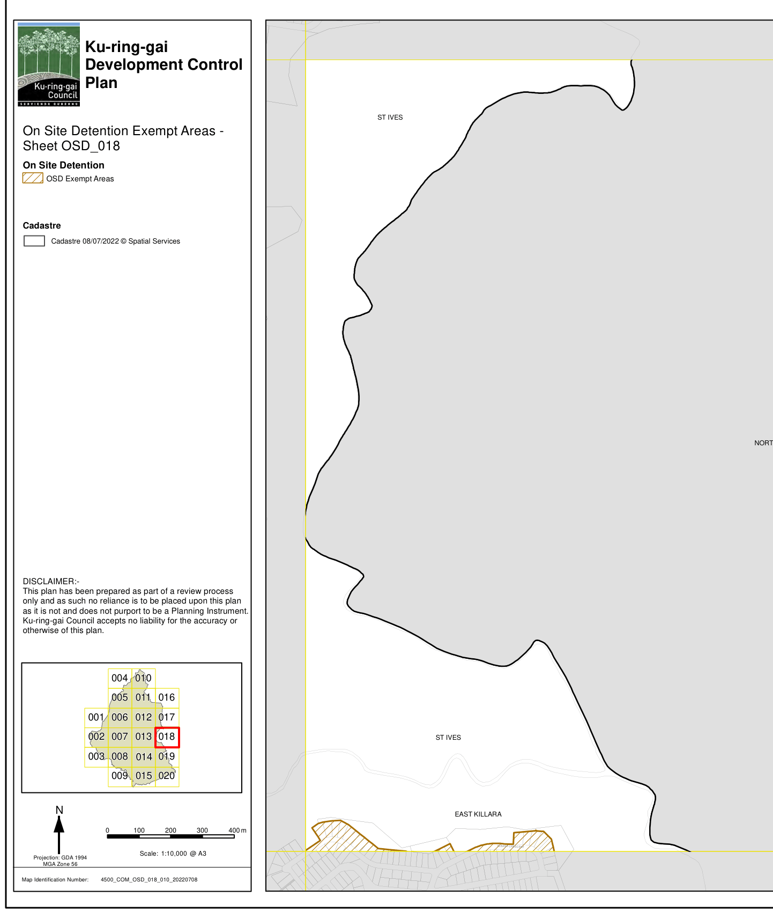

> [Picture on page 49: a map, saved as a picture (images/part-24r-references-water-management-page-49-1.gif, 150 dpi); the street names and other small labels are on the picture.]
> Words printed on the picture (title and legend, copied from the PDF):
> On Site Detention
> OSD Exempt Areas
> Cadastre 08/07/2022 © Spatial Services
> This plan has been prepared as part of a review process
> only and as such no reliance is to be placed upon this plan
> as it is not and does not purport to be a Planning Instrument.
> Ku-ring-gai Council accepts no liability for the accuracy or
> otherwise of this plan.
> 005 011 016
> 001 006 012 017
> 002 007 013 018
> 009 015 020

#### Plan

#### On Site Detention Exempt Areas -

#### Sheet OSD_018

NORTHERN BEACHES LGA

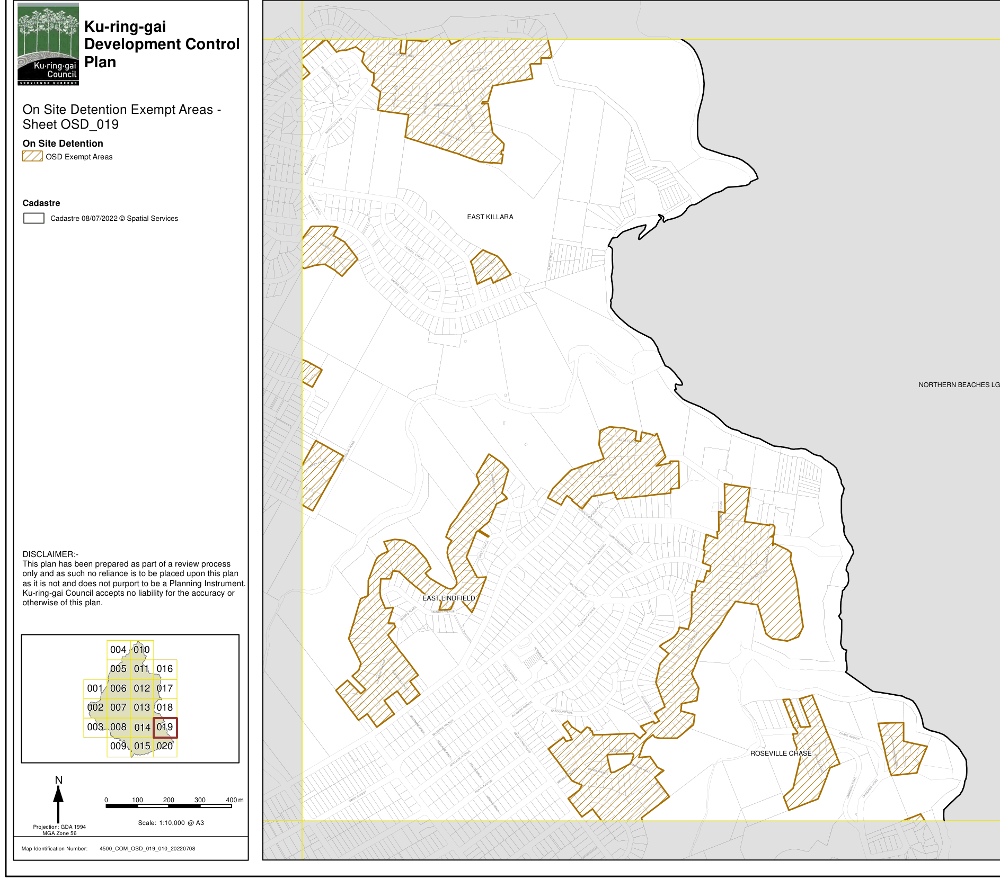

> [Picture on page 50: a map, saved as a picture (images/part-24r-references-water-management-page-50-1.gif, 150 dpi); the street names and other small labels are on the picture.]
> Words printed on the picture (title and legend, copied from the PDF):
> On Site Detention
> OSD Exempt Areas
> Cadastre 08/07/2022 © Spatial Services
> This plan has been prepared as part of a review process
> only and as such no reliance is to be placed upon this plan
> as it is not and does not purport to be a Planning Instrument.
> Ku-ring-gai Council accepts no liability for the accuracy or
> otherwise of this plan.
> 005 011 016
> 001 006 012 017
> 002 007 013 018
> 009 015 020
> JINDALEE PLACE MURRUMBA PLACE
> BRISBANE WALK BRISBANE AVENUE
> NORTHERN BEACHES LGA

#### Plan

#### On Site Detention Exempt Areas -

#### Sheet OSD_019

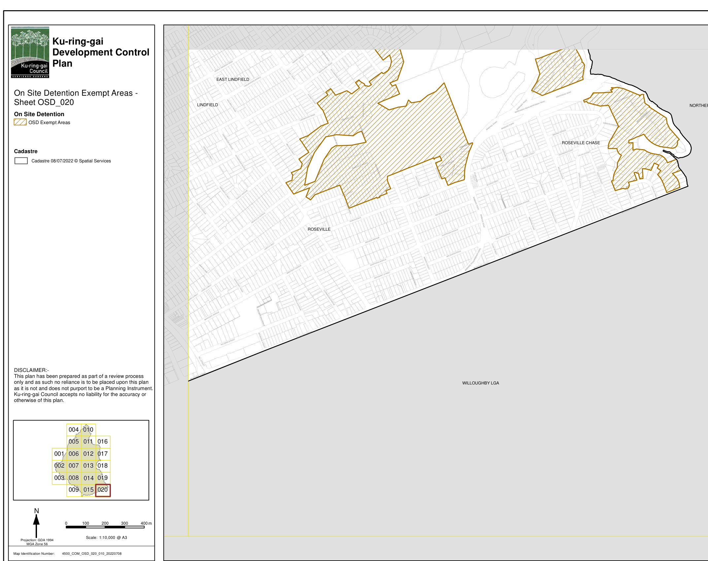

> [Picture on page 51: a map, saved as a picture (images/part-24r-references-water-management-page-51-1.gif, 150 dpi); the street names and other small labels are on the picture.]
> Words printed on the picture (title and legend, copied from the PDF):
> On Site Detention
> OSD Exempt Areas
> Cadastre 08/07/2022 © Spatial Services
> This plan has been prepared as part of a review process
> only and as such no reliance is to be placed upon this plan
> as it is not and does not purport to be a Planning Instrument.
> Ku-ring-gai Council accepts no liability for the accuracy or
> otherwise of this plan.
> 005 011 016
> 001 006 012 017
> 002 007 013 018
> 009 015 020
> MIDDLE HARBOUR ROAD
> BRIDGE PASSAGE  LANE
> KOONGARA ROAD CALGA STREET

#### Plan

#### On Site Detention Exempt Areas -

#### Sheet OSD_020

NORTHERN BEACHES LGA
