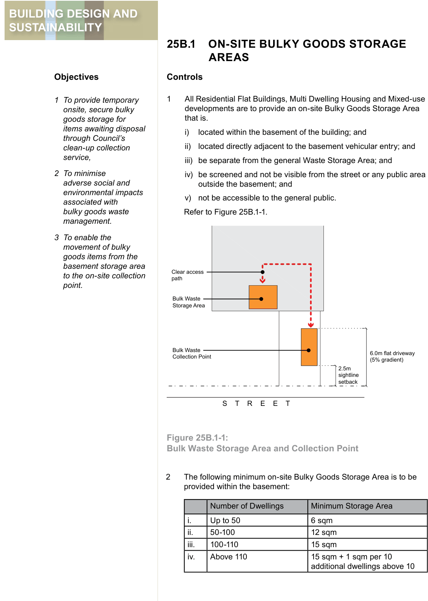

#### 25B		 Bulky Goods Waste

25B.1	 	On-site Bulky Goods Storage Area 25B.2	 	On-Site Temporary Bulky Goods Collection Point

### BULKY GOODS WASTE

> [Picture on page 16: a map, saved as a picture (images/part-25-waste-management-page-16-1.gif, 150 dpi); the street names and other small labels are on the picture.]
> Words printed on the picture (title and legend, copied from the PDF):
> 1	 To provide temporary
> onsite, secure bulky
> goods storage for
> items awaiting disposal
> 2	 To minimise
> adverse social and
> bulky goods waste
> 3	 To enable the
> movement of bulky
> goods items from the
> basement storage area
> to the on-site collection
> outside the basement; and
> 6.0m flat driveway
> provided within the basement:

Figure 25B.1-1:

#### Objectives

ol Plan

### 25B.1    ON-SITE BULKY GOODS STORAGE

### AREAS

#### Controls

All Residential Flat Buildings, Multi Dwelling Housing and Mixed-use

developments are to provide an on-site Bulky Goods Storage Area

that is.

located within the basement of the building; and

i)

ii)	 located directly adjacent to the basement vehicular entry; and

iii)	 be separate from the general Waste Storage Area; and

iv)	 be screened and not be visible from the street or any public area

v)	 not be accessible to the general public. Refer to Figure 25B.1-1.

#### Bulk Waste Storage Area and Collection Point

The following minimum on-site Bulky Goods Storage Area is to be

|  | Number of Dwellings | Minimum Storage Area |
|---|---|---|
| i. | Up to 50 | 6 sqm |
| ii. | 50-100 | 12 sqm |
| iii. | 100-110 | 15 sqm |
| iv. | Above 110 | 15 sqm + 1 sqm per 10 additional dwellings above 10 |

### 25B.1    ON-SITE BULKY GOODS STORAGE

### AREAS (CONTINUED)

#### Controls

3 The Bulky Goods Storage area is to be:

i) a room or a caged area; and

ii)	 have a minimum doorway width of 2 metres; and

iii)	 have instructive signage regarding storage and collection of

bulky items.

4 The instructive signage displayed at the Bulky Goods Storage area

is to:

i) provide contact details for the Building Manager; and

ii)	 clearly label the room as ‘Bulky Goods Storage’; and

iii)	 provide instruction on the storage of bulky goods; and

iv)	 indicate the route to the ‘Bulky Goods Collection Point’; and

v)	 provide instruction on the timing and responsibility of movement

of bulky goods from the Bulky Goods Storage area to the on-site

Bulky Goods Collection Point.

### WASTE AND RECYCLING

#### Objectives

1	 To ensure efficient

collection of bulky goods

from the on-site collection

points by Council

collection contractors. 2	 To ensure the storage and

collection of bulky goods

does not impact on the

landscape setting and

deep soil provisions of the

residential development; 3	 To maintain a high quality

streetscape that reflects

the Ku-ring-gai character

of buildings in a landscape

setting including canopy

trees.

### 25B.2    ON-SITE TEMPORARY BULKY GOODS

### COLLECTION POINT

#### Controls

1 All Multi-Unit and Residential Flat Building developments are to

provide an on-site Bulky Goods Collection Point as part of the entry

access driveway, a separate hardstand area is not permitted. 2 The Bulky Goods Collection Point:

i) is to be located on the exit of the driveway within the front

setback, close to the street boundary; and

ii)	 is to be setback 2.5m from the street boundary to maintain

sitelines; and

iii)	 is to have a maximum 5% gradient in any direction; and

iv)	 is to measure a minimum 2.0m wide x 3.5m long; and

v)	 is to be line marked as a designated Bulky Goods Collection

Point; and

vi)	 is not to prevent access to and from the basement car park, and

maintain at least one travel lane at all times while temporary

storage of bulky goods takes place on the driveway. Refer to Figure 25B.1-1.

Note: Conditions of consent will require that all bulky goods waste

material is placed on the on-site Bulky Goods Collection Point ready for

collection. Materials placed on the footpath will not be collected and will

incur a penalty fine.

Note: Bulky Goods Waste will only be collected from the on-site

Collection Point. Any waste outside the development boundary will not

be collected.
