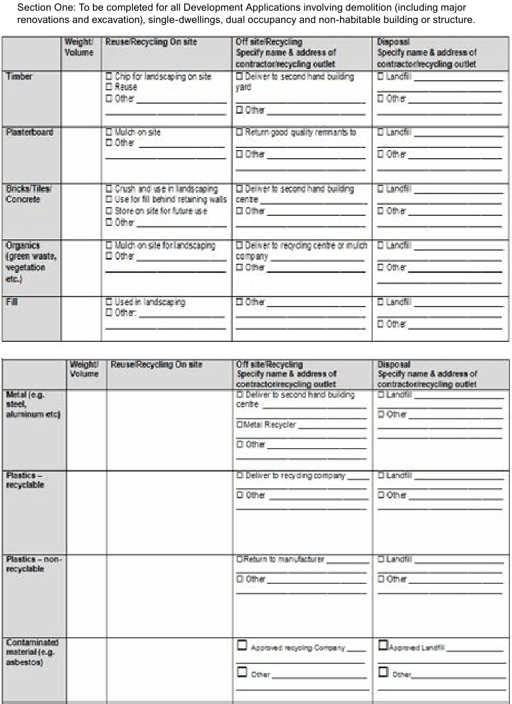
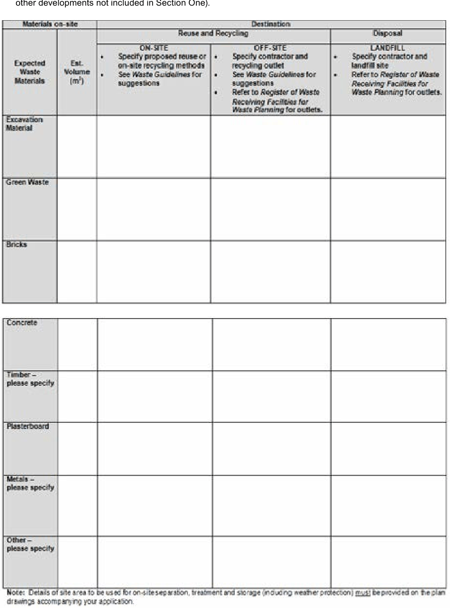
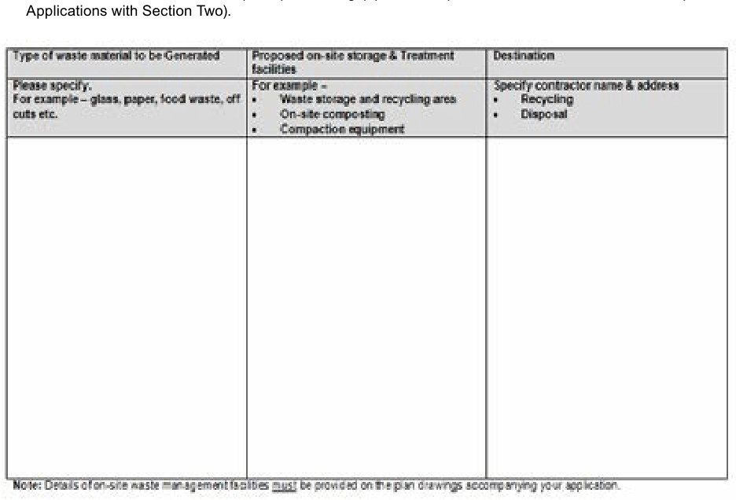
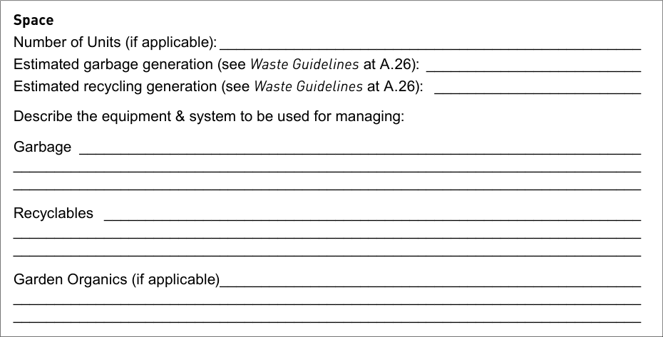
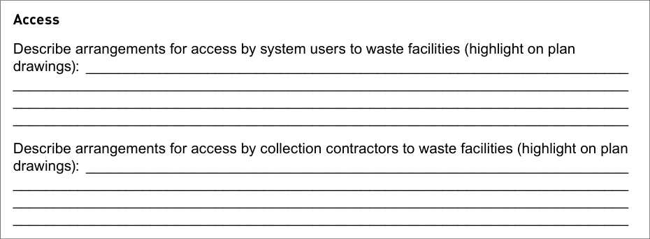

## 2 Internal Road Geometry

The design parameters covered in AS2890.2 Off Street Parking – Part 2

Commercial Vehicle Facility is to be complied with.

### 25R.4  WHAT IS A WASTE MANAGEMENT

### PLAN?

1 A waste management plan (WMP) is a checklist that provides

Council with details of the following:

i) the volume and type of waste to be generated;

ii)	 how the waste is to be stored and treated on site;

iii)	 how and where the non-reusable, or recyclable residual, is to be

disposed of; and

iv)	 how ongoing waste management for the site will operate. Completion of the WMP will help to determine what materials are on

the site and how and where they will be stored, re-used/recycled and

eventually disposed of. A list of local outlets and other waste disposal

facilities can be obtained from Council’s ‘Register of Waster Receiving

Facilities for Waste Planning’ and from the Waste Service NSW recycling

directory. A copy of the proforma WMP follows. Further copies can be obtained

from Council’s Customer Service counter or from Council’s website

(www.krg.gov.au).

### REFERENCES

### REFERENCES - WASTE MANAGMENT

### 25R.5  WASTE MANAGEMENT PLAN

To be completed for all Developer Applications: To facilitate sustainable waste management and waste reduction, Council

requires on-site sorting and storage of waste products pending re-use or

collection. Completing this proforma will assist you in identifying the type

of waste that will be generated and in advising Council how you intend to

reuse, recycle or dispose of your waste.

#### A2.5 Waste Management Plan To be completed for all Development Applications.

The information provided on the proforma (and on your accompanied

plans) will be assessed against the design objectives of the DCP (e.g. to

maximise reuse and minimise disposal where possible) and the relevant

controls for your particular use. If space is insufficient in the table please provide attachments.

To facilitate sustainable waste management and waste reduction, Council requires on-site sorting and storage of waste products pending reuse or collection.  Completing this proforma will assist you in identifying the type of waste that will be generated and in advising Council how you intend to reuse, recycle or dispose of your waste.

The information provided on the proforma (and on your accompanied plans) will be assessed against the design objectives of the DCP (e.g. to maximise reuse and minimise disposal where possible) and the relevant controls for your particular use.

If space is insufficient in the table please provide attachments.

Outline of Proposal

Applicant’s Name & Address: __________________________________________________ __________________________________________________________________________ Phone:   ____________________________Fax:  __________________________________ Site Address:  ______________________________________________________________ Buildings & other structures currently on the site:  __________________________________ __________________________________________________________________________ __________________________________________________________________________ Builders Name & Address: ____________________________________________________ __________________________________________________________________________ Brief Description of Proposal: __________________________________________________ __________________________________________________________________________ __________________________________________________________________________ __________________________________________________________________________ The details provided on this form are your intentions for managing waste relating to this project. Signature of Applicant: __________________________   Date: _______________________

### REFERENCES

### REFERENCES - WASTE MANAGMENT

> [Picture on page 7: a picture, saved as a picture (images/part-25r-references-waste-managment-page-7-3.gif, 150 dpi).]
> Words printed on the picture (title and legend, copied from the PDF):
> Section One: To be completed for all Development Applications involving demolition (including major
> renovations and excavation), single-dwellings, dual occupancy and non-habitable building or structure.

Section Two: Construction Stage (To be completed and submitted with all Development Applications for all

> [Picture on page 8: a picture, saved as a picture (images/part-25r-references-waste-managment-page-8-2.gif, 150 dpi).]
> Words printed on the picture (title and legend, copied from the PDF):
> other developments not included in Section One).

Section Three: Use of Premises (Occupation Stage) (To be completed and submitted with all development

> [Picture on page 9: a picture, saved as a picture (images/part-25r-references-waste-managment-page-9-2.gif, 150 dpi).]
> Words printed on the picture (title and legend, copied from the PDF):
> Applications with Section Two).

### REFERENCES

### REFERENCES - WASTE MANAGMENT

Section Four: On Going Management (To be completed and submitted with Sections Two and Three).

> [Picture on page 10: a picture, saved as a picture (images/part-25r-references-waste-managment-page-10-2.gif, 150 dpi).]
> Words printed on the picture (title and legend, copied from the PDF):
> ____________________________________________________________________________
> ____________________________________________________________________________
> Recyclables _ _________________________________________________________________
> ____________________________________________________________________________
> ____________________________________________________________________________
> ____________________________________________________________________________

#### Space

Number of Units (if applicable):____________________________________________________ Estimated garbage generation (see Waste Guidelines at A.26): ___________________________ Estimated recycling generation (see Waste Guidelines at A.26): _ _________________________ Describe the equipment & system to be used for managing: Garbage _____________________________________________________________________

____________________________________________________________________________ Garden Organics (if applicable)_ __________________________________________________

> [Picture on page 10: a picture, saved as a picture (images/part-25r-references-waste-managment-page-10-11.gif, 150 dpi).]
> Words printed on the picture (title and legend, copied from the PDF):
> drawings): ____________________________________________________________________
> ____________________________________________________________________________
> ____________________________________________________________________________
> drawings): ____________________________________________________________________
> ____________________________________________________________________________
> ____________________________________________________________________________
> ____________________________________________________________________________

#### Access

Describe arrangements for access by system users to waste facilities (highlight on plan

____________________________________________________________________________ Describe arrangements for access by collection contractors to waste facilities (highlight on plan

#### Amenity

Describe how noise associated with residents using bins, collection contractors emptying the

bins has been minimised: ________________________________________________________

____________________________________________________________________________

____________________________________________________________________________

____________________________________________________________________________ Describe the ventilation of waste storage areas (highlight on plan drawings): _ ______________

____________________________________________________________________________

____________________________________________________________________________

____________________________________________________________________________ Describe facilities for washing bins and waste storage areas (highlight on plan drawings): _____

____________________________________________________________________________

### 25R.6  WASTE GUIDELINES

| Type of Premises | Garbage Generation | Recycling Generation |
|---|---|---|
| Food premises |  |  |
| Butcher | 80L/100m2 floor area/ day | Information not available |
| Delicatessen | 80L/100m2 floor area/ day | Information not available |
| Fish shop | 80L/100m2 floor area/ day | Information not available |
| Greengrocer | 240 L/100m2 floor area/day | 120L/100m2 floor area/ day |
| Restaurants | 660L/100m2 floor area/day | 130L/100m2 floor area/ day |
| Supermarkets | 660L/100m2 floor area/day | 240L/100m2 floor area/ day |
| Takeaway | 80L/100m2 floor area/ day | Information not available |
| Retail (non-food sales) |  |  |
| Shops with less than 100m2 floor area | 50L/100m2 floor area/ day | 25L/100m2 floor area/ day |
| Shops with over 100m2 floor area | 50L/100m2 floor area/ day | 50L/100m2 floor area/ day |
| Showrooms | 40L/100m2 floor area/ day | 10L/100m2 floor area/ day |
| Hairdresser | 60L/100m2 floor area/ day | Information not available |
| Other |  |  |
| Backpacker accommodation | 40L/occupant/week | 20L/occupant/week |
| Boarding house/ guesthouse | 60L/occupant/week | 20L/occupant/week |
| Offices | 10L/100m2/day | 10L/100m2/day |
| Hotel | 5L/bed/day50L 100m2 floor area/day 660L/100m2 dining area/day | 50L/100m2 of bar and dining areas/day |
| Licensed club | 50L/100m2 floor area/ day | 50L/100m2 of bar and diningareas/day |
| Motel (without public restaurant) | 5L/bed/day 660L/100m2 dining area/day | 1L/bed/day |

Better Practice Guide for Waste Management in Multi-Unit Dwellings.

The current standard NSW commercial waste generation rates are those

established by the Combined Sydney Region of Councils. For further

information on commercial waste generation rates as they become

available, please refer to www.environment.nsw.gov.au

### REFERENCES

### REFERENCES - WASTE MANAGMENT
