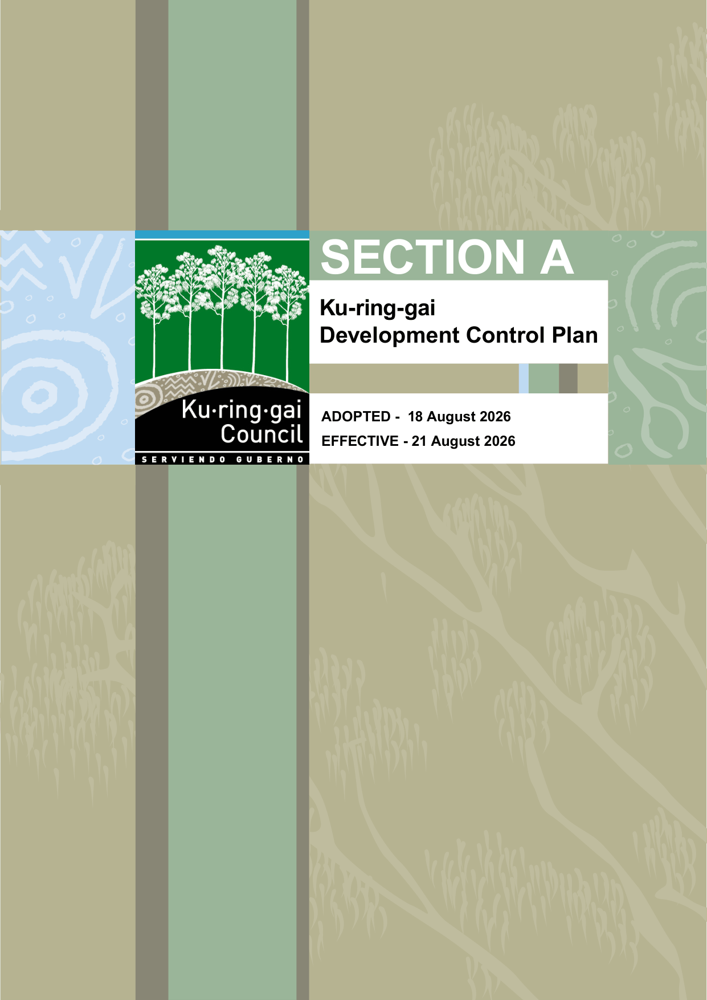
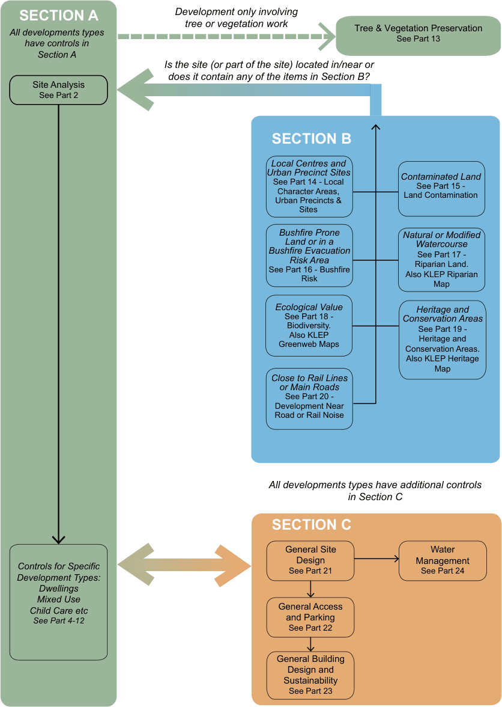

# Ku-ring-gai Development Control Plan - Section A Cover and Contents - Section A

Source PDF: [cover-and-contents-section-a.pdf](https://planfortomorrow.sharepoint.com/sites/Planfortomorrow/Shared%20Documents/00%20NSW-Planning-Resources/dcp/ku-ring-gai-development-control-plan/section-a-cover-and-contents/cover-and-contents-section-a.pdf)

> [Picture on page 1: a picture, saved as a picture (images/section-a-cover-and-contents-page-1-1.gif, 150 dpi).]

### SECTION A

### Ku-ring-gai

### Development Control Plan

#### ADOPTED -  18 August 2026 EFFECTIVE - 21 August 2026

#### HOW TO USE THE DCP

Definitions and

#### INTRODUCTION

What is in this DCP

Abbreviations See Part 1B - Dictionary

See Part 1

> [Picture on page 2: a map, saved as a picture (images/section-a-cover-and-contents-page-2-8.gif, 150 dpi); the street names and other small labels are on the picture.]
> Words printed on the picture (title and legend, copied from the PDF):
> Development only involving
> tree or vegetation work
> Tree & Vegetation Preservation
> All developments types
> See Part 13
> have controls in
> Is the site (or part of the site) located in/near or
> does it contain any of the items in Section B?
> See Part 2
> Local Centres and
> Urban Precinct Sites
> See Part 14 - Local
> See Part 15 -
> Urban Precincts &
> Natural or Modified
> Land or in a
> See Part 16 - Bushfire
> See Part 17 -
> Also KLEP Riparian
> See Part 18 -
> See Part 19 -
> Also KLEP Heritage
> Close to Rail Lines
> or Main Roads
> See Part 20 -
> Road or Rail Noise
> All developments types have additional controls
> in Section C
> See Part 21
> See Part 24
> Controls for Specific
> Child Care etc
> See Part 4-12
> See Part 22
> See Part 23

#### SECTION A

#### SECTION B

#### SECTION C

#### KEY:

#### SECTION B

#### SECTION C

ii

|  | C |
|---|---|
| SECTION A PART 2 SITE ANALYSIS Introduction......................................................................................... p2-2 2.1 Site Analysis ...................................................................................... p2-3 PART 3 LAND CONSOLIDATION AND SUBDIVISION Introduction......................................................................................... p3-2 3A General Controls for Consolidation and Subdivision ......... p3-3 3A.1 Lot Shape, Orientation and Design .......................................... p3-4 3A.2 Minimum Lot Depth for Bushfire Prone Land........................... p3-5 3A.3 Building Footprint......................................................................... p3-9 3A.4 Trees and Vegetation.................................................................. p3-10 3A.5 Access.......................................................................................... p3-11 3A.6 Infrastructure................................................................................ p3-14 3B Land Consolidation................................................................. p3-17 3C Strata and Community Title Subdivision .............................. p3-21 3R References................................................................................ p3-23 3R.1 Minimum Lot Depth Maps........................................................... p3-24 PART 4 DWELLING HOUSES Introduction......................................................................................... p4-2 4A Site Design ............................................................................... p4-3 4A.1 Local Character and Streetscape .............................................. p4-4 4A.2 Building Setbacks ........................................................................ p4-6 4A.3 Built-Upon Area ........................................................................... p4-12 4A.4 Landscaping ................................................................................ p4-14 4B Access and Parking ................................................................ p4-15 4B.1 Vehicle Access ............................................................................ p4-16 4B.2 Car Parking Provision ................................................................. p4-17 4B.3 Carports and Garages ................................................................ p4-18 4C Building Design and Sustainability ....................................... p4-21 4C.1 Building Envelopes ...................................................................... p4-22 4C.2 Building Facades ......................................................................... p4-24 4C.3 First Floor Design and Roof Forms ........................................... p4-26 4C.4 Private Open Space .................................................................... p4-28 4C.5 Solar Access ................................................................................ p4-29 4C.6 Natural Ventilation ....................................................................... p4-30 4C.7 Ancillary Facilities ....................................................................... p4-31 | CONTENTS |
| Ku-ring-gai Development Control Plan | iii |

iv

| 4C.8 Fencing ......................................................................................... p4-35 4C.9 Waste Management..................................................................... p4-37 4C.10 Materials and Finishes................................................................. p4-38 PART 4.1 SECONDARY DWELLINGS Introduction......................................................................................... p5-2 4.1A Site Design ............................................................................... p5-3 4.1A.1 General ......................................................................................... p5-4 4.1A.2 Site Layout ................................................................................... p5-5 4.1A.3 Building Setbacks and Separation ............................................ p5-7 4.1B Access and Parking ................................................................ p5-11 4.1B.1 Access .......................................................................................... p5-12 4.1B.2 Car Parking Provision ................................................................. p5-14 4.1C Building Design and Sustainability ....................................... p5-15 4.1C.1 Solar Access ................................................................................ p5-16 4.1C.2 Private Open Space .................................................................... p5-17 4.1C.3 Building Envelopes ...................................................................... p5-18 4.1C.4 Building and Room Sizes ........................................................... p5-19 4.1C.5 Building Appearance ................................................................... p5-20 4.1C.6 Building Services ......................................................................... p5-21 4.1C.7 Visual and Acoustic Privacy ....................................................... p5-22 4.1C.8 Storage and Utility Areas ........................................................... p5-23 PART 5 DUAL OCCUPANCY AND SEMI-DETACHED DWELLINGS Introduction......................................................................................... p5-2 5A Site Design ............................................................................... p5-3 5A.1 Local Character and Streetscape ............................................ p5-4 5A.2 Site Layout ................................................................................... p5-6 5A.3 Building Setbacks ....................................................................... p5-8 5A.4 Built-Upon Area ............................................................................... p5-18 5A.5 Landscaping................................................................................. p5-20 5B Access and Parking ................................................................ p5-23 5B.1 Vehicle Access ............................................................................ p5-24 5B.2 Car Parking Provision ................................................................. p5-27 5B.3 Carports and Garages................................................................. p5-28 5C Building Design and Sustainability ....................................... p5-31 5C.1 Building Envelopes ...................................................................... p5-32 5C.2 Building Facades......................................................................... p5-34 5C.3 Dwelling Design and Layout ........................................... p5-37 5C.4 Private Open Space..................................................................... p5-39 5C.5 Solar Access................................................................................. p5-40 |
|---|

| C |  |
|---|---|
| 5C.6 Natural Ventilation...................................................................... p5-41 5C.7 Ancilliary Facilities...................................................................... p5-42 5C.8 Fencing........................................................................................ p5-46 5C.9 Waste Management................................................................... p5-48 5C.10 Materials and Finishes............................................................... p5-49 PART 6 MULTI-DWELLING HOUSING Introduction......................................................................................... p6-2 6A Site Design ............................................................................... p6-5 6A.1 Local Character and Streetscape ............................................. p6-6 6A.2 Site Layout ................................................................................... p6-8 6A.3 Building Setback .......................................................................... p6-11 6A.4 Building Separation ..................................................................... p6-13 6A.5 Site Coverage .............................................................................. p6-14 6A.6 Deep Soil Landscaping .............................................................. p6-15 6B Access and Parking ................................................................ p6-17 6B.1 Vehicle Access ............................................................................ p6-18 6B.2 Car Parking Provision ................................................................. p6-19 6B.3 Bicycle Parking Provision ........................................................... p6-22 6C Building Design and Sustainability ....................................... p6-23 6C.1 Communal Open Space ............................................................. p6-24 6C.2 Private Open Space .................................................................... p6-26 6C.3 Solar Access and Daylight.......................................................... p6-28 6C.4 Natural Ventilation ....................................................................... p6-29 6C.5 Dwelling Mix.................................................................................. p6-30 6C.6 Dwelling Placement and Room Design...................................... p6-31 6C.7 Building Entries and Internal Pathways ................................... p6-34 6C.8 Building Facades and Articulation ............................................. p6-35 6C.9 Building Storeys .......................................................................... p6-37 6C.10 Top Storey Design and Roof Forms .......................................... p6-38 6C.11 Internal Ceiling Heights .............................................................. p6-39 6C.12 Visual Privacy .............................................................................. p6-40 6C.13 Storage ......................................................................................... p6-41 6C.14 External Clothes Drying Facilities ............................................. p6-42 6C.15 Fencing ......................................................................................... p6-43 6R References ............................................................................... p6-45 6R.1 Design Quality Principles ........................................................... p6-46 PART 6.1 MULTI DWELLING HOUSING (TERRACES) Introduction......................................................................................... p6.1-2 | CONTENTS v |
| Ku-ring-gai Development Control Plan |  |

vi

| PART 7 | RESIDENTIAL FLAT BUILDING |  |
|---|---|---|
|  | Introduction......................................................................................... | p7-2 |
| 7A | Site Design ............................................................................... | p7-5 |
| 7A.1 | Local Character and Streetscape .............................................. | p7-6 |
| 7A.2 | Site Layout.................................................................................... | p7-8 |
| 7A.3 | Building Setbacks ........................................................................ | p7-10 |
| 7A.4 | Building Separation ..................................................................... | p7-14 |
| 7A.5 | Site Coverage .............................................................................. | p7-15 |
| 7A.6 | Deep Soil Landscaping .............................................................. | p7-16 |
| 7B | Access and Parking ................................................................ | p7-19 |
| 7B.1 | Car Parking Provision ................................................................. | p7-20 |
| 7B.2 | Bicycle Parking Provision ........................................................... | p7-22 |
| 7C | Building Design and Sustainability ....................................... | p7-23 |
| 7C.1 | SEPP 65 and Apartment Design Guide Requirements .......... | p7-24 |
| 7C.2 | Communal Open Space ............................................................. | p7-25 |
| 7C.3 | Ground Floor Apartments............................................................ | p7-27 |
| 7C.4 | Apartment Mix.............................................................................. | p7-29 |
| 7C.5 | Building Entries ............................................................................ | p7-30 |
| 7C.6 | Building Form and Facades ....................................................... | p7-32 |
| 7C.7 | Building Storeys ........................................................................... | p7-36 |
| 7C.8 | Top Storey Design and Roof Forms .......................................... | p7-37 |
| 7C.9 | Laundry and Air Clothes Drying Facilities ................................ | p7-38 |
| 7C.10 | Fencing ......................................................................................... | p7-39 |
| 7C.11 | Acoustic Privacy ......................................................................... | p7-40 |
| PART 7.1 | RESIDENTIAL FLAT BUILDINGS (TWO STOREY) |  |
|  | Introduction......................................................................................... | p7.1-2 |
| PART 8 | MIXED USE DEVELOPMENT |  |
|  | Introduction......................................................................................... | p8-2 |
| 8A | Site Design ............................................................................... | p8-5 |
| 8A.1 | Local Character and Streetscape.................................................... | p8-6 |
| 8A.2 | Site Layout ................................................................................... | p8-8 |
| 8A.3 | Building Setbacks ........................................................................ | p8-10 |
| 8A.4 | Building Separation ..................................................................... | p8-11 |
| 8A.5 | Wind Impact ................................................................................. | p8-13 |
| 8A.6 | Site Coverage.............................................................................. | p8-14 |
| 8A.7 | Deep Soil Landscaping .............................................................. | p8-15 |
| 8B | Access and Parking ................................................................ | p8-17 |
| 8B.1 | Vehicle and Service Access and Loading Facilities ................ | p8-18 |

| C |  |
|---|---|
| 8B.2 Car Parking Provision ................................................................. p8-21 8B.3 Bicycle Parking and Support Facilities Provision .................... p8-24 8C Building Design........................................................................ p8-25 8C.1 Solar Access and Daylight ......................................................... p8-26 8C.2 Natural Ventilation ....................................................................... p8-28 8C.3 Room Sizes.................................................................................. p8-29 8C.4 Apartment Mix and Accessibility .............................................. p8-31 8C.5 Building Entries ............................................................................ p8-32 8C.6 Internal Common Circulation Areas........................................... p8-34 8C.7 Roof Forms and Podiums ........................................................... p8-35 8C.8 Communal Open Space ............................................................. p8-37 8C.9 Building Facades and Articulation ............................................ p8-39 8C.10 Ground Floor Commercial Uses ................................................ p8-43 8C.11 Awnings ........................................................................................ p8-45 8C.12 Colonnades .................................................................................. p8-46 8C.13 Internal Ceiling Heights .............................................................. p8-47 8C.14 Visual Privacy .............................................................................. p8-48 8C.15 Acoustic Privacy .......................................................................... p8-49 8C.16 Late Night Trading ....................................................................... p8-52 8C.17 External Clothes Drying Facilities ............................................. p8-53 PART 9 NON RESIDENTIAL AND OFFICE BUILDING Introduction ........................................................................................ p9-2 9A Site Design ............................................................................... p9-3 9A.1 Building Setbacks ........................................................................ p9-4 9A.2 Building Separation ..................................................................... p9-5 9A.3 Deep Soil Landscaping .............................................................. p9-6 9B Access and Parking ................................................................ p9-7 9B.1 Service Access and Loading Facilities ..................................... p9-8 9B.2 Car Parking Provision ................................................................. p9-10 9B.3 Bicycle Parking Provision ........................................................... p9-14 9C Building Design ...................................................................... p9-15 9C.1 Solar Access ................................................................................ p9-16 9C.2 Natural Ventilation ....................................................................... p9-17 9C.3 Floor Depth .................................................................................. p9-18 9C.4 Building Entries ............................................................................ p9-19 9C.5 Internal Common Circulation ..................................................... p9-21 9C.6 Roof Forms, Terraces and Podiums ......................................... p9-22 9C.7 Communal Open Space ............................................................. p9-23 9C.8 Building Forms and Facades ..................................................... p9-25 9C.9 Corner Building Articulation ....................................................... p9-26 9C.10 Ground Floor Frontage ............................................................... p9-27 | CONTENTS vii |
| Ku-ring-gai Development Control Plan |  |

viii

| 9C.11 | Awnings and Colonnades .......................................................... p9-29 |
|---|---|
| 9C.12 | Internal Ceiling Heights .............................................................. p9-30 |
| 9C.13 | Visual Privacy .............................................................................. p9-31 |
| 9C.14 | Acoustic Privacy .......................................................................... p9-32 |
| 9C.15 | Fencing ......................................................................................... p9-33 |
| PART 10 | CHILD CARE CENTRE Introduction ........................................................................................ p10-2 |
| 10.1 | Risk Assessment .............................................................................. p10-4 |
| 10.2 | Building Height and Setbacks ......................................................... p10-8 |
| 10.3 | Parking and Access ......................................................................... p10-10 |
| 10.4 | Dual-Use and Multi-Use Facilities .................................................. p10-11 |
| PART 11 | SEX INDUSTRY PREMISES Introduction ....................................................................................... p11-2 |
| 11.1 | Submitting a Development Application........................................... p11-3 |
| 11.2 | Initial Limits on Development Consent ........................................... p11-4 |
| 11.3 | Sex Services Premises..................................................................... p11-5 |
| 11.4 | Home Occupation (Sex Services) Premises ................................. p11-10 |
| PART 12 | SIGNAGE AND ADVERTISING Introduction ....................................................................................... p12-2 |
| 12.1 | Signage Design................................................................................ p12-3 |
| 12.2 | Building Identification Signs ........................................................... p12-4 |
| 12.3 | Business Identification Signs .......................................................... p12-5 |
| 12.4 | Advertising Structures...................................................................... p12-7 |
| 12.5 | Advertising on Heritage Items or in Heritage Conservation Areas................................................................................................... p12-8 |
| 12.6 | Advertising on Outdoor Dining Furniture or Footpath Trading Activities p12-9 |
| 12.7 | Illumination of Signs........................................................................... p12-10 |
| 12.8 | Special Signs...................................................................................... p12-11 |
| 12.9 | Temporary Signs................................................................................ p12-12 |
| 12.10 | Maintenance....................................................................................... p12-14 |
| PART 13 | TREE AND VEGETATION PRESERVATION Introduction ........................................................................................ p13-2 |
| 13.1 | Tree and Vegetation Works.............................................................. p13-4 |
| 13.2 | Exemptions for Tree and other Vegetation Works......................... p13-6 |
| 13.3 | Heritage Items or Heritage Conservation Areas............................ p13-9 |
| 13.4 | Application for Tree and other Vegetation Works.......................... p13-11 |
