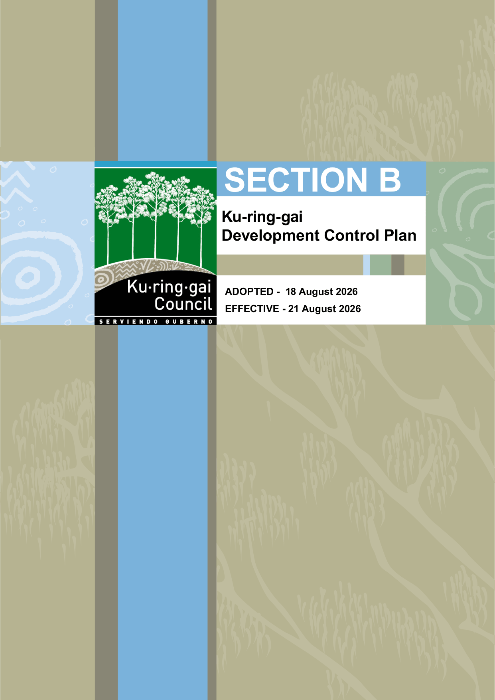
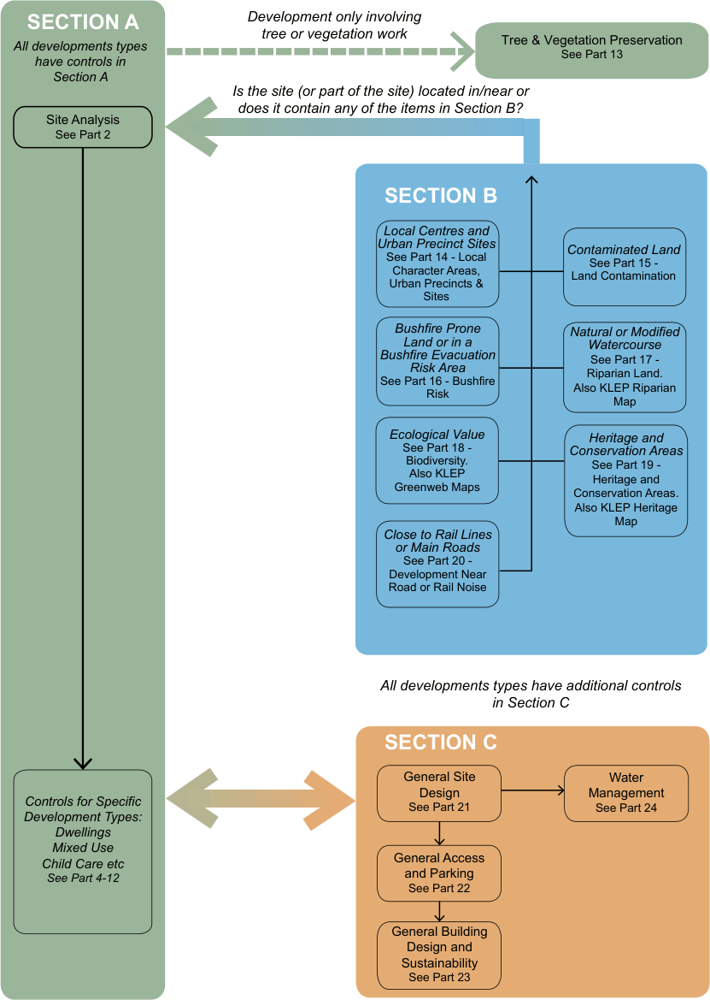

# Ku-ring-gai Development Control Plan - Section B Cover and Contents - Section B

Source PDF: [cover-and-contents-section-b.pdf](https://planfortomorrow.sharepoint.com/sites/Planfortomorrow/Shared%20Documents/00%20NSW-Planning-Resources/dcp/ku-ring-gai-development-control-plan/section-b-cover-and-contents/cover-and-contents-section-b.pdf)

> [Picture on page 1: a picture, saved as a picture (images/section-b-cover-and-contents-page-1-1.gif, 150 dpi).]

### SECTION B

### Ku-ring-gai

### Development Control Plan

#### ADOPTED -  18 August 2026 EFFECTIVE - 21 August 2026

#### HOW TO USE THE DCP

Definitions and

#### INTRODUCTION

What is in this DCP

Abbreviations See Part 1B - Dictionary

See Part 1

> [Picture on page 2: a map, saved as a picture (images/section-b-cover-and-contents-page-2-8.gif, 150 dpi); the street names and other small labels are on the picture.]
> Words printed on the picture (title and legend, copied from the PDF):
> Development only involving
> tree or vegetation work
> Tree & Vegetation Preservation
> All developments types
> See Part 13
> have controls in
> Is the site (or part of the site) located in/near or
> does it contain any of the items in Section B?
> See Part 2
> Local Centres and
> Urban Precinct Sites
> See Part 14 - Local
> See Part 15 -
> Urban Precincts &
> Natural or Modified
> Land or in a
> See Part 16 - Bushfire
> See Part 17 -
> Also KLEP Riparian
> See Part 18 -
> See Part 19 -
> Also KLEP Heritage
> Close to Rail Lines
> or Main Roads
> See Part 20 -
> Road or Rail Noise
> All developments types have additional controls
> in Section C
> See Part 21
> See Part 24
> Controls for Specific
> Child Care etc
> See Part 4-12
> See Part 22
> See Part 23

#### SECTION A

#### SECTION B

#### SECTION C

#### KEY:

#### SECTION A

#### SECTION C

ii

ii

|  | B |
|---|---|
| SECTION B PART 14 LOCAL CHARACTER AREAS, URBAN PRECINCTS AND SITES Introduction......................................................................................... p14-2 14 Local Character Areas.............................................................. p14-6 14.1 Ridge and Centres Character Area............................................ p14-8 14.2 Green Fingers Character Area................................................... p14-11 14.3 Western Interface Character Area............................................. p14-15 14.4 West Pymble Character Area..................................................... p14-19 14.5 Northern Plateau Character Area............................................... p14-23 14.6 Eastern Interface Character Area.............................................. p14-27 14.7 Western Slopes Character Area................................................ p14-31 14.8 North Turramurra Character Area.............................................. p14-35 14A St Ives Local Centre.................................................................. p14-39 14A.1 St Ives Local Centre Context....................................................... p14-40 14A.2 Public Domain and Pedestrian Access...................................... p14-41 14A.3 Proposed Community Infrastructure........................................... p14-42 14A.4 Setbacks......................................................................................... p14-44 14A.5 Built Form...................................................................................... p14-45 14A.6 Building Entries, Car Parking and Service Access.................. p14-46 14A.7 Precinct S1: St Ives Shopping Village........................................ p14-47 14A.8 Precinct S2: Stanley Street Shops............................................. p14-52 14A.9 Precinct S3: Buildings in R4 zones............................................. p14-58 14B Turramurra Local Centre.......................................................... p14-61 14B.1 Turramurra Local Centre Context............................................... p14-62 14B.2 Public Domain and Pedestrian Access...................................... p14-63 14B.3 Proposed Community Infrastructure........................................... p14-64 14B.4 Setbacks......................................................................................... p14-66 14B.5 Built Form...................................................................................... p14-67 14B.6 Building Entries, Car Parking and Service Access.................. p14-68 14B.7 Environmental Protection and Bush Fire Protection................. p14-69 14B.8 Precinct T1: Pacific Highway and Ray Street Retail Area....... p14-70 14B.9 Precinct T2: Rohini Street and Eastern Road Retail Area....... p14-81 14B.10 Precinct T3: Kissing Point Road Retail Area............................. p14-87 14B.11 Precinct T4: Hillview Area............................................................ p14-95 14C Pymble Local Centre .............................................................. p14-99 14C.1 Pymble Local Centre Context..................................................... p14-100 14C.2 Public Domain and Pedestrian Access...................................... p14-101 14C.3 Proposed Community Infrastructure........................................... p14-102 14C.4 Setbacks........................................................................................ p14-104 14C.5 Built Form...................................................................................... p14-105 | CONTENTS CONTENTS |
| Ku-ring-gai Development Control Plan | iii |

iv

iv

| 14C.6 | Building Entries, Car Parking and Service Access.................. | p14-106 |
|---|---|---|
| 14C.7 | Precinct 1: Grandview Street and Pacific Highway Commercial Area......................................................................... | p14-107 |
| 14D | Gordon Local Centre................................................................ | p14-113 |
| 14D.1 | Gordon Local Centre Context .................................................... | p14-114 |
| 14D.2 | Public Domain and Pedestrian Access...................................... | p14-115 |
| 14D.3 | Proposed Community Infrastructure........................................... | p14-116 |
| 14D.4 | Setbacks......................................................................................... | p14-118 |
| 14D.5 | Built Form...................................................................................... | p14-120 |
| 14D.6 | Building Entries, Car Parking and Service Access.................. | p14-121 |
| 14D.7 | Precinct G1: St Johns Avenue and Henry Street...................... | p14-122 |
| 14D.8 | Precinct G2: Pacific Highway Retail........................................... | p14-128 |
| 14D.9 | Precinct G3: Civic Hub................................................................ | p14-134 |
| 14D.10 | Precinct G4: Mixed Use............................................................... | p14-140 |
| 14D.11 | Precinct G5: Buildings in R4 Zones............................................ | p14-146 |
| 14E | Lindfield Local Centre............................................................. | p14-149 |
| 14E.1 | Lindfield Local Centre Context .................................................. | p14-150 |
| 14E.2 | Public Domain and Pedestrian Access..................................... | p14-151 |
| 14E.3 | Proposed Community Infrastructure.......................................... | p14-152 |
| 14E.4 | Setbacks....................................................................................... | p14-155 |
| 14E.5 | Built Form...................................................................................... | p14-157 |
| 14E.6 | Building Entries, Car Parking and Service Access.................. | p14-158 |
| 14E.7 | Precinct L1: Balfour Street Retail Area...................................... | p14-159 |
| 14E.8 | Precinct L2: Pacific Highway Retail Area.................................. | p14-166 |
| 14E.9 | Precinct L3: Tryon Place Mixed Use Area ............................... | p14-172 |
| 14E.10 | Precinct L4: Tryon Road and Lindfield Avenue Retail Area.... | p14-178 |
| 14E.11 | Precinct L5: Lindfield Hub........................................................... | p14-191 |
| 14E.12 | Precinct L6: 259 - 271 Pacific Highway, Lindfield .................. | p14-204 |
| 14E.13 | Precinct L7: Buildings in R4 Zones............................................. | p14-213 |
| 14E.14 | Precinct L8: Buildings in R4 Zones............................................. | p14-215 |
| 14F | Roseville Local Centre ............................................................ | p14-219 |
| 14F.1 | Roseville Local Centre Context................................................... | p14-220 |
| 14F.2 | Public Domain and Pedestrian Access...................................... | p14-221 |
| 14F.3 | Proposed Community Infrastructure.......................................... | p14-222 |
| 14F.4 | Setbacks........................................................................................ | p14-224 |
| 14F.5 | Built Form...................................................................................... | p14-225 |
| 14F.6 | Building Entries, Car Parking and Service Access.................. | p14-226 |
| 14F.7 | Precinct R1: Hill Street Shops..................................................... | p14-227 |
| 14F.8 | Precinct R2: Pacific Highway Shops.......................................... | p14-233 |
| 14F.9 | Precinct R3: Pacific highway to Roseville Station................... | p14-238 |
| 14G | Pymble Business Park............................................................ | p14-243 |
| 14G.1 | Urban Precinct ............................................................................ | p14-244 |
| 14G.2 | Public Domain and Pedestrian Access .................................... | p14-246 |
| 14G.3 | Proposed Community Infrastructure ........................................ | p14-248 |

### CONTENTS

v

| Building Setbacks ....................................................................... p14-250 Built Form .................................................................................... p14-252 Heritage......................................................................................... p14-255 On-site Parking .............................................................. p14-257 Australia Site.............................................................. p14-259 .......................................................................... p14-260 and Pedestrian Access ................................... p14-262 ....................................................................... p14-264 Club....................................................................... p14-267 ............................................................................ p14-268 ............................................. p14-271 ....................................................................... p14-274 p14-276 p14-278 p14-281 p14-282 Turramurra p14-285 p14-286 p14-288 p14-290 p14-292 |
|---|
| 14G.4 |
| 14G.5 |
| 14G.6 |
| 14G.7 Shared |
| 14H Screen |
| 14H.1 Urban Precincts |
| 14H.2 Public Domain |
| 14H.3 Building Setbacks |
| 14I Killara Golf |
| 14I.1 Urban Precinct |
| 14I.2 Pedestrian and Vehicular Access |
| 14I.3 Building Setbacks |
| 14I.4 Built Form .................................................................................... |
| 14I.5 Heritage ....................................................................................... |
| 14J Holford Crescent Gordon......................................................... |
| 14J.1 Building Setbacks ........................................................................ |
| 14K 45-47 Tennyson Avenue and 105 Eastern Road, |
| 14K.1 Urban Precinct ............................................................................ |
| 14K.2 Pedestrian and Vehicular Access.............................................. |
| 14K.3 Building Setbacks ....................................................................... |
| 14K.4 Built Form .................................................................................... |
| 14K.5 Public Domain ............................................................................. p14-294 |
| 14L Part 62 and 64-66 Pacific Highway, Roseville........................ p14-297 |
| 14L.1 Urban Precinct ............................................................................ p14-298 |
| 14L.2 Pedestrian and Vehicular Access.............................................. p14-300 |
| 14L.3 Building Setbacks ....................................................................... p14-302 |
| 14L.4 Built Form ................................................................................... p14-304 |
| 14L.5 Heritage ...................................................................................... p14-306 |
| 14L.6 Public Domain ............................................................................. p14-308 |
| 14M 47 Warrane Road, Roseville Chase ........................................ p14-311 |
| 14M.1 Urban Precinct .......................................................................... p14-312 |
| 14M.2 Public Domain, Pedestrian and Vehicular Access ................. p14-314 |
| 14M.3 Building Setbacks ....................................................................... p14-316 |
| 14N 8a, 14, 16 Buckingham Road .................................................. p14-318 |
| 14N.1 Urban Precinct ............................................................................ p14-319 |
| 14N.2 Pedestrian and Vehicular Access ............................................. p14-321 |
| 14N.3 Building Setbacks ....................................................................... p14-323 |
| 14N.4 Built Form .................................................................................... p14-325 |
| 14N.5 Heritage ....................................................................................... p14-327 |
| 14O 4, 12 and 14 Cowan Road, St Ives (Pymble Golf Club) p14-328 |
| 14O.1 Urban Precinct............................................................................. p14-329 |
| 14O.2 Pedestrian and Vehicular Access.............................................. p14-331 |
| 14O.3 Building Setbacks........................................................................ p14-333 |
| 14O.4 Built Form...................................................................................... p14-335 |

vi

| 14O.5 | Heritage......................................................................................... | p14-337 |
|---|---|---|
| 14P | Turramurra Plaza: 1364-1396 Pacific Highway & 1, 1A, 3, 3A Kissing Point Road, Turramurra.......................... | p14-342 |
| 14P.1 | Urban Precinct.............................................................................. | p14-343 |
| 14P.2 | Pedestrian and Vehicular Access............................................... | p14-345 |
| 14P.3 | Building Setbacks......................................................................... | p14-347 |
| 14P.4 | Built Form...................................................................................... | p14-349 |
| 14P.5 | Public Domain............................................................................... | p14-351 |
| 14R | References............................................................................... | p14-339 |
| 14R.1 | Lindfield Library Site Masterplan |  |
| 14R.2 | Turramurra Community Hub Masterplan |  |
| PART 15 | LAND CONTAMINATION |  |
| 15.1 | Land Contamination ......................................................................... | p15-2 |
| PART 16 | BUSHFIRE RISK |  |
|  | Introduction ........................................................................................ | p16-2 |
| 16.1 | Bushfire Risk Management ............................................................. | p16-3 |
| PART 17 | RIPARIAN LANDS |  |
|  | Introduction ........................................................................................ | p17-2 |
| 17.1 | General .............................................................................................. | p17-3 |
| 17.2 | Category 1 Environmental Corridor................................................. | p17-6 |
| 17.3 | Category 2 Terrestrial and Aquatic Habitat ................................... | p17-8 |
| 17.4 | Category 3 Bank Stability and Water Quality ................................ | p17-10 |
| 17.5 | Category 3A Watercourse Restoration .......................................... | p17-12 |
| PART 18 | BIODIVERSITY |  |
|  | Introduction ........................................................................................ | p18-2 |
| 18.1 | All Greenweb Categories ................................................................. | p18-4 |
| 18.2 | Category - Core Biodiversity Lands ............................................... | p18-6 |
| 18.3 | Category - Support for Core Biodiversity Lands ........................... | p18-7 |
| 18.4 | Category - Landscape Remnant ..................................................... | p18-9 |
| 18.5 | Category - Biodiversity Corridors and Buffer Areas ..................... | p18-10 |
| 18.6 | Category - Canopy Remnants ......................................................... | p18-11 |
| 18.7 | No Net Loss of Biodiversity............................................................... | p18-12 |
| 18.8 | Explanation of Greenweb Categories and Sub Categories ........ | p18-15 |
| 18R | References ....................................................................................... | p18-19 |
| 18R.1 | Greenweb Maps .......................................................................... | p18-20 |

| B HERITAGE ITEMS AND HERITAGE CONSERVATION AREAS Introduction........................................................................................ and Site Consolidation...................................... and Site Consolidation for New Development HCA............................................................................... Site Consolidation of a Heritage Demolition................................................................................ HCAs.............................................................. Heritage Alterations |  |
|---|---|
| PART 19 | p19-2 p19-5 p19-6 Item............ p19-7 p19-9 p19-10 Item........................................ p19-11 and Additions and ......................................................................... p19-13 p19-14 Streetscape.............................................. p19-15 ............................................ p19-19 Landscaping.......................................................... p19-20 Parking...................................................................... p19-21 CONTENTS Design............................................................................. p19-24 to Roofs......................... p19-28 (excluding garages p19-30 p19-31 ........................................... p19-33 p19-35 p19-36 Reuse............................................................................ p19-37 ............................................ p19-38 Landscaping.......................................................... p19-39 Parking.................................................................... p19-40 Design............................................................................. p19-42 (excluding garages and p19-46 to Roofs ....................... p19-47 p19-48 and Heritage Items........ p19-49 and Heritage Items .......... p19-50 Heritage Items or Heritage (HCAs).................................................... p19-51 p19-52 Streetscape............................................... p19-53 Setbacks......................................................................... p19-55 Landscaping........................................................... p19-58 p19-59 ROAD OR RAIL .......................................... p20-2 |
|  | 19A Subdivision |
|  | 19A.1 Subdivision within an |
|  | 19A.2 Subdivision and |
|  | 19B |
|  | 19B.1 Demolition within |
|  | 19B.2 Demolition related to a |
|  | 19C Development within HCAs: New Buildings |
|  | Introduction................................................................................... |
|  | 19C.1 Local Character and |
|  | 19C.2 Setbacks and Building Separation |
|  | 19C.3 Gardens and |
|  | 19C.4 Access and |
|  | 19C.5 Building |
|  | 19C.6 Roof Forms and Structures Attached |
|  | 19C.7 Outbuilding and Garden Structures and carports)................................................................................. |
|  | 19C.8 Fencing........................................................................................... |
|  | 19C.9 Secondary Dwellings within HCAs |
|  | 19D Heritage Items.......................................................................... |
|  | Introduction.................................................................................... |
|  | 19D.1 Adaptive |
|  | 19D.2 Setbacks and Building Separation |
|  | 19D.3 Gardens and |
|  | 19D.4 Access and |
|  | 19D.5 Building |
|  | 19D.6 Outbuilding and Garden Structures carports)........................................................................................ |
|  | 19D.7 Roof Forms and Structures Attached |
|  | 19D.8 Fencing.......................................................................................... |
|  | 19E Secondary Dwellings within HCAs |
|  | 19E.1 Secondary Dwellings within HCAs |
|  | 19F Development in the Vicinity of Conservation Areas |
|  | Introduction................................................................................... |
|  | 19F.1 Local Character and |
|  | 19F.2 Building |
|  | 19F.3 Gardens and |
| PART | 19F.4 Fencing.......................................................................................... 20 DEVELOPMENT NEAR 20.1 Development NOISE Near Road or Rail Noise |

vii

### THIS PAGE IS INTENTIONALLY BLANK

viii
