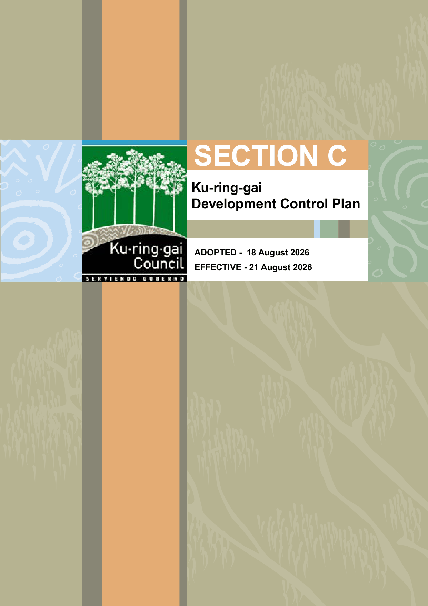
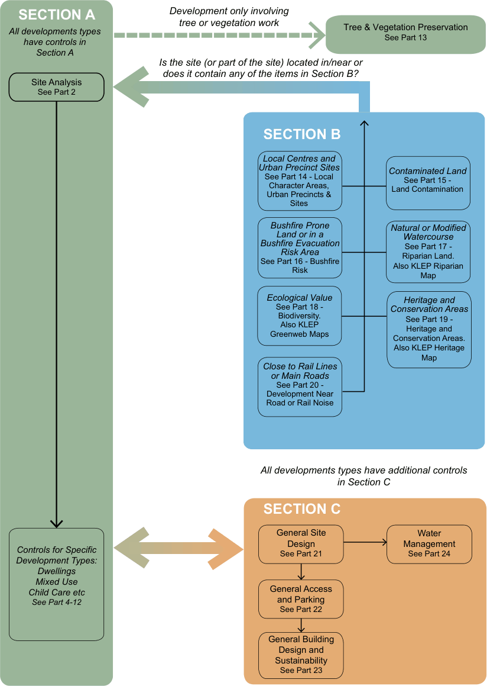

# Ku-ring-gai Development Control Plan - Section C Cover and Contents - Section C

Source PDF: [kdcp-section-c-cover-and-contents.pdf](https://planfortomorrow.sharepoint.com/sites/Planfortomorrow/Shared%20Documents/00%20NSW-Planning-Resources/dcp/ku-ring-gai-development-control-plan/section-c-cover-and-contents/kdcp-section-c-cover-and-contents.pdf)

> [Picture on page 1: a picture, saved as a picture (images/section-c-cover-and-contents-page-1-1.gif, 150 dpi).]

### SECTION C

### Ku-ring-gai

### Development Control Plan

#### ADOPTED -  18 August 2026 EFFECTIVE - 21 August 2026

### SECTION C

#### HOW TO USE THE DCP

Definitions and

#### INTRODUCTION

What is in this DCP

Abbreviations See Part 1B - Dictionary

See Part 1

> [Picture on page 2: a map, saved as a picture (images/section-c-cover-and-contents-page-2-9.gif, 150 dpi); the street names and other small labels are on the picture.]
> Words printed on the picture (title and legend, copied from the PDF):
> Development only involving
> tree or vegetation work
> Tree & Vegetation Preservation
> All developments types
> See Part 13
> have controls in
> Is the site (or part of the site) located in/near or
> does it contain any of the items in Section B?
> See Part 2
> Local Centres and
> Urban Precinct Sites
> See Part 14 - Local
> See Part 15 -
> Urban Precincts &
> Natural or Modified
> Land or in a
> See Part 16 - Bushfire
> See Part 17 -
> Also KLEP Riparian
> See Part 18 -
> See Part 19 -
> Also KLEP Heritage
> Close to Rail Lines
> or Main Roads
> See Part 20 -
> Road or Rail Noise
> All developments types have additional controls
> in Section C
> See Part 21
> See Part 24
> Controls for Specific
> Child Care etc
> See Part 4-12
> See Part 22
> See Part 23

#### SECTION A

#### SECTION B

#### SECTION C

#### KEY:

#### SECTION A

#### SECTION B

#### SECTION C

ii

### C

| SECTION C GENERAL SITE DESIGN Introduction......................................................................................... p21-2 and Slope ...................................................................... p21-3 Design ............................................................................ p21-5 ACCESS AND PARKING Introduction......................................................................................... p22-2 .............................................................................. p22-3 ................................................................... p22-6 ..................................................................... p22-8 ................................................................................... p22-9 ................................................ p22-10 ......................................... p22-11 .......................................................... p22-12 p22-13 p22-15 p22-16 |
|---|
| PART 21 |
| 21.1 Earthworks |
| 21.2 Landscape |
| PART 22 GENERAL |
| 22.1 Equitable Access |
| 22.2 General Vehicle Access |
| 22.3 Basement Car Parking |
| 22.4 Visitor Parking |
| 22.5 Parking for People with a Disability |
| 22.6 Pedestrian Movement within Car Parks |
| 22.7 Bicycle Parking and Facilities |
| 22.8 Surface Parking ................................................................................ |
| 22R References ............................................................................... |
| 22R.1 Car Parking Rates ....................................................................... |
| PART 23 GENERAL BUILDING DESIGN AND SUSTAINABILITY |
| Introduction......................................................................................... p23-2 |
| 23.1 Social Impact ..................................................................................... p23-3 |
| 23.2 Green Buildings ................................................................................ p23-4 |
| 23.3 Sustainability of Building Materials ................................................. p23-9 |
| 23.4 Materials, Colours and Finishes ..................................................... p23-11 |
| 23.5 Roof Terraces and Podiums ............................................................ p23-15 |
| 23.6 Building Services .............................................................................. p23-17 |
| 23.7 General Acoustic Privacy ................................................................ p23-20 |
| 23.8 General Visual Privacy ..................................................................... p23-21 |
| 23.9 Construction, Demolition and Disposal .......................................... p23-24 |
| 23R References ............................................................................... p23-27 |
| 23R.1 Examples of ESD Measures ...................................................... p23-28 |
| PART 24 WATER MANAGEMENT |
| Introduction......................................................................................... p24-2 |
| 24A Site Design for Water Management........................................ p24-3 |
| 24A.1 Development Type for Water Management............................... p24-4 |
| 24A.2 Location of Development for Water Management.................... p24-5 |
| 24A.3 Locating the Development on Site............................................. p24-7 |
| 24B Stormwater Discharge ............................................................ p24-9 |
| 24B.1 General ......................................................................................... p24-10 |
| 24B.2 Stormwater Disposal from Location A Properties ................... p24-11 |
| 24B.3 Stormwater Disposal from Location B Properties ................... p24-15 |
| 24B.4 Stormwater Disposal from Location C Properties ................... p24-16 |

### CONTENTS

iii

### SECTION C

iv

| 24B.5 | Stormwater Disposal from Location D Properties ................... | p24-17 |
|---|---|---|
| 24B.6 | Relocating Pipes and Modifying or Extinguishing Easements Where Council is the Authority .............................. | p24-28 |
| 24C | On-site Stormwater Management .......................................... | p24-29 |
| 24C.1 | General ......................................................................................... | p24-30 |
| 24C.2 | Effective Stormwater Management ........................................... | p24-31 |
| 24C.3 | General Controls for On-Site Stormwater Management ........ | p24-33 |
| 24C.4 | Mandatory Rainwater Tank Requirements ............................... | p24-36 |
| 24C.5 | Controls for On-site Detention ................................................... | p24-38 |
| 24C.6 | Stormwater Quality Control ........................................................ | p24-40 |
| 24D | Existing Drainage Systems .................................................... | p24-42 |
| 24D.1 | General ......................................................................................... | p24-43 |
| 24D.2 | Flood Studies and the Design Flood Standard ........................ | p24-44 |
| 24D.3 | Development Over or Adjacent to a Natural Waterbody, Open Channel or Drainage Depression ................................... | p24-46 |
| 24D.4 | Development Over or Adjacent to an Underground Pipeline | p24-48 |
| 24D.5 | Tennis Courts and Other Sporting Surfaces ............................ | p24-50 |
| 24D.6 | Fences .......................................................................................... | p24-51 |
| 24D.7 | Swimming Pools and Spas ........................................................ | p24-52 |
| 24E | Road and Trunk Drainage Design .......................................... | p24-53 |
| 24E.1 | Design Procedures ..................................................................... | p24-54 |
| 24F | On-site Wastewater Management .......................................... | p24-59 |
| 24F.1 | On-site Wastewater Management ............................................. | p24-60 |
| 24R | References ............................................................................... | p24-62 |
| 24R.1 | Design of On-site Detention Systems (OSD) ........................... | p24-63 |
| 24R.2 | Design of Property and Interallotment Drainage Systems ..... | p24-68 |
| 24R.3 | Flood Study Requirements ........................................................ | p24-75 |
| 24R.4 | Terms of Positive Covenants and Restrictions on Use ........... | p24-79 |
| 24R.5 | OSD Exemption Map .................................................................. | p24-92 |

### C

### CONTENTS

v

| PART 25 | WASTE MANAGEMENT |  |
|---|---|---|
|  | Introduction ........................................................................................ | p25-2 |
| 25A | General Waste and Recycling ................................................ | p25-3 |
| 25A.1 | General Requirements ............................................................... | p25-4 |
| 25A.2 | Waste Storage Rooms ............................................................... | p25-5 |
| 25A.3 | Access to Collection Points ....................................................... | p25-6 |
| 25A.4 | Construction of Waste and Recycling Rooms .......................... | p25-7 |
| 25A.5 | Residential Buildings .................................................................. | p25-8 |
| 25B | Bulky Goods Waste ................................................................. | p25-15 |
| 25B.1 | On-site Bulky Goods Storage Area .......................................... | p25-16 |
| 25B.2 | On-site Temporary Bulky Goods Collection Point ................... | p25-18 |
| 25R | References ............................................................................... | p25-19 |
| 25R.1 | Council’s Standard Bin Characteristics .................................... | p25-20 |
| 25R.2 | Council’s Collection Vehicle Characteristics ............................ | p25-21 |
| 25R.3 | Vehicle Access/Turning Circles ................................................. | p25-22 |
| 25R.4 | What is a Waste Management Plan? ........................................ | p25-23 |
| 25R.5 | Waste Management Plan ........................................................... | p25-24 |
| 25R.6 | Waste Guidelines ........................................................................ | p25-29 |
