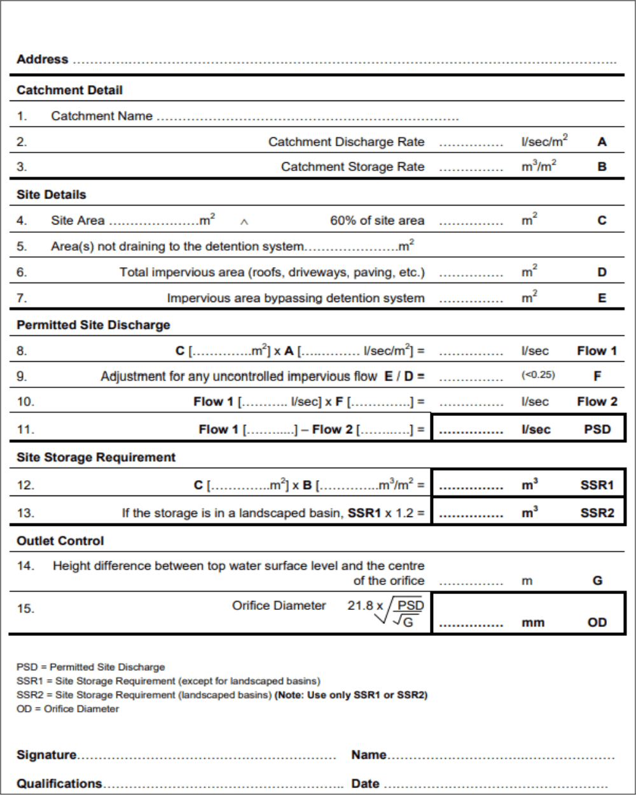

### 4.1   On-site Detention Calculation Sheet

### On-Site Detention Calculation Sheet

> [Picture on page 16: a picture, saved as a picture (images/ku-ring-gai-council-technical-guideline-for-water-page-16-4.gif, 150 dpi).]
