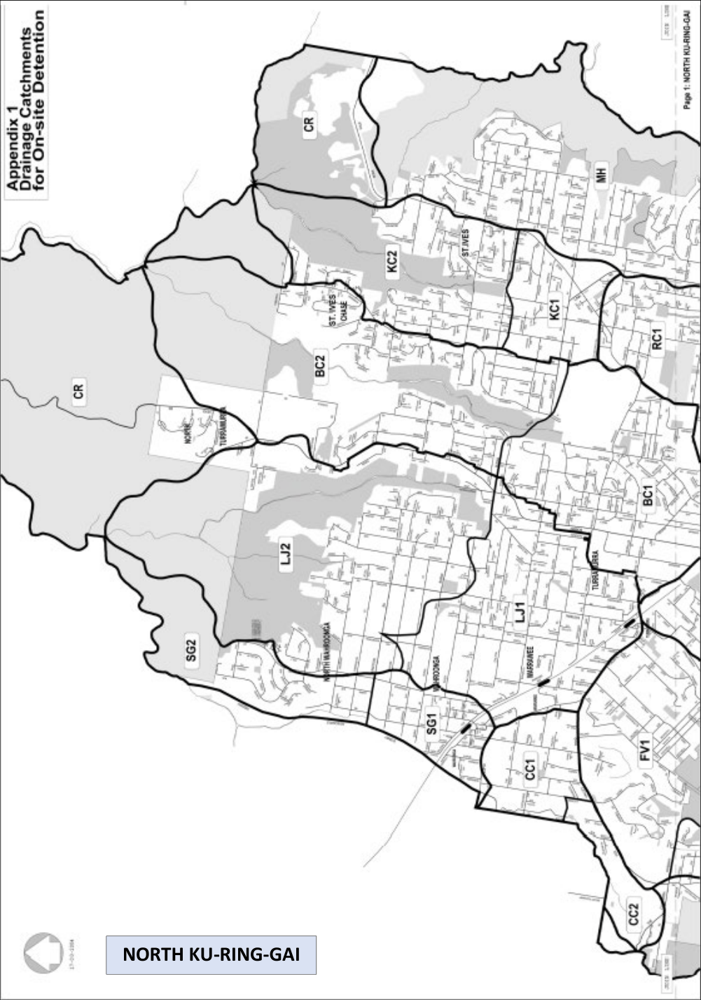
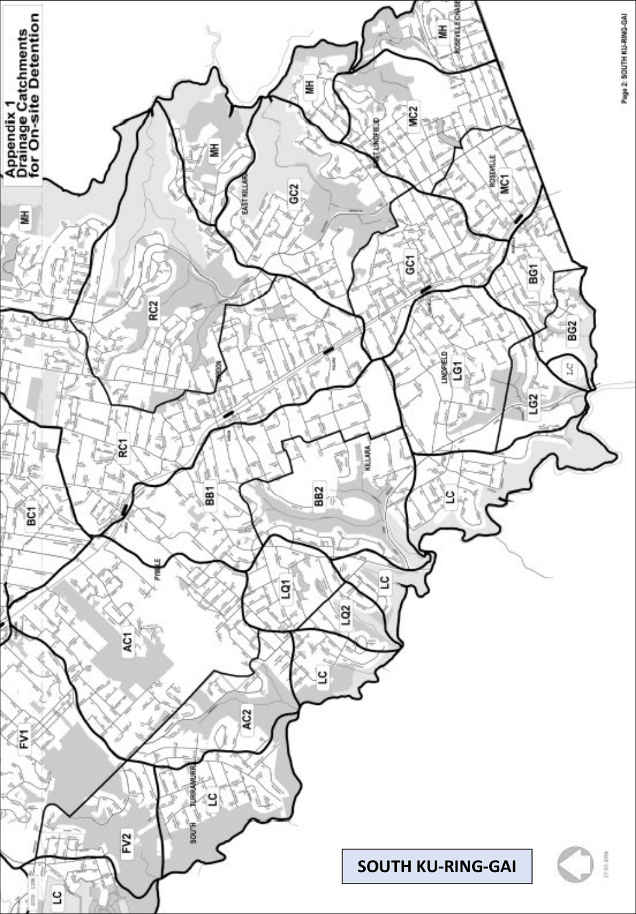

### 4.2   Drainage Catchments for On-site Detention

> [Picture on page 17: a picture, saved as a picture (images/ku-ring-gai-council-technical-guideline-for-water-page-17-2.gif, 150 dpi).]

#### NORTH KU-RING-GAI

Note: Refer to Council’s online map viewer

> [Picture on page 18: a picture, saved as a picture (images/ku-ring-gai-council-technical-guideline-for-water-page-18-1.gif, 150 dpi).]

#### SOUTH KU-RING-GAI

Note: Refer to Council’s online map viewer
