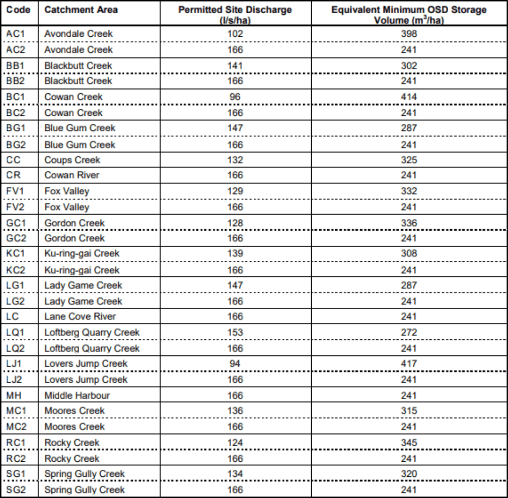

### 4.3   Permitted Site Discharge and Minimum On-site Detention Storage Volumes

> [Picture on page 19: a picture, saved as a picture (images/ku-ring-gai-council-technical-guideline-for-water-page-19-2.gif, 150 dpi).]
