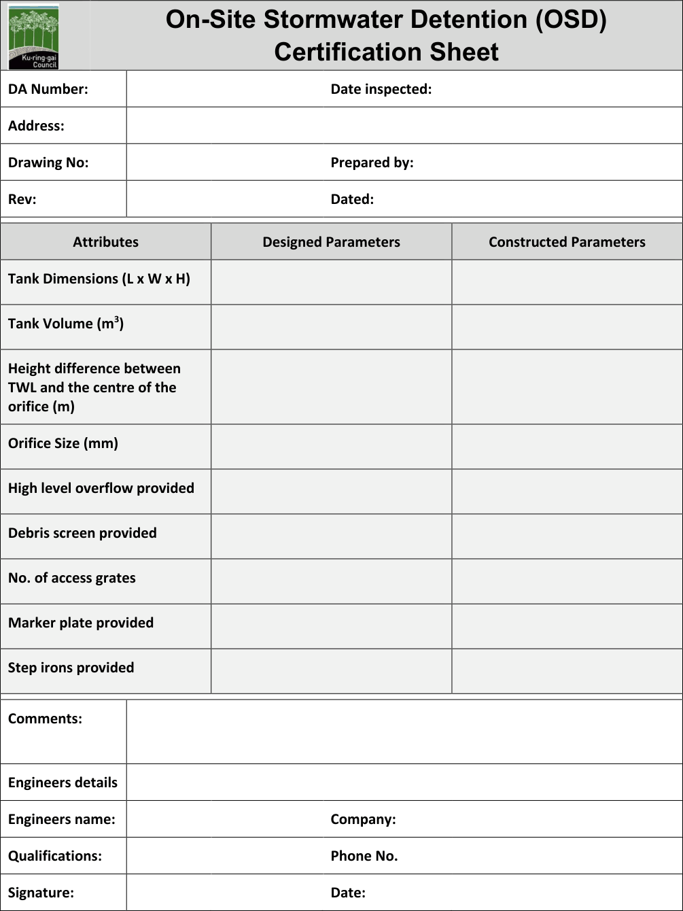

### 4.4   On-site Stormwater Detention (OSD) Certification Sheet

> [Picture on page 20: a picture, saved as a picture (images/ku-ring-gai-council-technical-guideline-for-water-page-20-2.gif, 150 dpi).]

### On-Site Stormwater Detention (OSD)

### Certification Sheet

#### DA Number:

#### Date inspected:

#### Address: Drawing No:

#### Prepared by:

#### Rev:

#### Dated:

#### Attributes

#### Designed Parameters

#### Constructed Parameters

#### Tank Dimensions (L x W x H)

#### Tank Volume (m3)

#### Height difference between

TWL and the centre of the

orifice (m)

#### Orifice Size (mm)

#### High level overflow provided

#### Debris screen provided

#### No. of access grates

#### Marker plate provided

#### Step irons provided

#### Comments:

#### Engineers details Engineers name:

#### Company:

#### Qualifications:

#### Phone No.

#### Signature:

#### Date:

## PART 5:   On-site Retention and Reuse Certification
