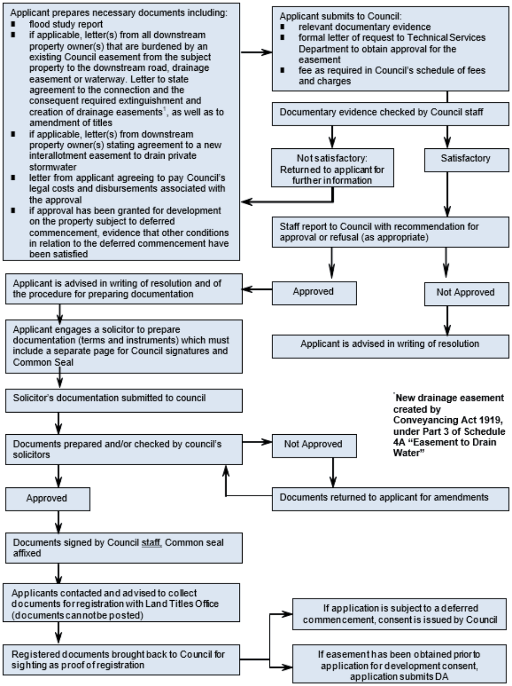

### 6.1   Process for Obtaining Approval for Connection into an Easement

> [Picture on page 22: a picture, saved as a picture (images/ku-ring-gai-council-technical-guideline-for-water-page-22-4.gif, 150 dpi).]

## PART 7:   Sample Letter to Neighbours Requesting

### Interallotment Easement
