### 8.1   Ku-ring-gai Rainfall Intensity Frequency Duration

The IFD Design Rainfall Depth and Intensity tables listed below have been downloaded from the Bureau

of Meteorology (BOM) website and are the data derived for a location at Kissing Point Road, Turramurra

from the Australian Rainfall & Runoff 2019. Council will accept this data as valid for any catchment

within the Local Government Area. Alternatively, the engineer may download the site specific rainfall

|  | Annual Exceedance Probability (AEP) |  |  |  |  |  |  |
|---|---|---|---|---|---|---|---|
| Duration | 63.2% | 50%# | 20%* | 10% | 5% | 2% | 1% |
| 1 min | 139 | 156 | 214 | 255 | 296 | 353 | 398 |
| 2 min | 113 | 127 | 172 | 204 | 237 | 286 | 327 |
| 3 min | 105 | 118 | 160 | 190 | 221 | 266 | 303 |
| 4 min | 99.2 | 111 | 152 | 181 | 210 | 252 | 286 |
| 5 min | 94.2 | 106 | 144 | 172 | 200 | 239 | 271 |
| 10 min | 75.2 | 84.8 | 116 | 138 | 161 | 191 | 215 |
| 15 min | 62.6 | 70.6 | 96.8 | 115 | 134 | 159 | 179 |
| 20 min | 53.8 | 60.8 | 83.2 | 99.1 | 115 | 137 | 154 |
| 25 min | 47.4 | 53.5 | 73.2 | 87.2 | 101 | 121 | 136 |
| 30 min | 42.5 | 47.9 | 65.6 | 78.1 | 90.8 | 108 | 122 |
| 45 min | 32.9 | 37.1 | 50.7 | 60.4 | 70.3 | 84.0 | 95.0 |
| 1 hour | 27.3 | 30.7 | 42.0 | 50.0 | 58.2 | 69.8 | 79.2 |
| 1.5 hour | 20.9 | 23.5 | 32.1 | 38.3 | 44.7 | 53.8 | 61.2 |
| 2 hour | 17.3 | 19.5 | 26.6 | 31.8 | 37.2 | 44.9 | 51.2 |
| 3 hour | 13.4 | 15.1 | 20.7 | 24.8 | 29.0 | 35.1 | 40.1 |
| 4.5 hour | 10.5 | 11.9 | 16.3 | 19.6 | 23.0 | 27.9 | 31.9 |
| 6 hour | 8.95 | 10.1 | 13.9 | 16.7 | 19.7 | 23.9 | 27.4 |
| 9 hour | 7.17 | 8.10 | 11.2 | 13.6 | 16.0 | 19.4 | 22.2 |
| 12 hour | 6.16 | 6.98 | 9.73 | 11.8 | 13.9 | 16.9 | 19.3 |
| 18 hour | 4.98 | 5.67 | 7.97 | 9.66 | 11.4 | 13.8 | 15.7 |
| 24 hour | 4.27 | 4.88 | 6.90 | 8.37 | 9.90 | 12.0 | 13.6 |
| 30 hour | 3.78 | 4.33 | 6.14 | 7.45 | 8.81 | 10.6 | 12.0 |
| 36 hour | 3.41 | 3.91 | 5.56 | 6.75 | 7.97 | 9.59 | 10.9 |
| 48 hour | 2.86 | 3.30 | 4.70 | 5.71 | 6.73 | 8.07 | 9.12 |
| 72 hour | 2.19 | 2.52 | 3.61 | 4.37 | 5.14 | 6.14 | 6.91 |
| 96 hour | 1.77 | 2.04 | 2.92 | 3.53 | 4.14 | 4.92 | 5.52 |
| 120 hour | 1.48 | 1.71 | 2.44 | 2.94 | 3.44 | 4.08 | 4.56 |
| 144 hour | 1.27 | 1.46 | 2.08 | 2.51 | 2.93 | 3.46 | 3.85 |
| 168 hour | 1.11 | 1.27 | 1.80 | 2.17 | 2.54 | 2.98 | 3.31 |

## PART 9:   Figures

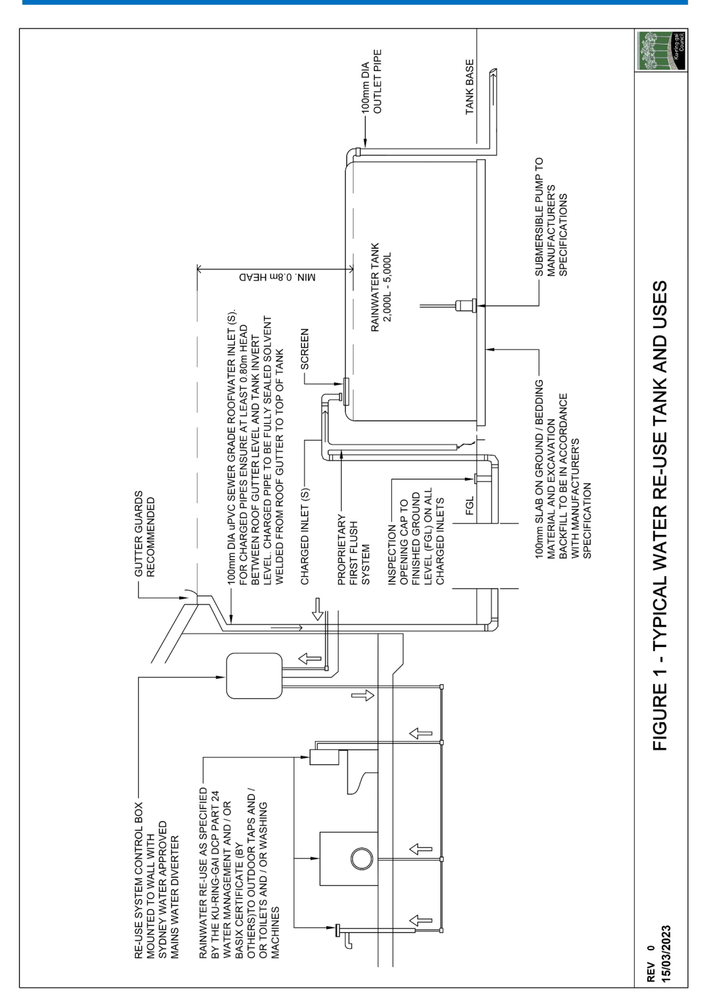

> [Picture on page 25: a picture, saved as a picture (images/ku-ring-gai-council-technical-guideline-for-water-page-25-2.gif, 150 dpi).]

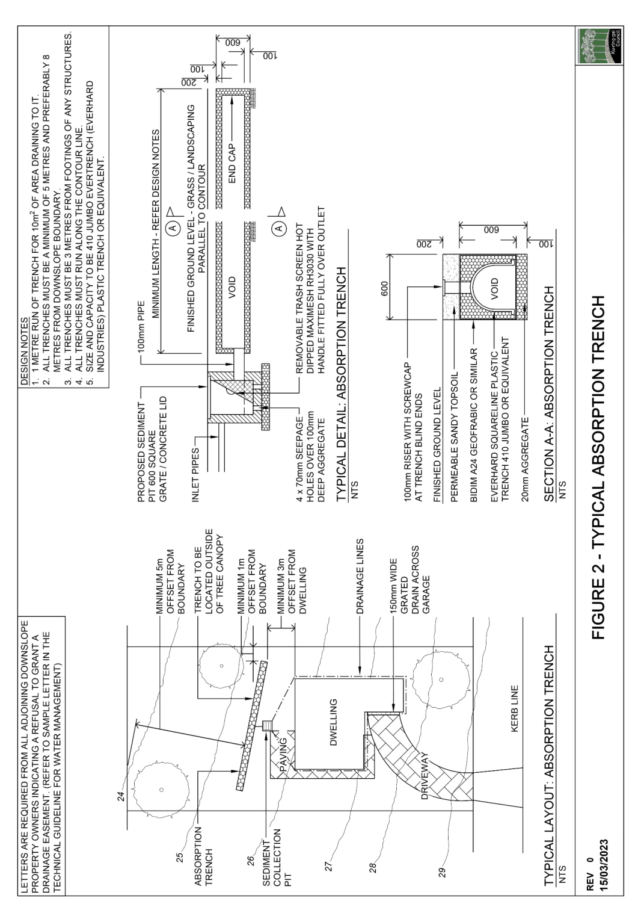

> [Picture on page 26: a picture, saved as a picture (images/ku-ring-gai-council-technical-guideline-for-water-page-26-1.gif, 150 dpi).]

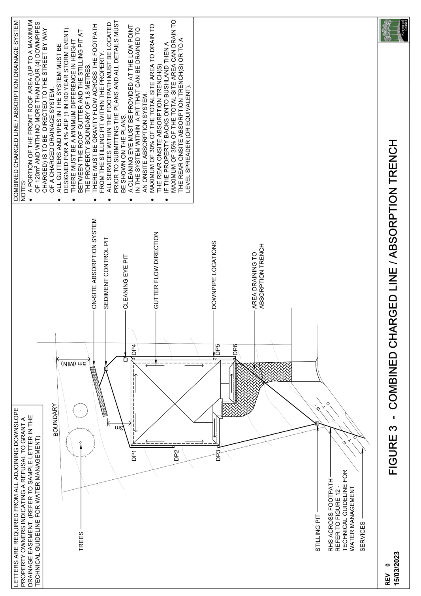

> [Picture on page 27: a picture, saved as a picture (images/ku-ring-gai-council-technical-guideline-for-water-page-27-1.gif, 150 dpi).]

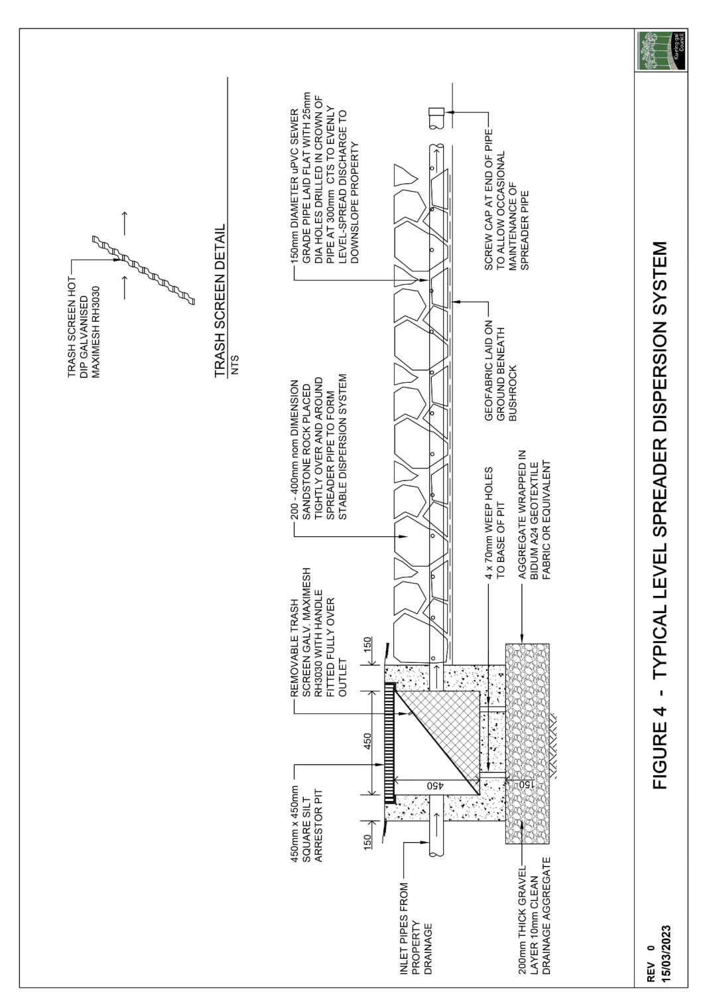

> [Picture on page 28: a picture, saved as a picture (images/ku-ring-gai-council-technical-guideline-for-water-page-28-1.gif, 150 dpi).]

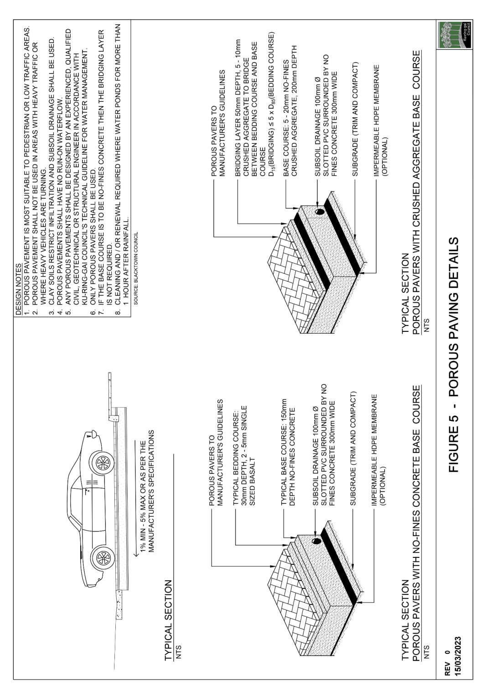

> [Picture on page 29: a picture, saved as a picture (images/ku-ring-gai-council-technical-guideline-for-water-page-29-1.gif, 150 dpi).]

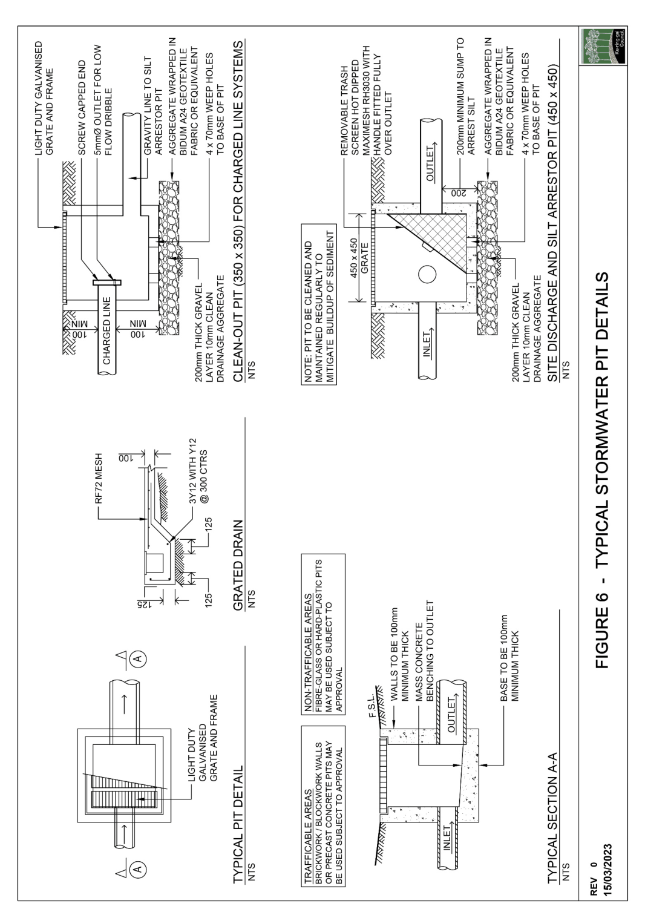

> [Picture on page 30: a picture, saved as a picture (images/ku-ring-gai-council-technical-guideline-for-water-page-30-1.gif, 150 dpi).]

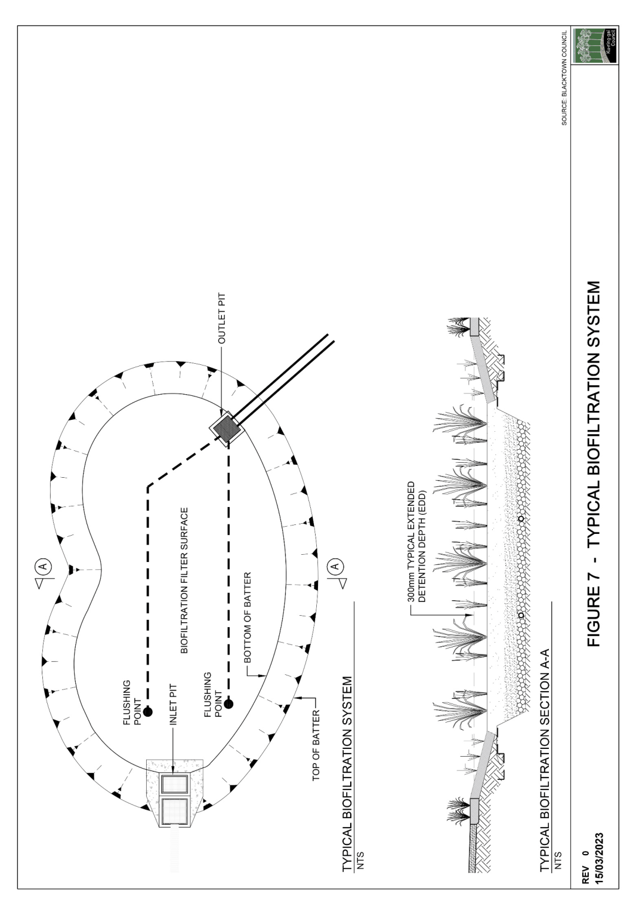

> [Picture on page 31: a picture, saved as a picture (images/ku-ring-gai-council-technical-guideline-for-water-page-31-1.gif, 150 dpi).]

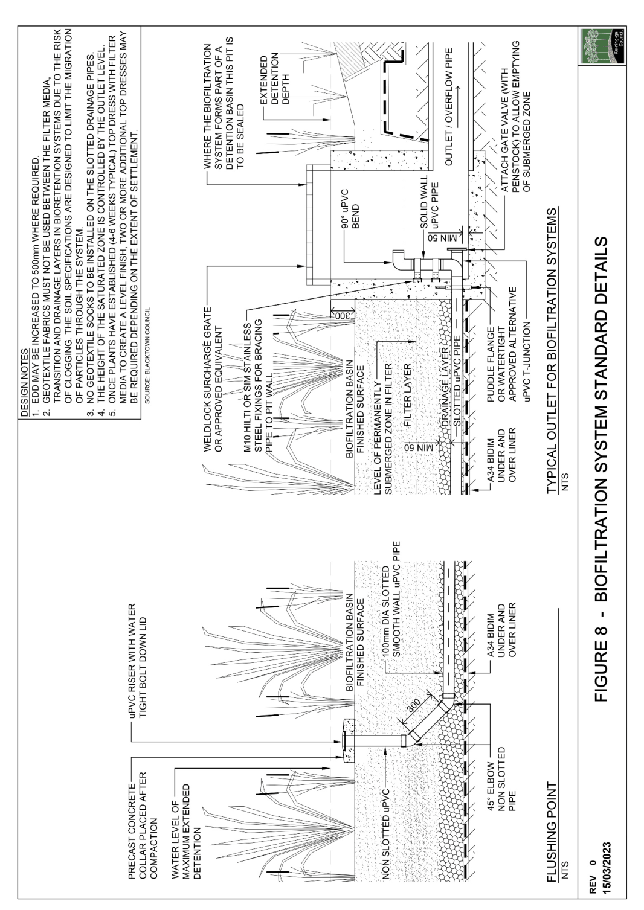

> [Picture on page 32: a picture, saved as a picture (images/ku-ring-gai-council-technical-guideline-for-water-page-32-1.gif, 150 dpi).]

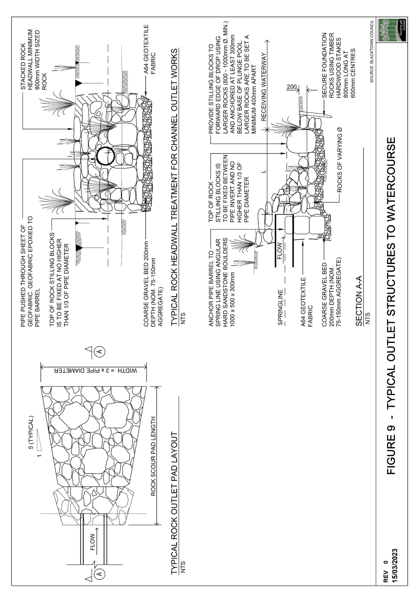

> [Picture on page 33: a picture, saved as a picture (images/ku-ring-gai-council-technical-guideline-for-water-page-33-1.gif, 150 dpi).]

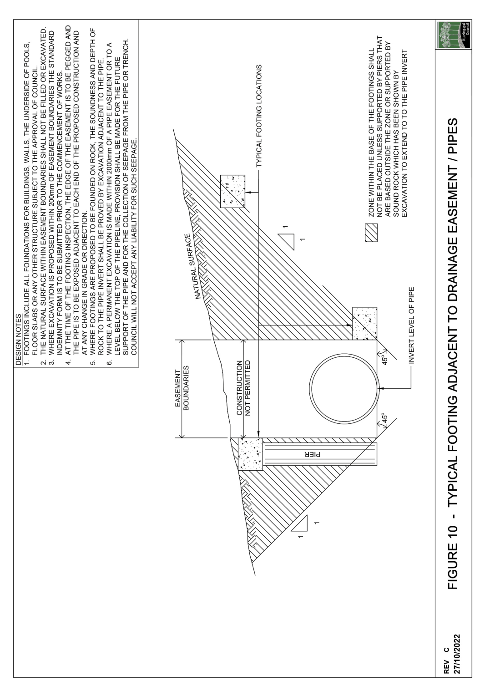

> [Picture on page 34: a picture, saved as a picture (images/ku-ring-gai-council-technical-guideline-for-water-page-34-1.gif, 150 dpi).]

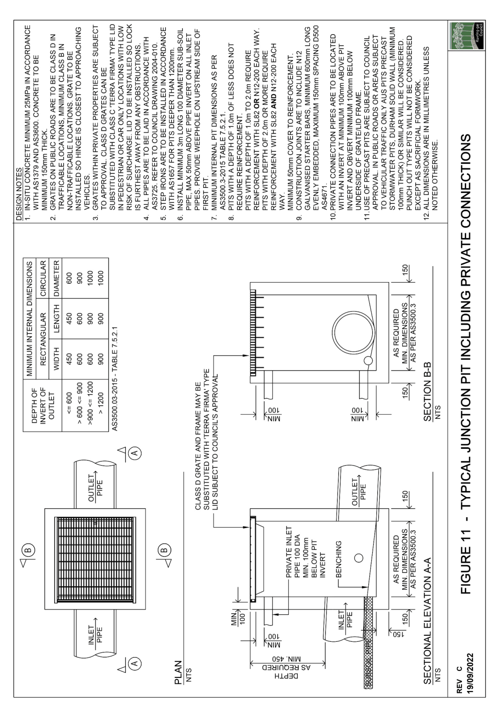

> [Picture on page 35: a picture, saved as a picture (images/ku-ring-gai-council-technical-guideline-for-water-page-35-1.gif, 150 dpi).]

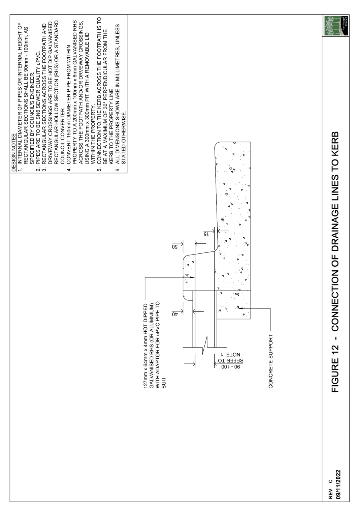

> [Picture on page 36: a picture, saved as a picture (images/ku-ring-gai-council-technical-guideline-for-water-page-36-1.gif, 150 dpi).]

### __________________________________________

#### Ku-ring-gai Council

#### 818 Pacific Highway. Gordon. NSW 2072

(02) 9424 0000
