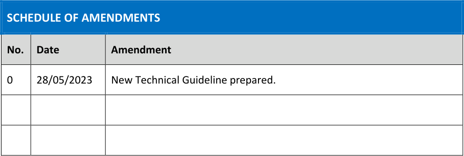

# Ku-ring-gai Development Control Plan - Ku-ring-gai Council Technical Guideline for Water Management

> This chapter is split into 20 section file(s), one per numbered heading, in the order they appear in the PDF.

Source PDF: [master-technical-guideline-for-water-management.pdf](master-technical-guideline-for-water-management.pdf)

### TECHNICAL GUIDELINE

### FOR WATER MANAGEMENT

### ___________________________

### Ku-ring-gai Council

> [Picture on page 2: a picture, saved as a picture (images/ku-ring-gai-council-technical-guideline-for-water-page-2-1.gif, 150 dpi).]

#### SCHEDULE OF AMENDMENTS

| No. | Date | Amendment |
|---|---|---|
| 0 | 28/05/2023 | New Technical Guideline prepared. |

#### DISCLAIMER

Ku-ring-gai Council and its employees accept no responsibility for any loss, damage, claim, expense, cost or liability arising with referencing and/or reliance on the standard drawings. It is expected that Ku-ring-gai Council’s standard drawings will be redrawn by a suitably qualified person referencing the information and responding to specific site or project conditions/requirements. The Ku-ring-gai Council title block may not be re-produced. The drawings may be subject to revision and users need to ensure that when referencing any standard drawing the current version is being used. Whilst all care has been taken to provide the most accurate and current standard drawings, it is the responsibility of the person referencing the drawings to ensure that the requirements of all relevant Australian Standards and guidelines are being met.

> The PDF's contents list (page numbers of the printed document) is not repeated here - see Sections below.

### INTRODUCTION

This technical guideline is intended to set out Council’s requirements for the design of stormwater

drainage and other engineering elements associated with development. It is not intended to be a

comprehensive design manual nor a stand-alone document but rather to be read in conjunction with

Part 24 ‘Water Management’ of the Ku-ring-gai DCP as well as relevant instruments, policies, codes,

industry guidelines and standards.

It is anticipated that adherence to this guideline will facilitate the efficient processing of engineering

plan submissions, and to ensure that stormwater infrastructure associated with any development is

designed and constructed to be safe, serviceable, economical to maintain and meets community

expectations.  However, it should be noted that the design guidelines do not limit Council’s right to

vary any necessary engineering requirements in accordance with industry best practices. Applicants

are advised to contact Council’s Development Engineers to discuss their proposal where an

inconsistency may arise.

## PART 1:   Specifications for Water Management Devices

<!-- sections -->
## Sections

1. [1.1 Rainwater Tanks](01-1-1-rainwater-tanks.md)
2. [1.2 Absorption / Infiltration Trenches](02-1-2-absorption-infiltration-trenches.md)
3. [1.3 Dispersal Trench / Level Spreader](03-1-3-dispersal-trench-level-spreader.md)
4. [1.4 Biofiltration / Raingarden](04-1-4-biofiltration-raingarden.md)
5. [1.5 Porous Paving](05-1-5-porous-paving.md)
6. [1.6 Vegetated Swales](06-1-6-vegetated-swales.md)
7. [1.7 Other Techniques](07-1-7-other-techniques.md)
8. [2.1 General](08-2-1-general.md)
9. [2.2 Inlet Pits](09-2-2-inlet-pits.md)
10. [2.3 Arrestors](10-2-3-arrestors.md)
11. [2.4 Pit Sizes and Design](11-2-4-pit-sizes-and-design.md)
12. [3.1 Site Impermeability Indicator](12-3-1-site-impermeability-indicator.md)
13. [4.1 On-site Detention Calculation Sheet](13-4-1-on-site-detention-calculation-sheet.md)
14. [4.2 Drainage Catchments for On-site Detention](14-4-2-drainage-catchments-for-on-site.md)
15. [4.3 Permitted Site Discharge and Minimum On-site Detention Storage Volumes](15-4-3-permitted-site-discharge-and-minimum-on.md)
16. [4.4 On-site Stormwater Detention (OSD) Certification Sheet](16-4-4-on-site-stormwater-detention-osd.md)
17. [5.1 On-Site Retention (OSR) and Reuse Certification Sheet](17-5-1-on-site-retention-osr-and-reuse.md)
18. [6.1 Process for Obtaining Approval for Connection into an Easement](18-6-1-process-for-obtaining-approval-for.md)
19. [7.1 Sample Letter to Neighbours Requesting Interallotment Easement](19-7-1-sample-letter-to-neighbours-requesting.md)
20. [8.1 Ku-ring-gai Rainfall Intensity Frequency Duration](20-8-1-ku-ring-gai-rainfall-intensity-frequency.md)
