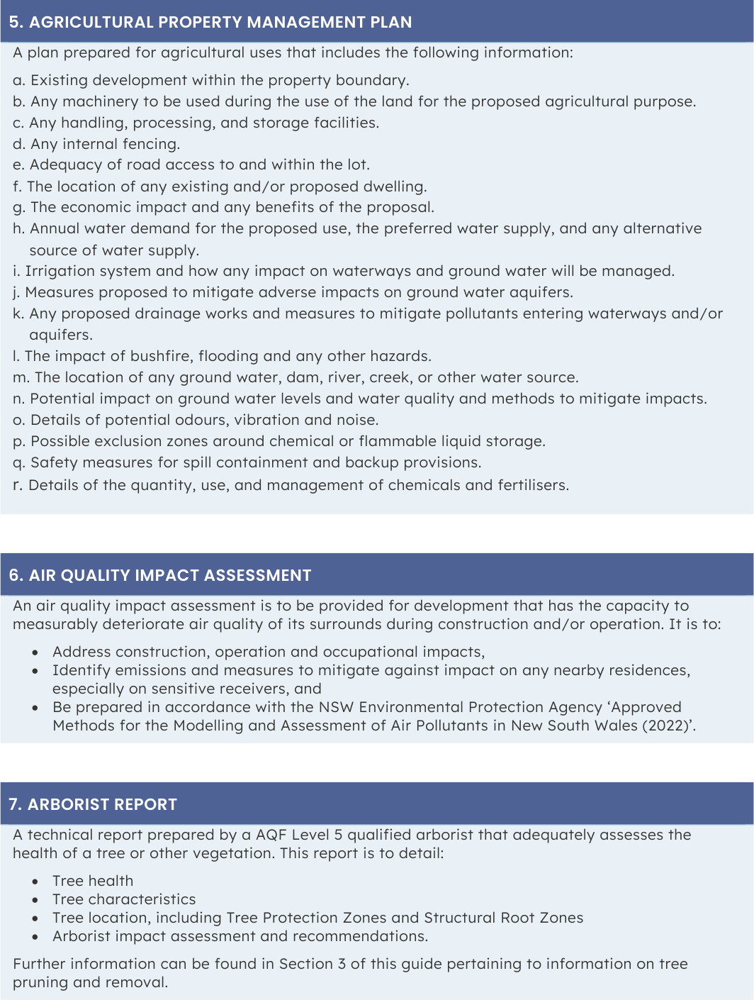

## 4. ACOUSTIC AND/OR VIBRATION REPORT

A report carried out to detail the noise and/or vibration intrusion related to aircraft, railway, restaurants, childcare centres, industrial buildings and any noise emitting uses. It must address Australian Standards and be prepared by a suitably qualified person.

> [Picture on page 10: a picture, saved as a picture (images/appendix-a-application-requirements-other-development-page-10-1.gif, 150 dpi).]
> Words printed on the picture (title and legend, copied from the PDF):
> source of water supply.
> aquifers.
> r. Details of the quantity, use, and management of chemicals and fertilisers.
