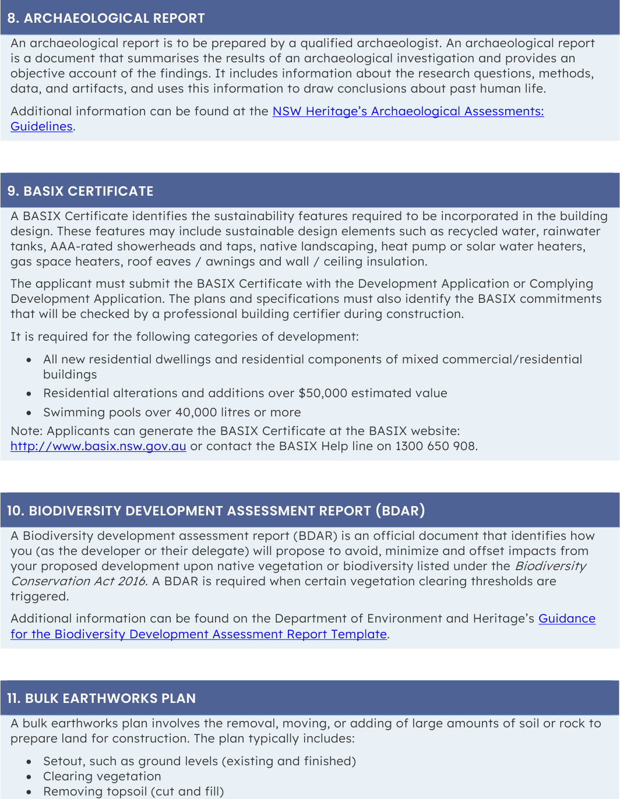

## 7. ARBORIST REPORT

A technical report prepared by a AQF Level 5 qualified arborist that adequately assesses the health of a tree or other vegetation. This report is to detail:

• Tree location, including Tree Protection Zones and Structural Root Zones

• Arborist impact assessment and recommendations. Further information can be found in Section 3 of this guide pertaining to information on tree

> [Picture on page 11: a picture, saved as a picture (images/appendix-a-application-requirements-other-development-page-11-1.gif, 150 dpi).]
> Words printed on the picture (title and legend, copied from the PDF):
> Guidelines.
