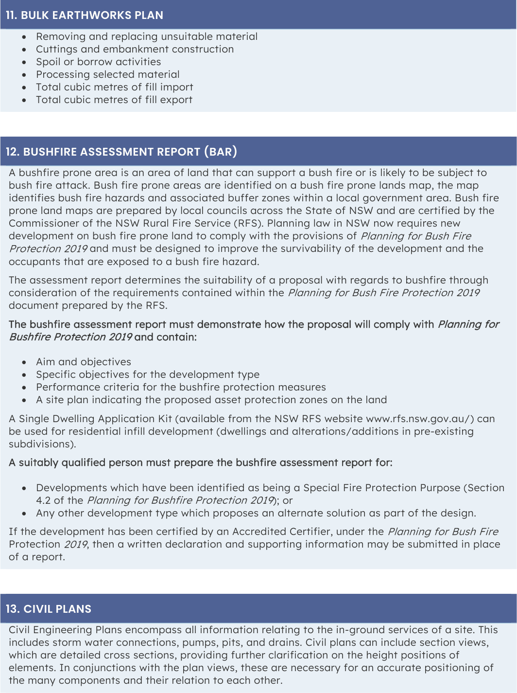

## 11. BULK EARTHWORKS PLAN

A bulk earthworks plan involves the removal, moving, or adding of large amounts of soil or rock to prepare land for construction. The plan typically includes:

• Setout, such as ground levels (existing and finished)

• Removing topsoil (cut and fill)

> [Picture on page 12: a picture, saved as a picture (images/appendix-a-application-requirements-other-development-page-12-1.gif, 150 dpi).]
> Words printed on the picture (title and legend, copied from the PDF):
> • Processing selected material
