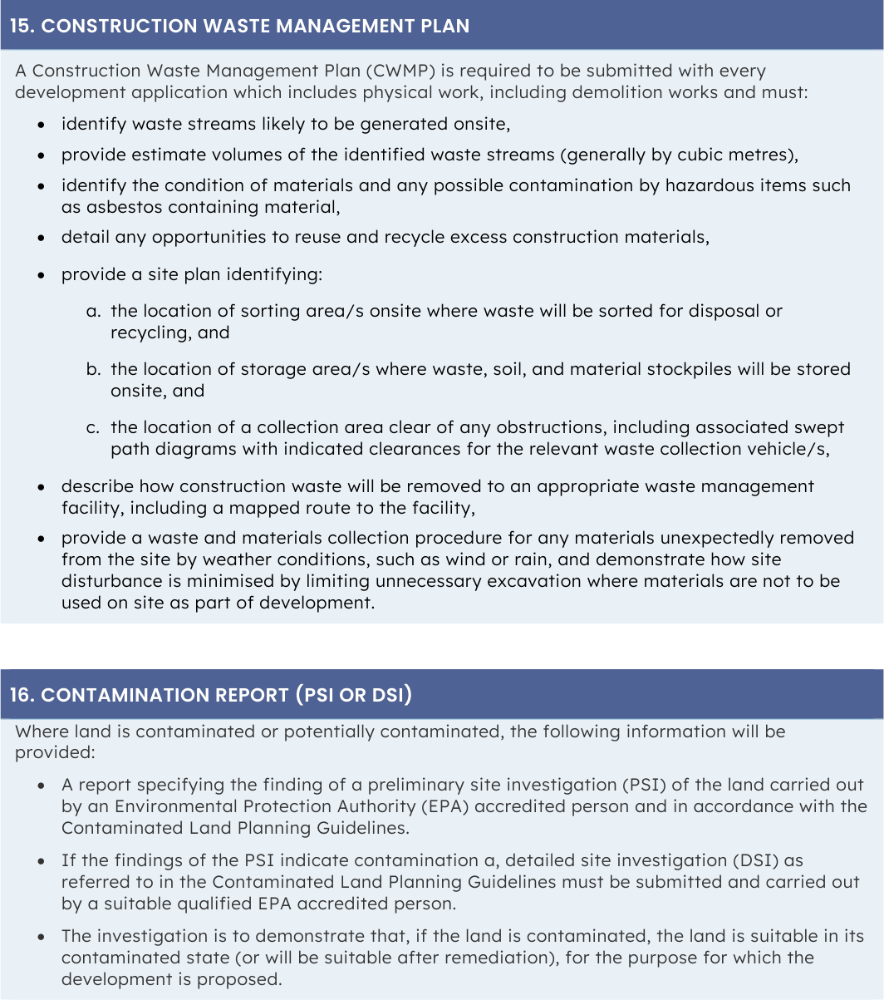

## 14. COLOUR, MATERIALS AND FINISHES SCHEDULE

The schedule shall specify colours and finishes and include the manufacturer’s details.

> [Picture on page 13: a picture, saved as a picture (images/appendix-a-application-requirements-other-development-page-13-3.gif, 150 dpi).]
> Words printed on the picture (title and legend, copied from the PDF):
> as asbestos containing material,
> recycling, and
> onsite, and
