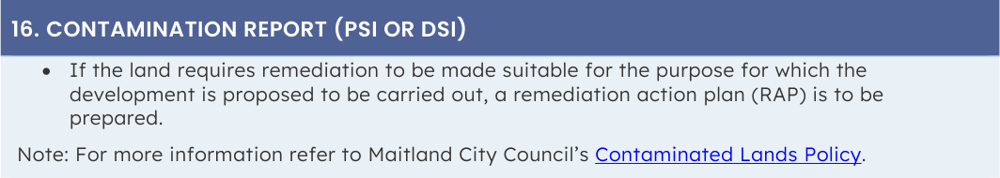

## 16. CONTAMINATION REPORT (PSI OR DSI)

Where land is contaminated or potentially contaminated, the following information will be

• A report specifying the finding of a preliminary site investigation (PSI) of the land carried out

by an Environmental Protection Authority (EPA) accredited person and in accordance with the

• If the findings of the PSI indicate contamination a, detailed site investigation (DSI) as

referred to in the Contaminated Land Planning Guidelines must be submitted and carried out by a suitable qualified EPA accredited person.

• The investigation is to demonstrate that, if the land is contaminated, the land is suitable in its

contaminated state (or will be suitable after remediation), for the purpose for which the

> [Picture on page 14: a picture, saved as a picture (images/appendix-a-application-requirements-other-development-page-14-1.gif, 150 dpi).]
> Words printed on the picture (title and legend, copied from the PDF):
> prepared.
