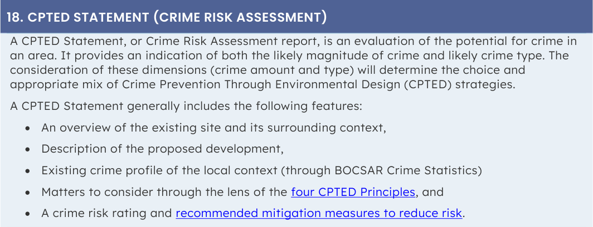

## 16. CONTAMINATION REPORT (PSI OR DSI)

• If the land requires remediation to be made suitable for the purpose for which the

development is proposed to be carried out, a remediation action plan (RAP) is to be

Note: For more information refer to Maitland City Council’s Contaminated Lands Policy.

| 17. COST ESTIMATE REPORT |  |
|---|---|
| A cost estimate report is utilised to ensure the correct application fees are applied to |  |
| developments and to provide an accurate reading of the Estimated Development Cost (EDC) of a |  |
| proposed development. There are three different assessment tiers with varying requirements for |  |
| each: |  |
| ESTIMATED DEVELOPMENT | REQUIREMENTS FOR COST ESTIMATE REPORT |
| COST (EDC) RANGE |  |
| Under $100,000 | To be estimated by an applicant or a suitably qualified person*, |
|  | with the methodology of cost calculation to be submitted with a |
|  | DA. |
| $100,000 - $3,000,000 | To be estimated by a suitably qualified person*, with the |
|  | methodology of cost calculation to be submitted with a DA. |
| Over $3,000,000 | A detailed cost report is to be prepared by a registered quantity |
|  | surveyor who is a member of a relevant professional body, and is |
|  | to be submitted with a DA.* |
| *Further details around cost estimate reports, including requirements and suitably qualified |  |
| persons, are provided in Planning Circular PS 24-002 Changes to how development costs are |  |
| calculated for planning purposes. |  |

> [Picture on page 14: a picture, saved as a picture (images/appendix-a-application-requirements-other-development-page-14-7.gif, 150 dpi).]
