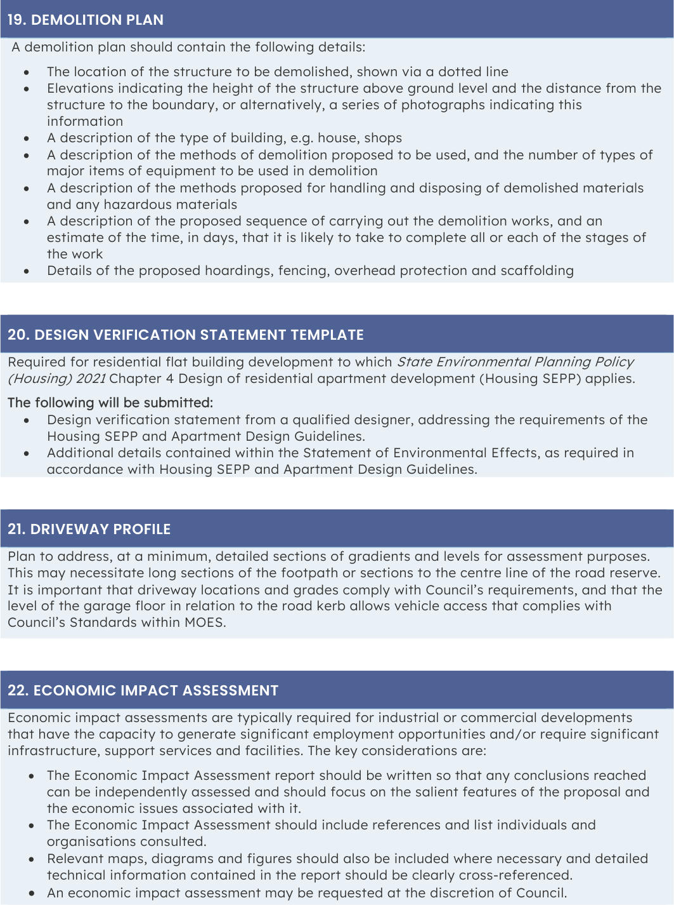

## 18. CPTED STATEMENT (CRIME RISK ASSESSMENT)

A CPTED Statement, or Crime Risk Assessment report, is an evaluation of the potential for crime in an area. It provides an indication of both the likely magnitude of crime and likely crime type. The consideration of these dimensions (crime amount and type) will determine the choice and appropriate mix of Crime Prevention Through Environmental Design (CPTED) strategies. A CPTED Statement generally includes the following features:

• An overview of the existing site and its surrounding context,

• Description of the proposed development,

• Existing crime profile of the local context (through BOCSAR Crime Statistics)

• Matters to consider through the lens of the four CPTED Principles, and

• A crime risk rating and recommended mitigation measures to reduce risk.

> [Picture on page 15: a picture, saved as a picture (images/appendix-a-application-requirements-other-development-page-15-1.gif, 150 dpi).]
> Words printed on the picture (title and legend, copied from the PDF):
> • The location of the structure to be demolished, shown via a dotted line
> • Elevations indicating the height of the structure above ground level and the distance from the
> information
> • A description of the type of building, e.g. house, shops
> • A description of the methods of demolition proposed to be used, and the number of types of
> • A description of the methods proposed for handling and disposing of demolished materials
> and any hazardous materials
> • A description of the proposed sequence of carrying out the demolition works, and an
> the work
> • Details of the proposed hoardings, fencing, overhead protection and scaffolding
