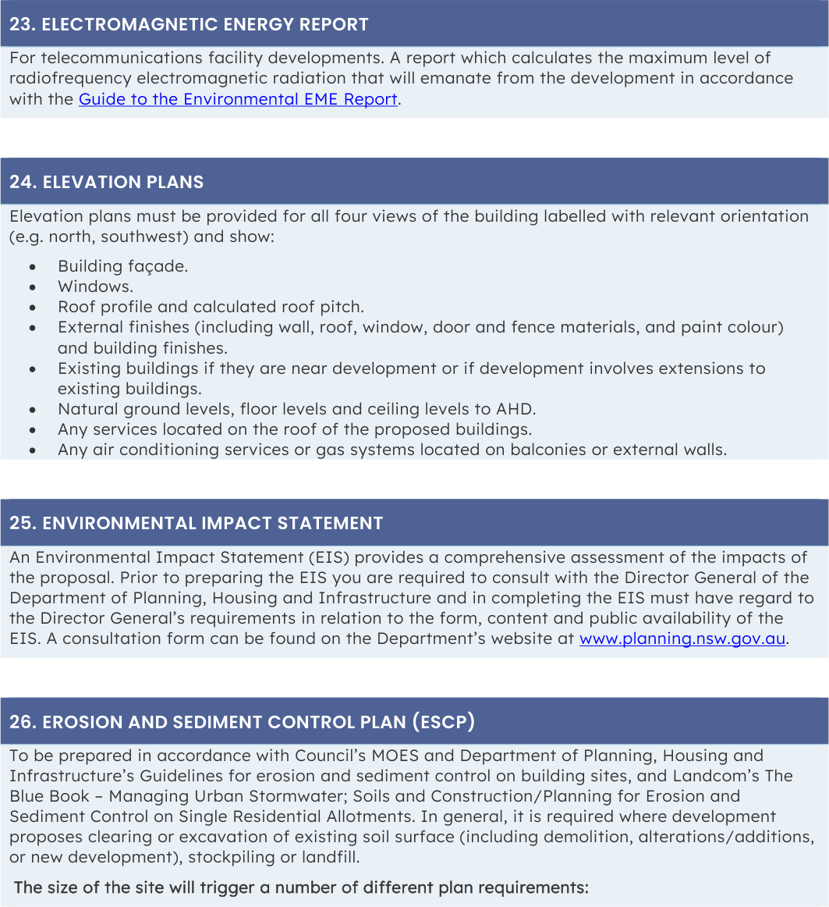

## 22. ECONOMIC IMPACT ASSESSMENT

Economic impact assessments are typically required for industrial or commercial developments that have the capacity to generate significant employment opportunities and/or require significant infrastructure, support services and facilities. The key considerations are:

• The Economic Impact Assessment report should be written so that any conclusions reached

can be independently assessed and should focus on the salient features of the proposal and the economic issues associated with it.

• The Economic Impact Assessment should include references and list individuals and

• Relevant maps, diagrams and figures should also be included where necessary and detailed

technical information contained in the report should be clearly cross-referenced.

> [Picture on page 16: a picture, saved as a picture (images/appendix-a-application-requirements-other-development-page-16-1.gif, 150 dpi).]
