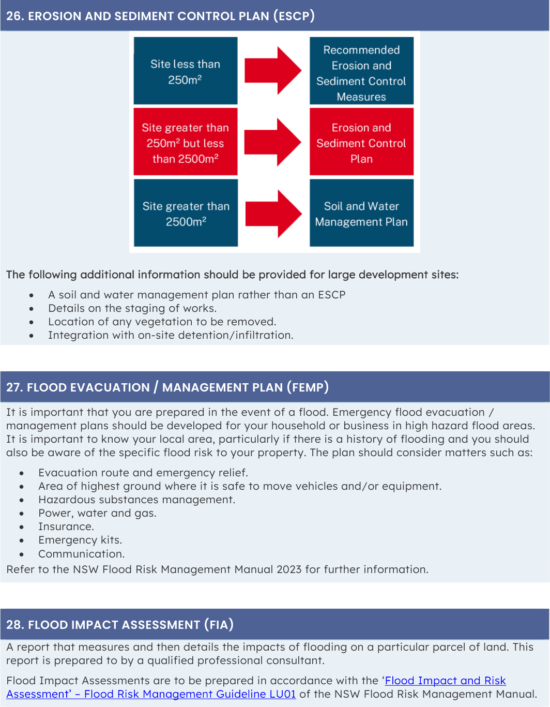

## 26. EROSION AND SEDIMENT CONTROL PLAN (ESCP)

To be prepared in accordance with Council’s MOES and Department of Planning, Housing and Infrastructure’s Guidelines for erosion and sediment control on building sites, and Landcom’s The Blue Book – Managing Urban Stormwater; Soils and Construction/Planning for Erosion and Sediment Control on Single Residential Allotments. In general, it is required where development proposes clearing or excavation of existing soil surface (including demolition, alterations/additions, or new development), stockpiling or landfill. The size of the site will trigger a number of different plan requirements:

> [Picture on page 17: a picture, saved as a picture (images/appendix-a-application-requirements-other-development-page-17-1.gif, 150 dpi).]
> Words printed on the picture (title and legend, copied from the PDF):
> • A soil and water management plan rather than an ESCP
> • Details on the staging of works.
> • Location of any vegetation to be removed.
> • Integration with on-site detention/infiltration.
